# FUNCTIONAL_SPEC · TeamLedger 全量功能规范

- 当前修订日期：**2026-10-15**。本文件与源码同属 `team-ledger`，是当前功能、页面、数据流和验收语义的唯一公开说明。
- 当前追溯规模：7 feature、9页面、51个稳定OP ID（v12可调用49项；OP-ORG-02/03为退休ID）、59 AC。
- DEV-015至DEV-022已交付员工主数据、调薪批次、canonical授权、本地keyd、内置账号、独立audit receiver、离线key副本及长期MAC/index安全边界；这不等于生产身份、真实介质责任、AI provider或生产发布批准。
- 历史Task ID仅用于说明实现阶段；历史私有计划、审查会话和本机验证路径不属于public文档。可执行事实以本仓库源码、迁移、测试及当前文档为准。

## 0. 全量功能地图与跨模块数据流

先用四张全量图看模块、共享对象、读写流向及审批/AI边界，再用§0.5/§0.5.1看组织历史和分区/最小交接。图中是**逻辑功能**，不是微服务或“全部已部署”的拓扑；技术架构图在[TECH §1.1/§1.2](TECHNICAL_SPEC.md#1-架构部署与信任边界)，运维审计/轮换/恢复流也统一维护在TECH §1.1/§7.4/§9.2，当前功能状态见本文§1.1。

### 0.1 功能模块关系

实线是当前授权约束的对象/来源引用，虚线是横切控制或共同语义，均不表示自动授权或正文流动。**黄色为已有实现/验证子范围，灰蓝为尚未实装子范围**；同一feature可同时包含两者。固定代码不等于生产启用；当前状态以本仓库源码、测试和本文登记为准。

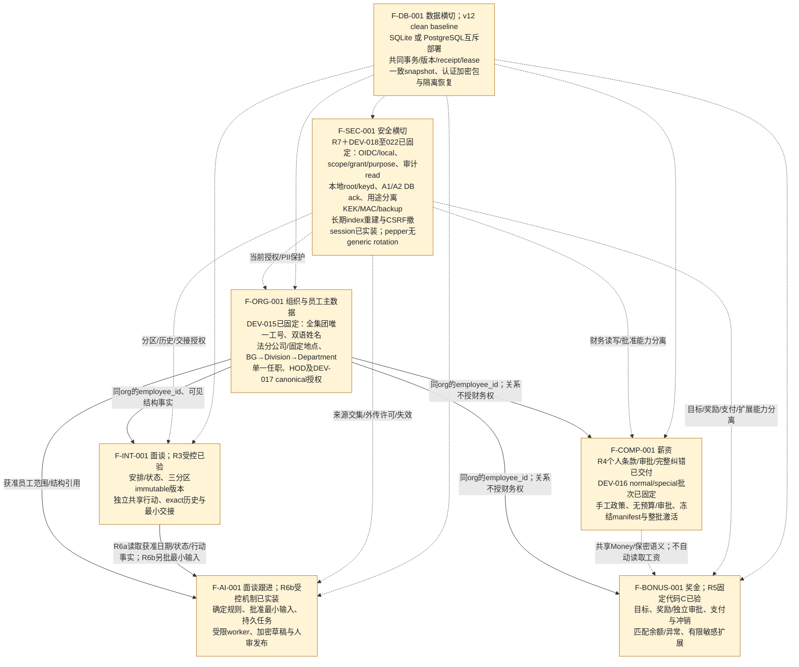

ORG是共享员工身份/组织事实的来源，不是所有敏感权限的来源；普通经理、HR名称、参与者、作者或员工本人均不会自动得到工资/奖金/历史正文。AI产物不反向自动修改人事、面谈、薪资或奖金事实；建议若需后续业务操作，仍由有权人员另行发起相应命令。

### 0.2 业务读写、持久化与结果流向

ORG/INT/COMP/BONUS/AI业务机制保持；R7已有审计、有限导出、KEK rewrap和恢复机制。DEV-018把生产密钥边界切换为同部署包的本地keyd＋受保护root/keyring，数据库仍只保存密文/wrapped DEK，API不挂载密钥卷。DEV-019内置账号/密码、双库与fresh Docker bootstrap/restart已固定代码并push；DEV-020已固定Compose同库独立audit receiver；DEV-021已实装双份离线密钥介质、pair只读验证与隔离恢复。AI provider仍是可选外部未决边界。

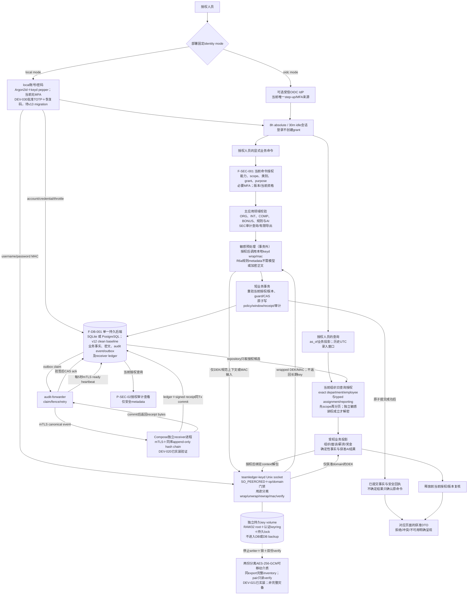

每个动作仍执行对应正文/技术契约，不把该总图当一个跨全部模块的大事务。笔记发布不兼写grant；扩权先独立授权，再显式发布最小正文。审批不由浏览器切换tab触发；列表/历史/导出分别授权，读权不包含导出权。撤权、来源变化与派生失效按其实际事务边界同步处理；敏感日志、URL和缓存不是数据流出口。

### 0.3 财务事实的流向：薪资与奖金互不替代

薪资随DEV-009、奖金随DEV-010固定代码交付；奖金已完成目标、奖励、批准、支付/冲销、异常、有限扩展和受控HMAC索引维护的双库/API/UI实装及最终验证。共享employee_id和Money语义不代表薪资自动计算奖金、目标成为债项或批准触发银行付款；不同币种/scale/周期不伪合计或自动FX。目标金融路径须显式policy及本地keyd的financial/MAC domain和所需版本ready，缺配置保持禁用。

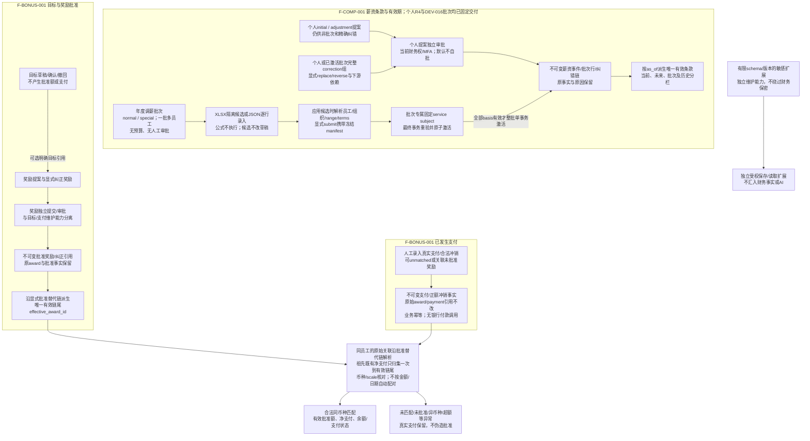

扩展是独立受控数据，不自动进入薪资、奖励、支付或AI输入。先发生支付后补批准仍保留实际日期与异常事实；纠正薪资/奖励/支付均保留原记录，不能覆盖、分叉替代链或重复归集同一支付。

### 0.4 面谈跟进与AI最小输入的流向
R6b在R6a确定规则之上实装获准employee的人工最小结构输入、独立批准、持久任务/lease/fence、API内到期扫描、独立mTLS worker、受控HTTPS provider协议、加密草稿及人审编辑/发布/丢弃。真实provider、区域、保留/训练政策及外传许可仍未提供，因此生产外传保持关闭；受控fixture只证明协议与边界。组织关系、参与者、shared标签与source引用均不自动授予AI或外传权。

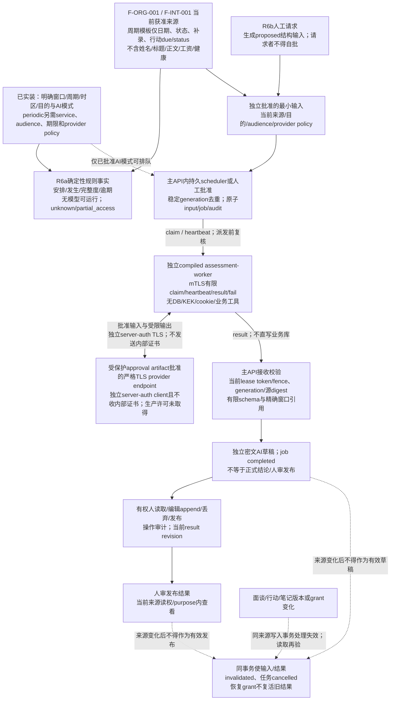

结构周期模板不含姓名/职位/笔记/行动正文/支持需求自由文本；文本仅走手动逐版本批准。薪资、奖金、private/HR保密及多余PII**不进入AI输入**；shared标签也不是外传许可。规则事实与AI草稿/人审结果分开；无权/缺失不是“没有记录”或“员工状态良好”。AI不评分、排名或自动进行人事/财务决策，provider已收到的数据也不能保证追溯撤回。

### 0.5 组织与历史：三种时间、当前scope和PII释放

下图以v12目标为准。`as_of`只投影业务有效期；历史`from/to`只筛UTC `recorded_at`；授权始终使用服务端捕获的集团IANA当前业务日。DEV-015期间尚无重要环境，因此v12采用全新schema/空库且不承接v11 team或grant；2026-10-15既有环境通知后，兼容义务从实际登记的已部署v12 baseline开始，未来变化必须前向迁移并保留其数据。

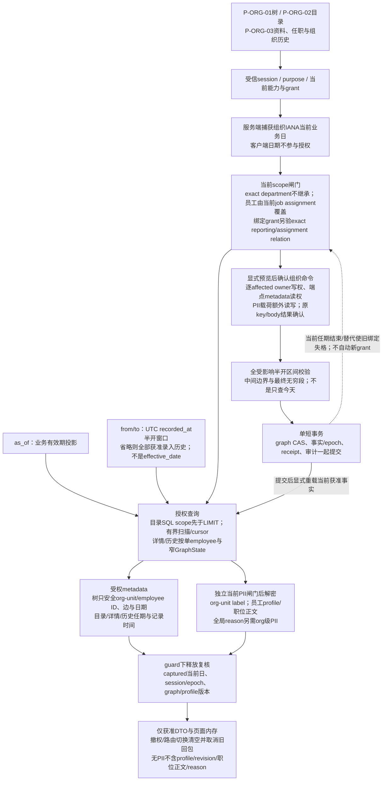

`subject_employee`是显式批准的一对一不可改绑对应，不是角色/能力/授权来源。原组织receipt只确认原commit：须当前原目标scope与所需写/PII资格、canonical digest匹配，不重要求已结束旧任期或旧graph CAS，不签发重授权票据。查询不把结构读权扩成PII，树即使请求label也不返回员工profile。

### 0.5.1 R3面谈分区、来源批准与R6b最小输入

本图保留R3面谈事实边界并显示后续R6b消费者。R3 metadata、正文和导出分别授权；R6b只接人工/standing-policy批准的最小来源，经受限worker形成草稿并人审发布。机制已交付不等于真实provider质量、外传/保留政策或生产启用获批。

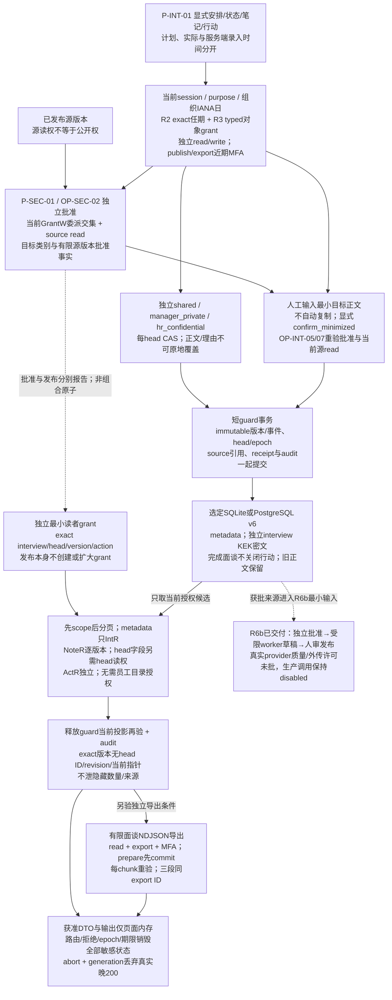

新目标版本受目标类别自己的读者授权；目标读者不需要源private权。发布者与批准者分别满足源read/目标批准条件，原源文本/ACL不变。已有head每次append明确supersedes与理由；completed后只允许更正版本，终态不重开。due_date保留，逾期按当前组织日、非终态计算。无在线撤权push承诺；新请求与释放点重验，浏览器已收到/截图/下载的旧内容不可追回。

### 0.6 后续开发的图示维护

全量与专项Mermaid共同构成权威图示；每task同步节点/边/状态、正文、技术契约、PLAN与证据。交付按[开发规则](DEVELOPMENT_RULES.md)实渲并核对7 features/9 pages/51 stable OP IDs/59 AC；未来或退休项明确标识。

## 1. 范围、语义与状态登记

目标是帮助授权人员管理**一个集团**内的法分公司、组织层级、任职/汇报历史、面谈、薪酬及奖金，并以受限AI辅助面谈跟进。当前部署严格一个active `org_id`，该ID就是集团唯一所有权/Staff Code命名边界；Branch是其下legal entity，不是另一个org。bootstrap/API拒绝创建第二active org；未来多集团/多租户必须先另做隔离与集团级唯一性设计。每个部署选择SQLite或PostgreSQL一种后端，不双写。

不是工资支付执行/个税/社保核算引擎，不自行增加招聘、考勤或员工自助，不自动评分、排名或决定调薪、雇佣、解雇。业务税制、法域等待确认项见第10节；未知事项不被当作已决定政策。

### 1.1 稳定功能与当前状态

| feature ID | 当前完整功能 | 设计状态 | 当前工作实现/检查（非全产品发布） | 最近发布 / 工作revision |
| --- | --- | --- | --- | --- |
| F-ORG-001 | 固定Business Group→Division→Department、全集团唯一员工工号/双语资料、雇佣/教育/单一岗位/直属主管(HOD)有效期历史 | DES-003/004完整并获批准 | DEV-015已实装OP-ORG-01/04..10、P-ORG-01/02/03与AC-ORG-01..11；DEV-017已实装department/job_assignment canonical授权 | 员工主数据固定C [`55466fe`](https://github.com/r404r/team-ledger-pub/commit/55466fe6f74d3c0dd56c42f0f2e72c427fb0c40e)，授权切换代码和测试在本仓库 |
| F-INT-001 | 面谈版本、共享/经理私有/HR保密分区、行动项、历史权限与交接 | DES-001/002；DEV-008已交付 | 8 INT OP、P-INT-01、6 AC、typed对象、独立source批准、人工最小化和有限导出已实装 | 当前源码、v6迁移和永久测试 |
| F-COMP-001 | 个人薪资条款/纠错、salary range、年度normal/special批次导入/显式提交/原子激活及历史 | DES-003/005/006；已交付 | 个人5 OP及Salary Range、N/S/NC/SC编号、加密candidate、冻结basis、原子activation/correction、审计outbox及批次页面已实装 | 个人R4 C [`ca82502`](https://github.com/r404r/team-ledger-pub/commit/ca8250245dae0b4a6b6d36b627209e97e5654a52)，批次C [`c46ed2`](https://github.com/r404r/team-ledger-pub/commit/c46ed2f638d71e28f106d199d54d0f6af01f5624) |
| F-BONUS-001 | 奖金目标、批准奖励、支付记录与敏感扩展 | DES-001/002；业务口径须显式批准 | 8 OP、P-BONUS-01、目标/奖励/批准、支付/冲销/异常、有限扩展、签名游标及受控HMAC维护已实装 | 固定代码C [`1c769d0`](https://github.com/r404r/team-ledger-pub/commit/1c769d0d5781eaf6cc797c46ab4ffc11d3940c95) |
| F-AI-001 | 定期面谈状态、依据草稿、人审发布、过期/失败处理 | DES-001/002；真实外传政策待批准 | 确定规则、人工proposed→独立approve、standing policy、稳定调度、持久queue/lease/fence/receipt、受限worker、加密draft及人审发布已实装；真实provider质量/外传未验 | 当前源码、v9/v10迁移和永久测试 |
| F-SEC-001 | 敏感内容库内密文、特殊权限、授权先于解密、密钥/审计/恢复 | DES-001/002/007/008；机制已交付 | 本地root/keyring、local/OIDC身份、同库独立receiver、双介质离线副本、长期MAC/index、identity canonical source及CSRF换键撤session已实装；不防host root | 当前源码、v12迁移、README runbook和永久测试 |
| F-DB-001 | SQLite/PostgreSQL共同业务语义、对应迁移、冲突及原子性 | DES-001/002；v12 clean baseline已验证 | 审计/outbox/export/rewrap/restore事实、SQLite一致snapshot、PG exported snapshot/custom dump及keyd backup domain已实装 | 当前源码与双数据库永久测试；容量、PITR、RPO/RTO和生产切流另行批准 |

“已接受”需要实际决策记录；“已实现/已验证”须由本仓库源码、迁移、永久测试及实际运行证据支持；“生产发布”还需要真实部署与责任人批准。历史Task ID和commit只说明演进阶段，不替代当前行为检查。

### 1.2 通用输入/输出与错误边界

- 对象有稳定 ID、组织所有权、版本及必要有效期。查看当前状态与查看指定日期 `as-of` 是不同查询；界面明确展示查询日期，未来批准记录不得悄悄覆盖今天的状态。
- 业务有效期采用明确的半开区间 `[valid_from, valid_to)`，未结束可无结束日期；起点必须早于终点。日期值与审计时间戳分开，审计时间记录统一时间基准；业务日历/时区在上线前确认，不依赖浏览器或服务器隐含本地时区。
- 写入携带被编辑的对象版本；过时版本返回明确冲突，不覆盖他人更新。失败不得产生半条历史或部分权限变更。
- 列表、详情、历史、统计和导出分别检查授权；不以“页面按钮隐藏”或不可猜ID当安全控制。未授权对象不暴露其敏感内容、历史和可辨识计数。
- 错误区分输入无效、状态不允许、版本/并发冲突、不可用及授权失败；对象不存在/无权查看的外部提示不得帮助枚举敏感对象。确切 API错误码/映射在 [技术规范](TECHNICAL_SPEC.md) 定义，报错不得含薪资、笔记、密钥或模型 prompt内容。
- 人员离职、org unit停用、需求撤回不等于硬删除已记录历史；数据保留/删除需法域和组织政策确认并由获权操作执行。

### 1.3 统一权限模型

授权必须同时满足：**role capability（操作能力）＋ org/department/employee scope（适用范围）＋ 数据类别 ＋ object grant/当前关系（对象授权与现时资格）＋ purpose（许可目的，特殊操作还须满足MFA等条件）**。默认拒绝，服务端每次按实际对象判断，先授权后解密。[S1]

| 职责/能力 | 可能允许的范围 | 明确不自动获得的权限 |
| --- | --- | --- |
| 组织/人员维护者 | 经授权scope内的部门、任职和必要人员资料维护 | 薪酬/面谈正文、特殊导出；人员维护能力不等于敏感内容读取能力 |
| 当前经理 | 当前管理scope内必要组织视图；明确grant的面谈分区/行动项 | 员工薪酬、全部历史面谈、HR保密或其他经理私有笔记；行政/虚线关系均不是薪酬授权 |
| 指定 HR人员 | 经明确能力、scope和对象授权的PII/HR保密资料 | “HR”名称本身不是全部薪酬/审批/导出通行证 |
| 薪酬查看/提出/审批/支付记录维护者 | 分开的能力和employee scope，目的与条件满足后操作 | 提出不等于批准，查看不等于导出；普通经理不得自动成为任一薪酬角色 |
| 安全/运维、IT/数据库管理员 | 必要基础设施、密文备份、权限或密钥服务操作能力 | 不默认读取人事/薪酬/笔记明文；也不能承诺应用宿主被攻破后仍对所有管理员保密 |
| AI worker/服务身份 | 批准目的下最小化面谈流程输入，受限内部接口和派生结果 | 薪酬、经理私有/HR保密、无权对象、数据库/密钥访问、对外自由HTTP工具及重大决策 |
| 员工本人 | 员工自助范围待用户确认 | 本基线不因“本人/参与者/作者”而自动开放工资、共享笔记或历史；确认前不启用未约定自助能力 |

grant具有对象/分区、读写/导出等操作、受授权身份、purpose和有效/撤销状态。授予敏感权限本身也需要明确管理能力和审计，不能自助提升。历史身份只说明当时事实，不决定今日权限。

v12新scope只允许**exact org / department / employee**；department不继承BG/Division/兄弟，employee覆盖看当前canonical job assignment。relation-bound grant只允许精确`reporting_line`或`job_assignment`事实；结束/replace后的successor或rehire新ID不复活。v12空库不导入v11 team scope、team_membership grant、capability、authority或receipt，也不保留兼容解析器。能力、独立grant、purpose及subject_employee仍须成立，关系/职位不自动授权；金融capability不接受关系绑定。

### 1.4 能力分离与启用条件

以下是职责到操作的设计矩阵，不是开箱即有的角色套餐。每格“可申请”仍需能力、当前 scope、类别、对象 grant、经批准的有限 purpose 和必要 MFA 全部成立；目录、PII、工资、历史、作者及员工本人均无自动访问权。敏感写/批/支付也须对应读取授权，不能靠获得写能力绕过敏感域。

| 分离能力 | 可申请入口/操作 | 不随之授予 |
| --- | --- | --- |
| 组织结构读取 | 组织树、目录、任职/汇报历史 | 姓名/联系等 PII、面谈正文、财务 |
| 组织/人员维护 | 建法分公司/org unit/员工及有效期事实；PII维护另须PII授权 | 面谈正文、工资读取/审批 |
| PII 读取 | 授权目录标签、员工资料 | 全员目录、联系方式导出、财务 |
| 面谈 metadata 读取/维护 | 可见面谈的安排、开始、完成、取消 | 三个正文分区、历史正文、扩大读者 |
| 分区笔记读取/写入/发布 | 每个分区分别授权；当前权限内追溯版本 | 其他分区、永久作者权、普通编辑扩权 |
| 行动项读取/维护 | 显式共享的最小描述与状态 | 保密来源正文 |
| 薪酬读取/提出/审批 | 三项独立能力；按 employee scope 与 purpose 生效 | 自批、支付维护、奖金权限、导出 |
| 奖金目标维护/奖励提出/奖励审批/支付维护/扩展维护 | 五项独立能力并须财务读取授权 | 相互代替、银行支付执行、自动批准 |
| 周期配置/评估请求/草稿读取/人审发布 | 当前来源读权交集内分别授权 | 薪酬、私有/HR 文本、自动员工侧写 |
| 最小 AI 输入批准 `assessment.input.approve` | 在 OP-AI-04 中由非请求者明确批准核实过的来源版本、provider policy、audience和最小结构输入；无此能力只能经OP-AI-03生成proposed input | 评估请求能力不等于输入批准，不授外传许可或人审发布能力；普通 shared 标签不等于批准 |
| 授权管理 | 在可委派的批准范围内授予/撤销 grant | 自我提升、默认业务明文读取 |
| 敏感导出 | 单独类别/对象/范围/目的/近期 MFA | 因读取而默认导出、已下载文件远程召回 |
| 审计读取/运维恢复 | 单独审计 scope 或受控运维身份 | 审计正文、业务解密、任何新员工目录权 |

purpose 从组织政策批准的有限集合选择；自由说明只解释请求，不能创造权利。审批默认拒绝提出者自批，不预设审批人数。建议采用可信 OIDC IdP 与后端管理会话；实际 IdP、委派批准者、MFA 近期窗口未确认前，相应生产能力不启用。

DEV-006共同身份交互已实装/实跑：未核对/401/设施不可用时不挂载受保护页面；登录只前往受信IdP，回调按批准issuer/sub映射，不按email/角色自动建主体/grant。MFA前往同身份真实认证，可信声明不足仍拒绝；成功轮换session/CSRF、重载权限与版本，**不自动提交资料、授权、批准或支付**。注销请求前立即销毁页面/表单/在途操作；仅服务端撤销提交并204才确认，失败关闭并允许明确重试，不声称IdP全局登出。焦点/后退/旧回包不得复活资料；核对subject/org/epoch变化清空旧树再明确重核。原提交grant命令epoch/原回执确认仍按独立契约，不把正常提交当外部换身份。唯一技术协议与时序在[TECH §7.1](TECHNICAL_SPEC.md#71-身份部署模式session与step-up)；生产政策未验。

近期MFA沿原安全设计是**会话级认证条件**，不是指定业务动作的一次性授权票据。step-up的action绑定认证事务与回跳意图，不创造能力、scope或grant；为一个动作完成MFA可满足其他**已经完整获权**动作的近期MFA门槛，无管理资格者即使请求`access_grant.manage`并完成认证仍不能管理，现有授权撤销后也不能继续。生产MFA映射及窗口政策尚待接受。

显式身份映射维护由持有受保护DB配置与本地keyd socket的受控进程执行，不把目标员工当操作者，也不借目标业务grant。CLI可选`-employee-id`，绑定已存在同org员工的一对一不可改绑`subject_employee`；省略保留已有对应，不推断、不转移、不创建capability/grant。检查已有approved active subject，**schema没有human-kind分类，不声称active-human核验或实名真人归责**。新事件的`local_maintenance`actor独立记录实际kernel有效UID＋域隔离host hash，应用actor subject为NULL；target subject/employee分列，不是共享/sudo账号背后真人证明。

**历史固定版本证据（不进入v12 baseline）**：v4曾把旧v3事件原值标为`legacy_unattributed`且不补造未知operator，历史页面区分执行身份、目标与未知记录。v12不导入、解释或显示通知前legacy行；2026-10-15通知后的兼容义务从实际登记的已部署v12 baseline开始，不追溯支持v1-v11。

### 1.5 页面注册、导航与字段分类

本表是 **9个稳定页面ID的唯一注册处**，不复用；路径/HTTP schema由[TECHNICAL_SPEC](TECHNICAL_SPEC.md) OP表唯一注册。登录/MFA/错误对话框是公共交互，不新增员工自助或DSN编辑页。R7已接通第九页P-SEC-02审计路由；本地keyd、内置identity mode和Compose独立audit receiver均已实装，但“页面可达”不等于真实生产IdP、介质责任或独立部署设施已验收。

DEV-025统一9个稳定页面及共同身份壳层的视觉系统：同源hash CSS提供系统字体、企业级颜色/间距tokens、品牌栏、当前导航状态、会话条、响应式表单/卡片/表格、alert/status、键盘focus和reduced-motion。视觉层不改变页面ID、OP、字段、权限、明确确认、错误或敏感数据清空语义；移动端宽导航和宽表只在各自容器滚动，不产生页面级横向溢出。

DEV-026将P-ORG-01人员资料录入按“查询条件、基本资料、工作联系方式、生命周期/更正依据、提交区”分组，label与control保持单一字段单元；字段、必填/可清空口径、创建/更正命令及组织事实边界不变。应用内主导航切换时，已核对身份壳层保持可见并在后台重新核对会话，不再短暂显示全屏checking状态；后台核对的401、身份上下文变化、敏感期限失效或服务失败仍销毁全部保护内容。

DEV-027曾将认证态共同会话区收敛为默认关闭的单行摘要；DEV-030进一步把正常态入口移入sticky应用顶栏右侧，以“会话正常”状态按钮打开不改变业务layout的浮层，身份边界、重新核对、注销、MFA及本地账号密码操作均在浮层内。路由切换、外部点击或Escape关闭并正确返回焦点，短视口内部滚动；受保护页面generation替换时目标和Teleport共同重建。未认证、checking、expired、changed、unavailable和操作中状态仍由独占gate销毁/阻止业务内容，不为收窄视觉而降低安全显著性。

DEV-028 T1将业务有效期投影日收敛为认证态顶部全局“查看日期”：初值来自服务端按组织IANA时区计算的当天，应用内切换人员资料、组织树、员工目录和薪酬工作台时保持同一内存值；用户改变后相关当前页面重新读取。页面不再要求重复填写或显示技术名`as_of`；`as_of`仍是API契约，只影响雇佣、任职、组织及薪资等有效期投影，不改变服务端独立捕获的当前授权判断日。该值不写local/session storage；单一合法`as_of`的受控深链接可恢复历史查看日期，其余重新登录或加载回到服务端当天。

DEV-028 T2将员工目录收敛为业务查询页：初次显示当前获准在职员工，空条件“显示全部员工”包含全部生命周期状态；姓名/Staff Code、Department、状态和每页数量为主要筛选，员工ID收进高级筛选。目录只在当前`pii.read`成立时自动请求并显示受保护资料，不再要求用户理解“请求PII”；结果用表格、空状态、当前页及前后游标分页呈现，不显示未授权总数。组织数据revision移入“数据状态”，批量JSON维护入口默认折叠。员工详情链接同时触发应用级路由并带合法历史查看日期，应用内和新标签页均读取相同`as_of`，不再出现空白详情。

DEV-028 T3将创建人员收敛为一次原子业务动作：创建页必填全集团Staff Code，可从当前获准员工中查找并选择直属主管/HOD，也可明确无直属主管。OP-ORG-05同一事务写profile/lifecycle、canonical identifier及可选administrative reporting；Staff Code冲突、主管不存在/跨组织/无权引用或revision变化时不留下半成品员工。成功后页面只以receipt确认提交，再按当前授权和查看日期重读完整资料；命令推进组织图导致本次会话auth epoch变化时，主体与org不变且重核对成功才继续。

字段分类：`M` 为受 scope 约束但允许必要明文的结构 metadata（ID、关系、日期、状态、revision、记录时间）；`P` 为加密 PII/姓名/联系方式及敏感职位资料；`N` 为加密面谈/行动文本，按三个分区授权；`F` 为加密薪酬/奖金/原因/凭证/扩展；`A` 为加密 AI 文本与最小输入；`U` 为脱敏授权/审计 metadata。即使是 M/U 也不是公开数据；内容不得因字段名称“备注”变为 M。

| 页面 ID / feature | 入口、字段及数据来源 | 详情/表单与操作条件 |
| --- | --- | --- |
| P-ORG-01 / F-ORG-001 | v12“组织树”：BG/Division/Department、employee安全ID、边/生命周期、as_of与graph revision；label另需PII，不返employee profile | root department/depth≤3/上限后重载；目录变更用OP-ORG-09，employee assignment/reporting用OP-ORG-10；不建team或自动grant |
| P-ORG-02 / F-ORG-001 | v12“员工目录”：ID、lifecycle、as_of assignment/reporting；获PII权才含双语姓名/联系/职位正文 | department/lifecycle/as_of及body q有界过滤；创建页通过OP-ORG-05原子提交profile/lifecycle、Staff Code及可选直属主管，进入详情/历史不预载其他敏感域 |
| P-ORG-03 / F-ORG-001及员工相关feature | v12资料/profile revision、工号/雇佣/教育、as_of单一任职、Direct Manager/HOD及历史；各工作台独立链接 | 初建Staff Code/主管随OP-ORG-05；profile更正用OP-ORG-08，后续组合主数据用OP-ORG-10；薪酬/面谈/奖金/AI各自授权/分页，不互相转授 |
| P-INT-01 / F-INT-001 | 当前主导航`/interviews`员工ID选择、员工面谈列表/安排页、`/interviews/:id`详情；metadata及分区/授权版本/行动各自独立 | 8 INT OP已实装；列表/详情自己的有限操作提示不依赖目录read。状态/补录、显式supersedes/理由更正、独立source批准与人工发布、额外授权NDJSON、原key/body结果确认；清理/冲突/partial明确呈现 |
| P-COMP-01 / F-COMP-001 | 已固定`/employees/:employee_id/compensation`；明确as_of/from/to四栏：现状、未来批准、当前提案、immutable批准/完整纠错，所选提案原史另显式有界页 | 5OP/initial-adjustment-correction/member_key/独立状态转换/精确对象NDJSON/grant已接通；当前快照不内嵌原史，旧修订页替换不累积，head/cursor变更销毁旧body需人工重查。无币种/税制默认，409不自动rebase |
| P-BONUS-01 / F-BONUS-001 | DEV-010固定代码路由`/employees/:employee_id/bonuses`；目标、奖励、支付/冲销、余额/异常、扩展分离（F，OP-BONUS-01），日期/状态（M） | 目标 OP-BONUS-02/07、奖励 OP-BONUS-03/04/05、支付 OP-BONUS-06、有限扩展 OP-BONUS-08；能力分别检查，命令前重验会话并按bonus/comp revision CAS，不放一个“财务编辑”总开关 |
| P-AI-01 / F-AI-001 | `/employees/:employee_id/followup`；确定规则、standing policy、最小输入请求/独立批准、持久任务、草稿打开/编辑/发布/丢弃（M，OP-AI-01-05/08） | 表单不预填业务默认；明确cadence/anchor/IANA timezone/due/pause/purpose/AI模式。请求与批准主体分离；worker凭据不进入浏览器。规则与AI状态分栏，draft不冒充published；生产provider许可缺失时不外传 |
| P-SEC-01 / F-SEC-001 | 主导航“授权”；当前会话、delegated grant列表/详情及全typed对象类别；PII/面谈/金融/AI结果有限导出由各业务入口显式选择对象 | OP-SEC-02/03独立预览/确认/真实revision撤销；canonical owner/独立能力/有限类别校验、敏感导出强制近期MFA。管理权不授正文；全部导出≤100对象/8MiB、prepare及逐批release重验，不落明文temp |
| P-SEC-02 / F-SEC-001 | 主导航`/security/audit`；独立`audit.read`＋audit类别＋`security_administration`目的及MFA，按时间、actor/object/action/purpose/结果/request ID查询（U，OP-SEC-04） | 签名cursor绑定caller/query/epoch；只返回脱敏事实，无正文/金额/prompt。拒绝/离页清旧结果；查看审计不获得关联业务对象读取权 |

导航只出现可申请使用的工作区；无 grant 的 tab 不显示敏感数量或隐藏分区的存在提示。直接 URL/API 不能绕过拒绝。切换 employee、purpose、查询日或授权变化时丢弃不匹配的在途响应和旧内容；返回按钮不得从缓存复活敏感数据。`as_of` 改变历史投影，不改变服务器“当前业务日”的授权判断。

### 1.6 列表、表单和公共反馈

- 列表先做scope/对象授权，再分页；默认不解密薪酬/笔记。R2目录SQL当前scope先于LIMIT，每页limit 1..100，最多500授权候选解密、另一个不解密peek；历史按UTC recorded_at/id keyset。cursor有效15分钟，绑定caller/org、捕获当前授权日、epochs/graph、查询/筛选/last key，变化后从第一页开始；不返未授权总数。业务投影标`as_of`，录入历史另标UTC窗口与每项有效期，不用查询日代录入日期。
- 姓名搜索仅在当前有PII grant的**exact Department**范围有界解密，`q`≤256 UTF-8 bytes且须include_profile；BG/Division只作为选择Department的导航控件，不是查询scope或隐式子树过滤。q不入URL/history/cursor原文/storage/log/error/audit；达到扫描界限提示search_incomplete。
- 每个表单明确必填、类型、日期/币种/scale/口径、理由和当前 revision；保存前展示将新增的事实/将结束的区间/授权影响。表单选择器只返回操作者有权引用的对象；客户端预校验不能替代服务端。提出、提交、批准、支付、导出均显式点击，不因切换 tab 自动执行。
- `loading`：局部加载标识、禁用本次相关重复提交，不闪现旧员工数据；`empty`：区分已授权范围确无记录、未来无计划、未配置，不把无权/不可用当空列表；`denied`：对象不可见统一“不存在或无权查看”，已知可见对象动作无权提示不能操作，正文及时清空。
- `MFA required`：指出须重新完成可信身份验证；不显示密钥/验证码，不在认证返回后自动批准/付款/导出，重新获取版本/权限后由用户再确认；失败/取消不写业务事实。
- `conflict`：安全说明“版本/基准/状态已变化”；保留仍获授权的未提交输入在内存供手工比较，重新加载最新版本；不能自动重放覆盖、自动批准或将未授权新版本解密展示。撤权时连未提交敏感输入也清空。
- `unavailable`：DB/密钥/provider/写锁忙显式失败，可手工重新加载；不得显示“已保存/已评估正常”。网络结果不确定时先读取当前事实核对；payment 使用原业务幂等键再次确认，不生成新事实或自动改键。没有服务端确认不能当成功。
- 批准、支付、授权扩大和导出确认展示授权范围、目的、实际有效日及不可逆边界；敏感内容不入 localStorage、URL 查询、分析 SDK 或离线缓存。错误关联安全 request ID，审计不可含表单正文。

每页查询控件与分页边界如下；它们调用相应已有 OP，不另承诺全组织敏感聚合/搜索接口。技术规范决定各查询的安全上限和 cursor 参数，界面不能将有界结果宣称全量。

| 页面 | 过滤/查询日期与列表边界 |
| --- | --- |
| P-ORG-01 | org与必选as_of、可选root_department_id、depth 1..3、limit 1..100、include_labels；授权有界快照超限拒绝并要求收窄；department scope不沿祖先/子孙继承，label不是员工姓名开关 |
| P-ORG-02 | BG/Division只导航选择一个exact Department；OP-ORG-04只提交department_id/employee_id/lifecycle/as_of/q。PII先于LIMIT/解密，最多500＋peek；不提供BG/Division子树查询或scope继承 |
| P-ORG-03 | 单employee；获当前独立PII权才显示当前profile/revision和职位正文。任职用as_of；组织历史from/to成对、UTC recorded_at `from,to)`、省略则全部获准历史，不按effective_date过滤。无PII仅metadata且不含profile/profile_revision/position正文/reason，future tabs各自授权分页 |
| P-INT-01 | 先选获准employee，再按日期窗口/面谈状态查metadata；单条详情按有权category/版本查看，行动按状态/due_date在返回的授权范围过滤；不全员全文搜索 |
| P-COMP-01 | 单employee必选as_of现状；future单列；变更历史按有效期/录入事实/提案状态查看，口径/币种不相加，无全组织工资排序/全文原因检索 |
| P-BONUS-01 | 单employee、期间/目标或奖励状态；payments按支付日及异常类别查看，分币种/scale；只有明确匹配才能显示同币种余额 |
| P-AI-01 | 单获准employee、明确配置窗口；事实/当前有效结果与旧失效历史分离；全局导航只作员工选择入口，不暗增全员评估排序 |
| P-SEC-01 | OP-SEC-06 仅 delegated scope 内按主体/对象/类别/purpose/有效、未来、撤销、过期状态查看授权列表与详情；cursor绑定范围/条件，详情不含业务正文、不自动打开PII/审计；授予后刷新列表，撤销从列表选定真实 grant ID |
| P-SEC-02 | 独立审计scope，时间窗口、actor/object/action/purpose/结果；受限cursor分页，不出现业务正文或模型prompt |

## 2. F-ORG-001 · 组织、人员、职位与有效期

**当前组织边界**：组织OP/三页、面谈最小交接及薪资event/term最小历史交接、独立read/export与撤权已实装。当前范围不外推为生产日历、PII责任或个人批准政策已全部通过。

### 用户目标

授权管理者能看清指定日期的BG→Division→Department、员工必要资料、单一任职及直属/虚线汇报关系，正确记录调岗与经理变更，不覆盖历史。

### DES-003/004员工主数据目标模型

截图中的员工台账不能继续塞进单一`profile`。DEV-015已按下述模型把稳定身份、受保护个人资料、雇佣关系、组织任职和财务派生分开；每个“当前值”都是指定`as_of`上的投影。员工主数据已固定交付；DEV-016已完成Salary Range及normal/special批次实装，当前边界以本节、v12迁移、源码和永久测试为准。

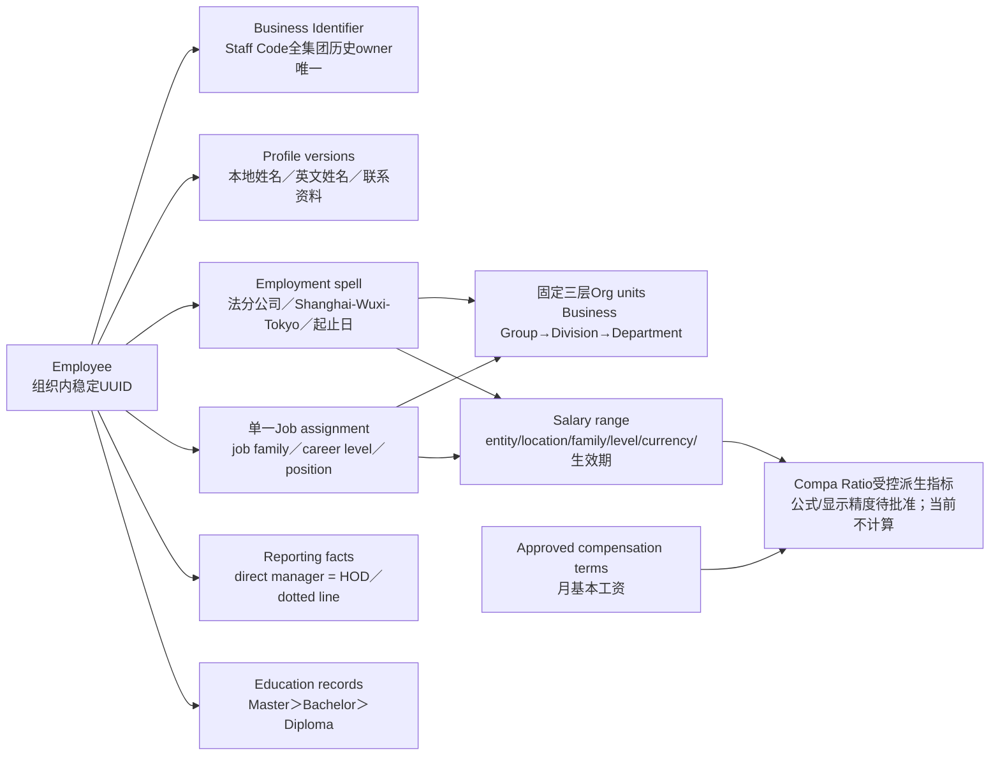

| Excel/页面字段 | 目标事实或投影 | 规则 |
| --- | --- | --- |
| 序号 | 列表展示序号 | 不持久化、不作为身份或导入匹配键 |
| 工号 Staff Code | `employee_business_identifier` | 员工UUID不变；全集团跨历史只能归属一个employee。允许换号；rehire到同一employee UUID可重新启用本人旧号且区间不重叠，任何旧号都不得转给另一员工 |
| 姓名 / English Name | 加密profile版本 | 分字段保存，不从单一display name反拆；更正追加版本 |
| 地点 / 所在公司 | `work_location` / `legal_entity`＋employment spell | Location只允许Shanghai/Wuxi/Tokyo；Branch语义固定为`法分公司`目录，不接受自由文本 |
| 业务单元 / 事业部 / 部门 | 固定`business_group → division → department`及其有效期父子关系 | 不复制三份当前文本到employee；层级不得跳级/加team层，按`as_of`沿获准层级派生 |
| Highest Education | 教育记录中的最高获准学历投影 | 固定排序Master>Bachelor>Diploma；不能以最新日期替代最高，同级按获授日/稳定ID确定展示 |
| Date of Employment | employment spell的两个明确投影 | rehire保留多段；页面同时显示首次入职日`first_employment_date`与本次有效employment spell起始日`current_employment_start`，不以一个含糊字段覆盖 |
| Job Family / Career Level | 单一job assignment引用受控目录 | 同一时点恰好至多一个primary assignment，不支持secondary/兼任；不得从title猜测 |
| Direct Manager / HOD | administrative reporting line | 两列是同一事实的两个展示名；每时点最多一个直属主管，不另建HOD role、不允许两列出现不同人员 |
| Monthly base salary | 获批compensation term中的唯一`monthly_base_salary`组件 | 税前固定月薪：unit=month、frequency=monthly、tax_basis=gross；仅CNY/JPY且scale0。奖金、浮动薪资、加班、一次性支付及非固定津贴不并入；同Branch员工可各用不同币种 |
| Compa Ratio | 当前禁用 | 只匹配同币种CNY或JPY、scale0且不得FX；用户已选择在公式未批准时不计算、不展示、不返回猜测值。未来启用须另行批准Salary Range口径、公式及显示精度 |

目录默认只显示业务所需字段；教育、工号、财务字段分别经过PII/financial授权。批量导入以组织级Staff Code做全集团精确匹配，姓名只供人工核对，绝不作为身份键。

目标员工主数据通过OP-ORG-09查询并维护`法分公司`、固定Location、固定三层org unit、job family/career level及固定education level目录；v12的OP-ORG-10是后续员工主数据/任职组合写，可在一个typed set原子提交identifier、employment、education、canonical job assignment/position、employee lifecycle及administrative/dotted reporting。OP-ORG-05仅在初建员工时复用同一canonical规则原子写必填Staff Code和可选administrative manager；不另建第二套identifier/reporting事实。直属主管/HOD由同一administrative reporting fact投影。目录、员工事实、组织图各有revision，命令显式列全依赖；没有“直接改Excel一行”或跨HTTP伪原子。Salary range仍由OP-COMP-11维护。

### 流程与输入/输出

1. v12不执行v11→v12升级或数据merge：在新的空SQLite文件或空PostgreSQL schema安装一份完整v12 baseline，旧开发数据库不作为启动输入。v12只创建Business Group→Division→Department、canonical job assignment及新授权类型；team/membership/position旧表、路由、scope/ref和decoder不进入新baseline。需要开发数据时仅以合成seed或v12 API重建。
2. 创建页面以一个OP-ORG-05命令提交姓名、联系资料、生命周期、必填Staff Code及可选直属主管；profile、identifier、administrative reporting、revisions、receipt和audit同事务提交或全部回滚，不自动建立assignment或grant。
3. OP-ORG-10在一个guard事务维护初建后的Staff Code换号/复用、employment、education、单一canonical job assignment/position和administrative/dotted reporting；页面Direct Manager/HOD共同读取同一administrative fact。普通转岗可在同一命令结束旧employment/assignment/reporting并新增后继，任一失败全部回滚。
4. 树/目录/详情按`as_of`查询有效任职；组织历史按UTC `recorded_at`录入窗口查询，保留每项独立有效期及原任期ID。组织变更在原子提交中推进graph/相关epoch，每请求按服务端捕获的当前组织业务日验证scope/绑定任期，未来结束不提前失格，当前结束或replace不等调度器；不自动为新经理创建grant。

输入包括org/employee、BG/Division/Department、职位/资料、关系类别、有效区间和编辑版本；输出是已授权的三层树、人员与历史投影、有效日期、版本及冲突说明。敏感PII由 F-SEC-001保护，非敏感层级资料也必须受scope约束。

### 行为、状态与错误

- 每时点administrative reporting每员工最多一个直属经理，无self/cross-org/环；dotted同org/非self/区间包含，可循环且不自动授权。
- org-unit树每时点严格BG→Division→Department、单父、无自环/跨org/循环。
- 关系有效期包含于对象生命周期；过去/未来/结束/更正均验证全部受影响边界和最终无穷段。graph/catalog/employee CAS防并发组合成非法图。
- 同一时点最多一个canonical primary job assignment；它同时表达department membership和position。secondary、兼任及重叠一律拒绝。
- 当前/未来/结束按查询日期投影，不改历史。员工、legal entity、location、org unit停用有明确日期，禁止悬空关系。
- 无效区间/对象/目录ref、跨org、重复父级、assignment或行政经理重叠、环、旧revision均整组拒绝；dotted循环除外。

### 页面操作与原子结构变更

P-ORG-01/P-ORG-02通过OP-ORG-09读取或维护BG/Division/Department、法分公司及job family/career level目录；Location和education是固定seed。创建页先读取catalog/graph revision及当前获准主管候选，再由OP-ORG-05在一个事务创建profile/lifecycle、Staff Code identifier和可选administrative reporting；不隐式建assignment或grant。后续员工主数据/任职/reporting只经OP-ORG-10。

P-ORG-03的双语姓名/联系方式更正是独立OP-ORG-08：以profile revision完整替换获准v2字段并追加密文版本，不改组织图。初建组合仅限OP-ORG-05明确列出的Staff Code/主管；后续profile更正与OP-ORG-10仍是两个独立命令，不能把任意资料与结构保存拼成跨HTTP原子动作。

OP-ORG-05与OP-ORG-09/10都使用canonical identifier/reporting规则和相同graph/catalog/employee revisions。初建事务先写尚不可见的新employee/profile，再核对manager endpoint，最后提交identifier/reporting、graph/employee revisions、一个OP-ORG-05 receipt及audit；任一检查失败整笔rollback。OP-ORG-09/10表单逐行展示typed action、owner/endpoints、旧ref、半开区间及全部expected revisions，1..100项。普通转岗由一个OP-ORG-10结束旧employment/assignment/reporting并新增后继；replace保原事实/替代链，不自动建立grant。每个affected employee/reporting endpoint须当前组织读写，identifier/education/position载荷另需PII；本地keyd加密准备在guard外，事务内重验资格/版本，全组facts/projection/revisions/epochs/receipt/audit一起commit或rollback。

v12有限PII加密载荷为`pii.org_unit_label.v1`、`pii.legal_entity_label.v1`、`pii.job_assignment_position.v1`、`pii.structure_reason.v1`及profile/identifier/education schema；全部绑定exact owner/AAD。面谈reason与薪酬batch import raw/rows同样必须使用技术规范唯一registry，不得临时发明schema/context。结果不确定只明确重放v12原key/body；先重验当前scope/PII/authority和digest，再确认receipt，不产生“重新授权ticket”。

| 源事实/投影 | 动作 | 前置 | 目标与不可变事实 | 拒绝 |
| --- | --- | --- | --- | --- |
| 无employee | 创建OP-ORG-05 | OrgR/OrgW、PIIR/PIIW、合法profile/lifecycle、Staff Code、catalog/graph revisions；可选主管另需当前OrgR | 新稳定ID、profile、identifier和可选administrative reporting同Tx；不自动任职或授权 | 无权、非法PII/日期、工号冲突、主管无效/跨org、旧revision；无半建对象 |
| 已有profile revision | 更正PII / OP-ORG-08 | employee PII读写、purpose、expected revision、v2 schema | append加密profile、CAS/audit原子；图不变 | 越权、旧revision、未知字段 |
| org-unit目录 | OP-ORG-09 add/end/replace | catalog/graph revisions、完整窗口 | BG→Division→Department事实及历史 | 跳级、多父、环、仍被引用却停用 |
| 员工主数据/任职/reporting | OP-ORG-10 add/end/replace | graph/catalog/employee revisions与全部owner授权 | 一个composite change/receipt；旧历史保留 | 任何invalid ref/重叠/环/旧revision，零部分事实 |
| 有效relation-bound grant | exact relation当前日结束 | 当前日资格复核 | 旧绑定失效；后继不自动继承 | as_of回退或再任职恢复旧权 |
| 无/已有workforce目录 | 目录查询/维护 / OP-ORG-09 | 查询需org目录读权；维护另需org目录写权＋适用PII、expected_catalog_revision＋expected_graph_revision | bounded current/history及revision；Branch仅`法分公司`，Location仅Shanghai/Wuxi/Tokyo，org unit只能BG→Division→Department，education固定Master>Bachelor>Diploma；job family/level追加版本 | 自由文本/未知目录值、跳级父子、任一旧revision、破坏仍被引用生命周期、越权 |
| 员工主数据事实集合 | composite typed change set / OP-ORG-10 | 每affected employee及reporting endpoint当前OrgR/OrgW＋适用PIIR/PIIW、graph/catalog/employee revisions | identifier/employment/education/canonical assignment-position/reporting/lifecycle在一个guard Tx追加/结束/替代，单一receipt、facts/projection/revisions/epochs/audit原子 | 跨org、工号已归另一employee、assignment重叠、manager环、无目录ref、独立HOD kind、部分成功 |

单一任职政策已确认：同一时点最多一个canonical primary job assignment，不启用secondary/兼任。行政每时点最多一个直属经理，页面HOD是同一事实别名；缺经理可明确为无。dotted同org/非self/区间包含、允许循环且不授权。

P-ORG-03资料页标`as_of`与当前授权判断日；profile是当前获准版本，不被历史日回退。组织历史另显示操作者安全subject ID、UTC录入时间、graph before/after与本employee事实的业务有效期、结束/替代链；`from/to`成对且按UTC recorded_at `from,to)`，止日不包含，省略则全部获准历史，**不是effective_date过滤**。职位正文须当前employee PII，全局change reason须当前org PII；无PII时只metadata，省略profile/profile_revision、职位正文和reason。目录/详情/历史尽可能窄GraphState而非全org历史图；释放前在guard下重验捕获当前日、session/epochs/graph与profile版本。结构预览是未提交客户端内容，仅服务器确认可称已登记；未来已登记不称今天生效。

### 权限与验收

以下为F-ORG-001唯一验收登记；场景按v12 clean baseline重写。员工主数据及canonical授权切换均已实装，但不外推生产启用。

| 验收 ID | 页面 / 操作 | 合成输入、动作与可观察结果 | 当前覆盖 / 未决 |
| --- | --- | --- | --- |
| AC-ORG-01 | P-ORG-01/02/03；OP-ORG-01/04/05/06/07/09/10 | 建BG→Division→Department及E的assignment X；2027-01-01原子结束旧assignment并新增另一Department/Y。前后日期树/目录/详情投影正确、历史保留；树不泄profile/薪资 | DEV-015候选双库/API/UI已验 |
| AC-ORG-02 | P-ORG-01/03；OP-ORG-09/10/06/07 | M1结束边界、M2当天开始，旧线无效新线唯一；跨org/self/行政重叠、跳级父子、多父级拒绝，无部分事实 | DEV-015候选双库/API已验 |
| AC-ORG-03 | P-ORG-01；OP-ORG-09/10 | 已有BG→Division→Department窗口，请求形成org-unit或administrative中间窗口环；即使首尾无环也整组拒绝。dotted循环允许但仍同org/非self/生命周期包含 | DEV-015候选全窗口双库拒绝已验 |
| AC-ORG-04 | P-ORG-01；OP-ORG-09/10 | OP-ORG-09两客户端持同旧graph/catalog revisions改父子，最多一成功；OP-ORG-10两客户端持同旧employee revision改任职，最多一成功。另一409，均无非法图/部分事实 | DEV-015候选CAS/rollback双库已验 |
| AC-ORG-05 | P-ORG-03/P-SEC-01/P-INT-01/P-COMP-01；OP-ORG-10/06/07、OP-SEC-02/03、INT正文OP、OP-COMP-01/02 | 换M2后旧M1历史查询不回退当前授权；再任职不复活旧grant，新经理无独立交接不看旧正文；金融不继承经理身份 | reporting-line relation-bound与既有对象授权已回归；department/job-assignment授权仍见AC-ORG-12 |
| AC-ORG-06 | P-ORG-02/03；OP-ORG-04/06/10 | 重叠assignment/secondary拒；无目录权拒，无PII可读metadata但不得搜profile/职位正文；q只POST、有界500，cursor换上下文失效；停department越界整组拒 | DEV-015候选双库/API/UI已验 |
| AC-ORG-07 | P-ORG-03；OP-ORG-05/06/08 | 创建双语profile、Staff Code及可选直属主管后重读权威详情；再以profile revision完整更正，追加加密历史/审计。创建任一identifier/manager失败零部分员工；同旧更正版本最多一成功，越权/未知字段拒绝；创建非upsert | DEV-015 profile v2密文/API；DEV-028原子创建SQLite API/UI已验，PostgreSQL待真实DSN |
| AC-ORG-08 | P-ORG-02/03；OP-ORG-05/06/07/10 | 原子创建本地姓名“合成员工甲”＋英文名“Example A”及文本工号`\"0007\"`；两姓名和工号独立往返。该员工换为`\"0008\"`后rehire可重新启用本人旧`\"0007\"`，但另一employee在任何日期取得`\"0007\"`均整组拒绝；姓名不参与身份匹配，缺PII权不显示/解析工号 | DEV-015候选双库/API/UI及PII拒绝；DEV-028创建组合SQLite回归已验，PostgreSQL待真实DSN |
| AC-ORG-09 | P-ORG-03；OP-ORG-06/07/09/10 | employee先hire到`法分公司`/Shanghai，结束后rehire到`法分公司`/Tokyo；指定日期投影唯一并保留全部spell。Wuxi可选，未知Location或非`法分公司`Branch拒绝；first/current employment dates分别可解释 | DEV-015候选双库/API/UI已验 |
| AC-ORG-10 | P-ORG-01/02/03；OP-ORG-01/04/07/09/10 | SQLite新文件和PG空schema分别安装v12，合成建立BG→Division→Department并写一个canonical assignment；schema/API不存在team第四层、team scope/ref、OP-ORG-02/03 writer。以v11 DB启动须明确`SCHEMA_VERSION_UNSUPPORTED`且零写入，不自动升级/merge/清空；换用空v12 DB后真实API/UI成功 | DEV-015 clean baseline、旧schema拒绝、两库/API/UI已验 |
| AC-ORG-11 | P-ORG-03；OP-ORG-06/07/09/10 | 先记录Bachelor，再记录日期更早的Master和日期更晚的Diploma，Highest Education为Master；未知level拒绝。Direct Manager与HOD读出同一administrative reporting fact且不授financial；独立HOD kind或不同人员拒绝。新assignment含canonical position payload，department不一致/secondary/并发旧revision整组拒绝 | DEV-015候选双库/API/UI已验 |
| AC-ORG-12 | P-ORG-03；OP-ORG-07/09/10、OP-SEC-02/03/06 | 单个OP-ORG-10命令结束旧employment/assignment/reporting并新增合法后继，facts/projection/revisions/epochs/receipt/audit同Tx；任一目录、Staff Code owner、manager endpoint、单一任职或授权失败时SQLite/PG零部分事实。新grant只接受org/department/employee scope与reporting_line/job_assignment ref，team/team_membership类型一律拒绝；assignment结束后successor/rehire不复活绑定grant | 双库/API/UI永久测试覆盖组合写、旧team输入拒绝、department scope、job_assignment relation-bound、业务日coverage、DB kind/owner约束及end/replace不复活 |

## 3. F-INT-001 · 面谈、分区笔记、行动项与历史交接
**R3当前边界**：面谈、分区笔记、行动项与历史交接已实装；AI消费者由F-AI-001的受限worker和人审机制处理，真实provider质量与外传仍未批准。当前契约和验收以本节、源码与永久测试为准。

### 用户目标

管理者和获授权 HR人员可以记录每次面谈、共享后续行动及追溯修订，同时把共享、经理私有与HR保密内容分开，保证历史不因换经理而自动泄漏。

### 流程与输入/输出

1. 安排面谈，记录员工、参与者事实、计划/实际时间及适用scope。参与者记录用于追溯，不自动授予所有分区的读权。
2. 按分区记录版本化笔记：`shared`、`manager_private`、`hr_confidential`。创建/发布笔记时明确授权读者和用途；笔记正文与修订历史均敏感。
3. 创建共享行动项，记录责任人、到期日、状态和必要来源引用；不能把私有/HR正文复制到共享行动项泄漏。涉及保密来源的行动项描述必须经授权人最小化后发布。
4. 保存/完成面谈，后续纠正以新版本保留旧版本和修改理由；不静默覆盖已记录内容。更换分区或扩大读者是显式授权变化，不是普通文本编辑。
5. 查询历史时重新验证当前资格和独立对象grant；经理变更默认撤回旧管理grant，新经理仅获明确批准的交接内容，不自动获得全部旧笔记。

输入为面谈身份/时间、参与者、笔记分区/正文/版本、行动项及对象grant；输出只包含调用者有权读的面谈信息、笔记版本、可见行动项和其状态。无权分区的正文、摘要及差异不能通过混合详情/导出泄漏。

### 行为、状态与错误

- 面谈可为已安排、进行中、已完成、已取消；取消保留原因/历史，完成不意味着所有行动项完成。需要补录的历史面谈标明实际日期与录入事实，不假装按时发生。
- 笔记有草稿/已发布及版本，只有符合分区写入/发布能力者能操作；已发布修订可追溯。撤回可见性和删除正文按独立授权/保留政策，不默认抹历史。
- 行动项为待办、进行中、已完成、已取消；逾期由到期日和非终态推导，不能靠改变面谈“已完成”隐藏未完成事项。
- 保存过时版本、引用不同员工/组织、越权分区、无效状态转换及未授权扩大读者均失败；部分笔记成功而权限/行动项失败的组合写不能报告整体成功。
- `shared`意为“明确授权的共享读者”，不是组织全员公开。`manager_private`不是作者永久所有；`hr_confidential`也不是所有HR默认可见。

### 页面流程与有限状态转换

P-INT-01 从 OP-INT-01 选可见面谈，OP-INT-04 只取允许 metadata/分区/行动项；日期/状态筛选与分页不泄露隐蔽笔记数量。安排 OP-INT-02 填 employee、允许参与者 ID、计划时间/时区、是否历史补录；开始/完成/取消 OP-INT-03 填实际起止或安全原因，录入时间由服务端产生。

三分区独立head与immutable draft/published版本；已有head每次append显式选择supersedes并填edit_reason，发布另明确确认。普通OP-INT-05不改category、不接受audience/grant字段、不写grant。跨类别来源由管理者先经独立OP-SEC-02记录同employee已发布源版本批准（至多10），当前须源NoteR与允许目标类别的delegated GrantW；发布者另须当前源NoteR、有效目标NotePub或ActW source批准、人工最小化confirm_minimized。目标正文不自动填入。授权与发布分别报告，后一步失败不抹已成功授权。

明确批准的目标共享正文由目标类别/target grants 保护，不要求目标读者额外得到源私有正文读权；来源引用仅追溯事实，不授予权限。无源读权者不能沿引用打开私有原文/差异，也不暴露隐蔽内容摘要；批准者须有源内容的读取及允许公开该最小内容的管理权。

行动OP-INT-07输入手工最小shared正文、typed同org责任人、nullable due_date与有限源版本；source引用对无源read者省略，不是可辨识旁路。面谈完成不关闭行动，既有行动仍独立完成/取消，due/原文字/历史不覆盖；终态不再新建行动。P-SEC-01按typed interview/note_head/note_version/action_item交接；exact version不授head/其他历史/目录，直读/详情/导出省略head ID及当前revision/指针，即使该版本恰好current。head fields另须当前head NoteR并在释放点重验，操作提示不依赖员工目录权。

| 源 | 动作 / OP | 前置 | 目标 / 不可变事实 | 拒绝 |
| --- | --- | --- | --- | --- |
| scheduled | start / OP-INT-03 | 最新 revision、实际开始时间 | in_progress，保留计划/录入事实 | 越权、无实际时间、过时版本 |
| scheduled | complete（明确补录）/ OP-INT-03 | 实际发生起止、补录事实和必要完成字段 | completed，不假装按计划发生 | 日期矛盾或缺实际时间 |
| in_progress | complete / OP-INT-03 | 完成字段、实际结束及最新 revision | completed，行动项不自动关闭 | 无效顺序、缺字段 |
| scheduled / in_progress | cancel / OP-INT-03 | 取消能力、必要安全原因 | cancelled，保留历史 | completed/cancelled 再取消或重开 |
| 无笔记 / 任一旧版本 | 新 draft / OP-INT-05 | 对该类别写权、预期 head | 追加不可变 draft 版本，head 移至新版本 | 普通编辑改类别/读者、覆盖旧正文 |
| draft | 显式发布新版本 / OP-INT-05 | 发布能力、当前类别与读者 grant、head | published 版本；旧 draft 证据仍可追溯 | 隐式扩权、过时 head；不能靠发布解锁其他分区 |
| published | 修订 / OP-INT-05 | 当前写权、修订理由 | 新 draft 或显式 published 版本 | 修改/删除原发布版本 |
| todo | start / OP-INT-08 | 行动维护权、revision | in_progress | 错员工/组织、无权、旧版 |
| todo / in_progress | complete / cancel / OP-INT-08 | 当前状态、完成/取消事实 | done / cancelled，历史保留 | 终态重新打开或无效转换 |

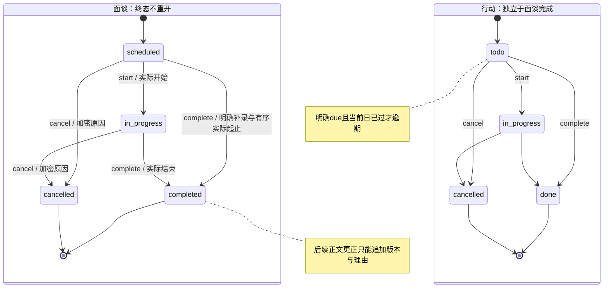

笔记、grant、行动项是独立显式操作；界面分别报告每项结果，不声称多个请求具有一个原子组合事务。单个命令内部业务事实/权限影响/审计不得半写；若前一笔已成功后一笔拒绝，明确呈现已保存项与未保存项，不显示整体完成。

### 权限与验收

F-INT-001唯一验收登记；“受控已验”指合成批准、真实两库/外部I/O/成品界面，不代生产政策。当前可重复证据是对应源码旁永久测试及本表列出的可观察结果。

| 验收 ID | 页面 / 操作 | 合成输入、动作与可观察结果 | 当前覆盖 |
| --- | --- | --- | --- |
| AC-INT-01 | P-INT-01；OP-INT-01/04/06、OP-SEC-05 | S/M/H；只shared账号列表/详情/历史/筛选/导出仅S，无M/H摘要/数量；参与者/作者不扩权 | 双库真实原无权404、独立旧S1授权；最新直读/详情/编码导出无父head或current指针，owner head保持；真实页面仅旧S1/完整三段NDJSON200、同ID、storage0/0，无其他版本/私有/行动；目录上下文404保持 |
| AC-INT-02 | P-INT-01；OP-INT-02/03/05/06 | 过去actual、后来recorded；draft→publish→completed后明确理由/supersedes更正；旧版本不覆盖、不重开 | 两库成品草稿/发布、明确历史补录completed、完成后更正；直接旧S1与真实API重启DTO精确保持；终态/不合法时刻消费者拒绝 |
| AC-INT-03 | P-INT-01；OP-INT-07/08、OP-INT-03 | 过去due todo，面谈complete仍逾期；行动done保留due/源/原文字；private源人工最小化后shared | 双库消费者覆盖无due、当前日与来源批准/隐藏；成品完成面谈后独立行动done200，due仍保留、overdue=false；面谈完成不自动关闭 |
| AC-INT-04 | P-INT-01/P-SEC-01；OP-INT-04/06、OP-SEC-02/03 | 撤旧grant已知历史ID拒；新经理无交接拒；仅一个shared版本不授其他历史/private或父head关联 | R2确切任期当前日不复活；R3真实JSON两库旧/恰好current版本均不泄head/revision/current指针，最新compiled成品直读/详情/导出及原DB重启保持；真实撤NoteR后已知ID404/页面文字历史输出清空；late真实200离页注入不复活 |
| AC-INT-05 | P-INT-01/P-SEC-01；OP-INT-05、OP-SEC-02 | 普通编辑不能改private类别/夹audience或grant；独立source批准后手工最小目标发布，原private/ACL不变、分步结果 | 双库strict字段/类别/来源消费者拒绝；两个production页面实际未批准source403→独立OP-SEC-02→手工shared发布201，source选择不自动复制 |
| AC-INT-06 | P-INT-01；OP-INT-03/05/08 | 两人旧head最多一成功/一冲突；跨owner、终态、无权无副作用；独立命令不误报组合成功 | 两库native HTTPS并发同head3返回201/409；事务/KMS/audit/crossowner/MFA/终态消费者及race绿；界面独立笔记/行动/授权反馈与不确定原key/body确认 |

## 4. F-COMP-001 · 薪资现状、逐次调薪与纠错

### 用户目标

特殊授权人员能准确查看员工在指定日期的薪资条款、每次调薪前后值及原因/审批/生效历史，区分未来调薪、今天现状与待审建议，避免用覆盖一个salary字段丢失历史。

### 流程与输入/输出

1. 建立初始薪酬条款：员工、有效期及唯一`monthly_base_salary`。该组件固定为税前固定月薪（month/monthly/gross），币种仅CNY或JPY且scale0；同一Branch可混用，但每名员工每个有效terms只有一个币种。奖金、浮动、加班、一次性支付及非固定津贴不并入，也不自动年化或推税制。
2. 有提出能力者创建调薪建议，指定拟生效日、基准条款/版本、before/after、原因及必要审批依据。
3. 具备独立审批能力、employee scope和purpose者审阅并批准/拒绝初始条款或调薪建议；批准调薪时核对基准仍有效，冲突不得悄悄改before并继续批准。审批人职责和是否允许自批须由用户确认；确认前默认不允许自批，操作能力仍分离。
4. 现状按查询日从有效、批准记录得出；批准的未来调薪独立显示待生效，不提前改变现状。过去的批准记录形成逐次变更链。
5. 已批准内容不可原地覆盖。纠错采用有授权/审批及理由的 `supersedes`（替代）或 `reversal`（冲销）记录，保留原事件及引用链，重新计算受影响日期的现状。

输入包括CNY/JPY整数条款/调整金额、固定month/monthly/gross口径、有效日期、before/after、原因、基准版本及审批动作；输出是指定日现状、未来计划和历史。换币不属于普通adjustment；未授权人员看不到金额、原因或可推金额比例。

### 金额、状态与错误

- 薪资Money固定为`currency=CNY|JPY`、`scale=0`，API `amount_minor`是只含ASCII数字的规范非负int64十进制字符串，直接表示整人民币元或整日元。UI/API/Excel权威Money输入统一拒绝任何小数点表示（包括`100.0`）、科学记数或符号；不以格式规范化/舍入掩盖输入错误。只有合同允许的exact decimal计算在量化为Money时使用`ROUND_HALF_UP`，禁止JavaScript/数据库浮点。
- 同一Branch可混用CNY/JPY，Branch没有强制默认币种；员工获批terms币种才是事实。不同币种不能相加、排序比较或自动FX；汇率、税社保和年/月换算不在范围。每名员工同一有效terms只有一种币种，越界/缺口径拒绝。
- 建议状态为草稿、待审批、已批准、已拒绝、已撤回。未批准建议不影响现状；批准后的待生效/已生效是按日期计算的结果，不是绕过审批的手动状态。
- 同员工同时间不能存在无法解释的冲突有效条款/调整链。早期补录、追溯纠错或改变未来基准必须核对后续before/after，存在依赖冲突时拒绝并要求明确处理，不能任选“最后一行”。
- 换币只允许显式个人`correction replace`：完整after terms可人工输入另一允许币种的整数金额，不从旧金额或汇率派生。普通adjustment的同币种限制不适用于此例外，但所有受影响后继必须显式替代其before identity/币种，PATCH、submit、approve均重验完整闭包；缺一成员整组拒绝，批准后每个日期仍唯一terms且保留原币种历史。
- 过时基准/并发调薪、无效生效日、错误employee/组织、审批越权、重复批准及修改已批准原内容均拒绝；批准与条款/历史变更保持原子性。

### 年度normal / special调薪批次

批次是跨员工聚合根，不是把多次个人OP-COMP-03循环调用。一个组织每年可有任意多个`normal`和`special`批次，不设数量上限。创建时服务器在同一事务分配不可编辑、永不复用的业务编号：adjustment为`N-{cycle_year}-{sequence}`/`S-{cycle_year}-{sequence}`，correction为`NC-...`/`SC-...`；sequence按集团org＋cycle year＋type＋mode独立递增，最少四位且超过9999自然扩展。同一员工可先后进入任意批次，但后一批submit必须引用当时最新获批compensation basis。

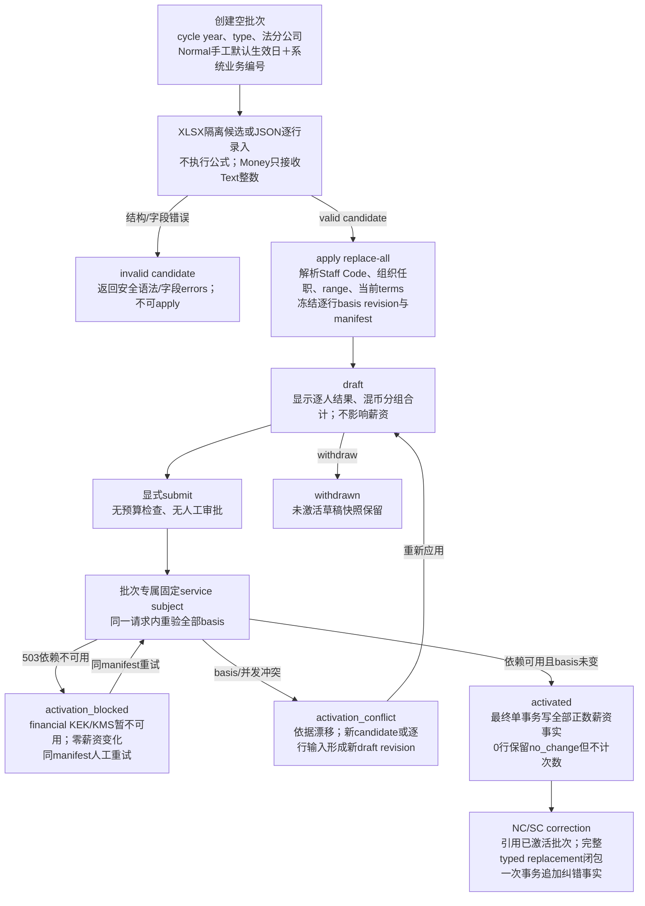

| 用户表头 | 批次字段/派生 | 功能规则 |
| --- | --- | --- |
| 年度绩效考核等级 | normal line `performance_grade` | 不接外部来源；每行手工输入并冻结原值，不自动决定金额 |
| 次年平均调薪幅度 | normal line `average_merit_increase` | 可选受控百分比文本，例如`6%`或`6.0%`；仅参考展示，不参与计算/上下限/校验金额 |
| 部门建议调薪幅度 | normal line `department_suggested_increase` | 可选受控百分比文本；仅参考展示，保留与最终金额差异，不把百分比换算成Money |
| 调薪额度 | line `increase_amount` | 与员工before同币种CNY/JPY、scale0的显式整数且`>=0`；负数/小数/换币拒绝；0记录`no_change`且不生成薪资事实/次数 |
| 调整后月基本工资 | 服务端以scale0整数派生`before_monthly_base + increase_amount` | before/increase/after必须同币种；客户端/Excel值只核对，0时等于before；不得FX |
| 特殊调薪月份 | special line `effective_month` | 手工输入规范`YYYY-MM`并按组织时区月首生效；无追溯期限，但该日期全部employee/org/range/comp依赖必须可解析 |
| 调整前薪资 | 服务端按员工basis派生 | 权威事实为CNY或JPY、scale0、month/monthly/gross；Excel值必须精确一致 |
| 特殊调薪额度 | special line `increase_amount` | 同before币种的scale0整数且`>=0`；负数、小数、换币拒绝，0按`no_change`处理 |
| 调整后薪资 | 服务端派生 | 正数时只改变唯一税前固定`monthly_base_salary`，不改变币种或复制浮动项目；0不复制相同terms |
| 调薪原因 | special line `reason_code`＋加密`reason_text` | 两者必填；code须命中部署时从薪资policy载入的受控目录，文本为1..1000 UTF-8 bytes；不得进入日志、URL或普通审计metadata |

Normal默认生效日由创建者在批次draft手工指定，不存在系统年度默认；special逐员工手工指定月份且没有lookback cutoff。每个special行显示服务端当前日期对应的业务年份Y与Y−1已激活正增量normal/special次数，并返回`count_as_of_date`；行本身追溯到其他年份也不改变这个提示窗口。correction和0增量`no_change`不另加次数；提示只读，不限制继续调整。

已激活批次通过独立`NC-{year}-{sequence}`/`SC-{year}-{sequence}`纠错命令接收1..500个员工及各自完整typed correction members。服务从批次原adjustment event沿当前active薪资链生成模板：首成员保留真实before term引用，后续成员按member key显式串联，并带出每个当前after完整terms；页面允许人工改动但不假造`before_ref:null`或省略后继。每组沿DEV-009既有完整闭包校验：目标/下游依赖不完整、未包含该批次原事件、跨员工、非当前head或无权引用时整批拒绝；单个事务追加全部replacement/reversal薪资事实并保留原批次、原事件及业务编号。纠错不是负数调薪，也不改原批次次数。

批次submit冻结逐行薪资币种/scale0、Staff Code identifier及revision、employment/assignment及revision、Salary Range及revision、当前terms及revision。金额摘要字段唯一命名为`increase_totals_by_currency`：对完整draft按行`increase_amount`checked求和，按currency code稳定排序；出现的币种即使合计为0也保留。不存在grand total、跨币种预算比较或FX。

批次当前**不设budget字段、预算上限或人工审批**。具当前org-scope CompW＋FinR＋financial purpose＋近期MFA者只能通过显式OP-COMP-10 `submit`触发生效；导入、应用candidate、保存draft和页面切换均不生效。每个批次创建独立固定service subject；最终事务以该subject写个人薪资批准事实，不能回退为submitter身份。

financial密钥依赖暂不可用时写入`activation_blocked`且零薪资变化；原manifest可人工重试。Staff Code、组织任职、Salary Range或terms basis漂移时写入`activation_conflict`；重新应用candidate或逐行草稿会形成新revision再提交。≤500行的正增量事实、schedule、批次activation、receipt、audit/outbox在一个最终事务提交，任一失败整批rollback。financial wrapper当前只经同部署本地keyd，不存在外部KMS fallback。

XLSX上传只产生TTL固定24小时的加密、不可变**import candidate**，不修改draft，也不保存原工作簿。Money列只收规范ASCII非负Text整数；numeric、小数点、指数、公式/cached value、日期serial及其他币种拒绝。安全包/XML边界错误直接422；表头/行字段错误形成`invalid` candidate并返回安全errors、不可apply。`valid` candidate响应在当前授权下返回规范解析行供页面应用前逐人预览工号、币种、before/increase/after、生效日/月及原因；预览不含冻结basis且不改变draft。显式应用时才在当前授权和revision下解析员工/组织/range/terms basis并生成完整draft摘要，任一业务错误不替换旧draft。

列表/详情读取要求当前org-scope FinR及每个员工当前可读覆盖；服务在解密前检查全体，并在解密后重新取得会话/授权逐人检查。创建、导入、编辑、submit、withdraw及纠错另须CompW；批次不要求CompApprove。任一员工无权时整批404且不释放部分明细/count/摘要。批次导出尚未纳入DEV-016；仍只能使用现有个人有限导出。

薪资policy默认disabled；启用文件可配置最多50个Special原因code/显示名称，初始未配置即为空。Normal生效日和绩效值由每个draft手工输入；参考率不参与计算；special不设追溯期限；adjustment拒绝负数。API拒绝budget、approver、approval-level、次数上限或lookback cutoff等未知字段。技术上限为500唯一员工、XLSX压缩10MiB、展开50MiB和ZIP entry 10,000；它们不是业务批次数/调薪次数限制。

### 薪酬工作台、个人审批、批次提交与完整纠错组

P-COMP-01 的“指定日现状、未来已批准、提案、批准历史/纠错”分栏分别取 OP-COMP-01 与 OP-COMP-02，不把最新创建行当现状。`record_kind=proposals`只提供可见当前草稿/待审/终态snapshot、proposal revision与基准，供重载/编辑/审批，不计入排程。完整不可变修订另显式`record_kind=proposal_revisions`按所选proposal逐页取得；页面明确当前一页/继续更旧/回到首个页，不把有限页当全史或一次加载所有正文，旧head/权限变化须人工重载。现状有查询日、生效区间和条款来源；批准详情只读，保留批准者/时间、before/after、currency/scale/周期/组成、原因/依赖，不给普通编辑按钮。选定proposal导出仅该当前确切snapshot，不隐含完整修订历史。

同一P-COMP-01新增“年度调薪批次”路由：OP-COMP-06列出/读取业务编号、逐行冻结依据、special Y/Y−1次数和混币摘要；OP-COMP-07创建空批次；OP-COMP-08创建隔离import candidate并返回应用前规范行预览；OP-COMP-09以replace-all应用candidate或JSON逐行草稿；OP-COMP-10执行submit、withdraw及已激活批次纠错，`approve/reject`不是batch action；OP-COMP-11查询及维护有效期Salary Range。页面提供批次创建、Salary Range新增/结束/替换、XLSX候选逐行预览/错误、apply、核对确认、submit及blocked重试/conflict重新导入；activated明细显示原adjustment event，由服务生成含真实before引用和全部active后继的完整typed correction模板，人工修改后原子提交；个人审批按钮仍只属于OP-COMP-05。

OP-COMP-03 表单显式选 `initial / adjustment / correction`。initial before为null，整个拟定过去/未来链不能有未被替代/撤销的既有初始条款；合法完整reverse排除整链后可重新建立initial，原批准历史不删，不能只看today无工资就重复initial。adjustment引用确切基准事件/条款版本及员工aggregate revision，after组成/口径完整，不自动把百分比换薪资。草稿OP-COMP-04可改字段；提交/批准/拒绝/撤回OP-COMP-05独立确认。

correction 是**一个员工的一组显式替代或撤销事实**：表单逐行列原已批准事件 ID、原 before/after/日期、`replace / reverse`、拟替代 before/after/日期或撤销后剩余条款、理由、每个新依赖引用及组 revision。reverse 追加批准撤销标记，将目标排除有效链，不删除原事件、不写负工资；若撤销全部合法初始链，指定日现状明确“未建立有效条款”，不能留下无合法初始的后继调整。显示受影响日期窗口及所有下游依赖；用户须逐项明确包含受影响的后续替代，原批准/审批证据只读。只更早期金额却未修正依赖 before 的组整体拒绝，不自动重写后续金额或补入依赖；撤销标记不当“最新一行工资”覆盖剩余条款。

DEV-009既有个人薪资机制保持；DES-006将薪资policy固定为CNY/JPY→scale0、month/monthly/gross及ROUND_HALF_UP，其他薪资币种/scale/unit/frequency/tax basis/rounding拒绝。Bonus币种/scale仍未批准，不能套用薪资allowlist。exact对象授权、纠错、导出和审计边界保持不变。

| 源 | 动作 / OP | 前置 | 目标 / 不可变事实 | 拒绝 |
| --- | --- | --- | --- | --- |
| 无提案 | create / OP-COMP-03 | 财务读取＋提出权、明确口径/基准、员工 revision | draft，未改变任何有效条款 | 缺 currency/scale、越界、无权或错误员工 |
| draft | edit / OP-COMP-04 | 提出权、proposal revision | 新 draft revision | submitted 或终态编辑、旧版覆盖 |
| draft | submit / OP-COMP-05 | 必填/组结构完整、版本有效 | submitted；现状不变 | 缺理由/依赖、旧版、无提交权 |
| draft / submitted | withdraw / OP-COMP-05 | 撤回权及当前 revision | withdrawn，保留提案事实 | approved/rejected/withdrawn 再撤 |
| submitted | approve / OP-COMP-05 | 独立审批、财务读 grant/purpose/MFA、未自批、最新员工基准、完整纠错链 | approved；原子追加审批/条款事件/排程投影/审计与来源失效 | 基准冲突、重复批准、初始已存在、依赖缺失或任何窗口条款冲突 |
| submitted | reject / OP-COMP-05 | 审批权、安全理由/版本 | rejected，不改现状 | 草稿/终态直接拒绝或越权 |
| approved | 日期查询 / OP-COMP-01 | 当前读 grant，明确 as_of | 显示 future/effective/ended 投影；批准记录始终 approved | 不允许手动“生效”、patch 金额或删除批准 |
| approved 原事件集合 | 新 correction 经 submit/approve | 当前完整替代组、原引用与下游更新明确 | 新 approved 纠错，原事件保留，投影可重建 | 不完整组原子拒绝；rejected/withdrawn 纠错不影响投影 |
| 无批次 | create / OP-COMP-07 | org-scope CompW＋FinR＋MFA、启用薪资policy、cycle year/type/legal entity；normal手工默认日 | 服务器事务分配`N/S-{year}-{seq}`，创建批次专属service subject，返回空draft R1；现状不变 | policy缺失、非法类型/年份/实体/日期、无权；调用者不可指定/修改编号 |
| draft / activation_conflict | upload / OP-COMP-08；apply/edit / OP-COMP-09 | current R、完整员工financial scope；XLSX有界解析或JSON逐行 | upload只建加密candidate；apply/edit在当前basis上replace-all并追加draft revision/manifest；原薪资不变 | 敌意文件、负increase、special原因缺失、重复/无权员工、stale candidate/R；不部分应用 |
| draft | submit / OP-COMP-10 | CompW＋FinR＋MFA；非空；manifest匹配；全部薪资/组织/range依赖当前；无budget/approve步骤 | 固定service subject重验并在单Tx写全部正数事实、activation、receipt/audit；0行仅保留结果 | 自动submit、budget/approver字段、approve/reject action、任一错误/过时依赖；不得部分生效 |
| activation_blocked | retry submit / OP-COMP-10 | 原R/manifest未变、同一固定service恢复、当前人类授权仍有效 | 重走全部重验；成功activated，失败仍零薪资事实 | 不可换service或跳过basis检查 |
| activation_conflict | apply/edit / OP-COMP-09 | 当前CompW＋FinR、新candidate或完整JSON行 | 新draft revision和新manifest；旧冲突状态/history保留 | 直接复用旧manifest、自动覆盖 |
| activated | correction / OP-COMP-10 | `NC/SC`纠错含每员工完整DEV-009 typed member闭包 | 一次原子追加replacement/reversal事实并登记correction；原批次、事件、编号及次数保留 | patch/delete、自动补链/分次提交、跨owner或不完整依赖 |

### 权限与验收

以下为 F-COMP-001 唯一验收登记；金额示例遵循DES-006薪资CNY/JPY scale0政策，不代表bonus或Compa Ratio公式/精度已批准。

| 验收 ID | 页面 / 操作 | 合成输入、动作与可观察结果 |
| --- | --- | --- |
| AC-COMP-01 | P-COMP-01/P-ORG-03；OP-COMP-01/02、OP-SEC-05 | 特殊读者可见获准员工的条款/原因/完整链，普通/虚线经理、一般 HR、DBA、AI/员工本人无独立 grant 被拒；读者无审批/导出不能批/导 |
| AC-COMP-02 | P-COMP-01；OP-COMP-03/04/05、OP-COMP-01 | initial 100 的 draft/submitted 时无有效薪资；独立人批准后有效日有100。未来 2027-01-01 调为120且批准，2026-12-31仍100、当天120，早期 as_of 仍旧条款；未批准/拒绝/撤回不改变现状 |
| AC-COMP-03 | P-COMP-01；OP-COMP-02/03/04/05 | 同币种E0/E1/E2纠错缺下游E2时整组拒绝，完整替代后历史保留。另以CNY terms显式个人correction换为人工输入JPY整数：create/PATCH/submit/approve均允许该replace例外但禁止FX；若后继仍引用CNY before且未入组则整组拒绝，完整组批准后各日期唯一terms且CNY原史不变 |
| AC-COMP-04 | P-COMP-01；OP-COMP-03/04/05、OP-COMP-01/02 | 两审批客户端同 aggregate basis，最多符合最新基准的一项批准成功；另一冲突无新增事件。patch approved、重复批准、自批拒绝，原事实/现状不变；纠错 rejected/withdrawn 不影响排程 |
| AC-COMP-05 | P-COMP-01；OP-COMP-03/01 | API CNY/JPY `amount_minor="9007199254740993"`、scale0精确往返；UI/API Money输入`100.0`/`100.5`/指数/符号、scale1、USD、溢出、非gross/monthly拒绝。受控exact量化向量：100.49→100、100.50→101、100.51→101、0.5→1、9007199254740993.5→9007199254740994；量化后int64溢出拒绝且全程不经float |
| AC-COMP-06 | P-COMP-01；OP-COMP-02/03/05 | 追溯纠错各日期唯一；reverse保留原事实，合法整链reverse后可重新initial。个人换币只可完整replace correction，不自动FX；缺下游依赖/无效日期/组织引用整组拒绝不半写 |
| AC-COMP-07 | P-COMP-01；OP-COMP-06..11 | normal draft可同时含CNY650、JPY1000、CNY零行，完整摘要按币种稳定分组且0行不生成薪资事实；负数、小数、after不等于before＋increase、分组int64溢出均在替换draft前拒绝，不改旧draft/薪资。无grand total/FX |
| AC-COMP-08 | P-COMP-01；OP-COMP-06..10、OP-COMP-02 | 当前业务日为2026年时，Special追溯至2025月仍显示`count_as_of_date`及2026/2025已激活正增量normal/special次数；0/correction不计。历史月只要basis/任职完整即无lookback拒绝；受控reason code＋加密text必填；继续增加special不受限 |
| AC-COMP-09 | P-COMP-01；OP-COMP-09/10/01/02 | 已激活N/S批次可用NC/SC编号提交完整typed correction members；缺下游、越权或过时整组拒绝；完整组在单事务追加替代事实，保留原batch/event/code/count。一般basis变化使submit整批conflict且零部分事实 |
| AC-COMP-10 | P-COMP-01；OP-COMP-08/09 | Money Text lexeme精确；numeric/公式/`100.0`等拒绝。结构/行字段错误可保存invalid candidate＋errors且不能apply；valid candidate不改draft，只有显式apply后才返回完整draft摘要；安全包/XML边界直接422。24小时过期后不能应用 |
| AC-COMP-11 | P-COMP-01；OP-COMP-06..10 | submit仅接受当前revision＋manifest；固定service subject执行，正数行全写或全不写，0行不写term/event；financial依赖503进入blocked并可同manifest重试，basis冲突进入conflict并需新draft revision |
| AC-COMP-12 | P-COMP-01；OP-COMP-06..11 | 同完整维度/币种range有效期重叠拒绝；同Branch分别有CNY/JPY range合法；min/mid/max整数及顺序错误拒绝。无/多匹配时batch basis拒绝；Compa Ratio不计算、不返回。全批任一员工授权不足在解密前整体404，解密后再验授权 |

## 5. F-BONUS-001 · 奖金、支付记录与敏感扩展

### 用户目标

授权人员分别管理奖金目标、批准奖励和实际支付事实，以及确有必要的薪酬扩展信息，不将“计划奖金”写成已发放收入，也不通过扩展字段绕过薪酬保密。

### 奖金模块关系

下图同时是后续开发必须维护的奖金功能索引。目标、奖励、批准、支付与扩展是独立对象；共享员工引用不产生隐式授权或状态转换。

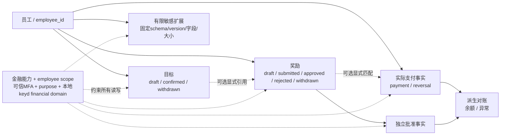

### 奖金数据流向

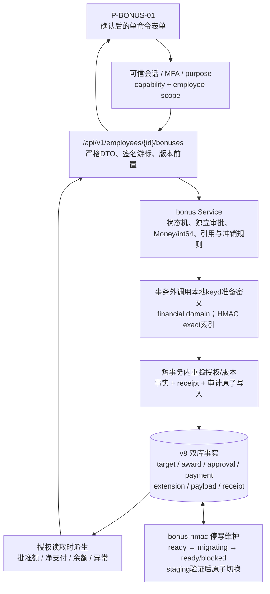

### 流程与输入/输出

1. 可记录奖金目标/计划及其期间、口径和版本；这是目标，不是已批准债项，也不能标paid。
2. 具备提出/审批能力者建立和批准bonus award，记录员工、奖项类别、适用期间、币种/金额、原因和审批事实。目标与award可关联但不得混为一条无状态金额。
3. 有支付记录维护能力者录入真实payment事实：员工、实际金额/币种、支付日期、最小必要凭证引用及award关联（未匹配时明确标识）；系统记录事实，**不连接银行执行付款**，也不因实际支付与批准不符而隐去已发生事实。
4. 分开输出批准额和实际支付/冲销记录；已匹配且同币种时计算未支付余额，推导未支付/部分支付/已支付。超额、未匹配或币种不符显示异常/待核对，不伪造已合法批准或直接换汇抵销。纠正用关联记录保留原事实。
5. 薪酬扩展只接收已允许的schema/版本、字段和大小，按同样敏感类别/权限存取；新增扩展含义需更新完整规范/参考，不是任意JSON数据洞。

输入为目标/award/payment/扩展、员工、期间、金额口径、审批和版本；输出仅为授权scope内分离的目标、批准、支付事实、余额及版本化扩展。未确认税制/奖金计划不得由AI或系统自行决定。

### 行为、状态与错误

- 目标可草稿/确认/撤回；award可草稿/待审批/已批准/已拒绝/已撤回，已批准撤销通过明确纠正流程保留历史；payment事实及其冲销不改写审批事实。
- 正常支付关联已批准award并按相同币种/scale核对；真实未匹配、超额、不同币种或关联尚未批准award的支付仍记录且标异常，不成为批准依据。已知关联必须同组织/员工且有权引用；不存在/越权/跨员工关联拒绝，可用明确unmatched记录真实事实。负值须明确为合法冲销而非普通支付；重复提交同一幂等事实不生成第二条，不能把导入异常误报成“没有支付”。
- Bonus只共享Money共同wire、精确整数/exact decimal机制、无隐式FX、同币种/scale核对及保密边界；允许币种、scale、计划口径与量化policy由独立Bonus policy决定，不继承F-COMP-001的CNY/JPY或固定月薪限制。下列USD/EUR仅是受控合成policy fixture，不代表生产币种获批；目标、批准和实际支付总额分别展示。
- schema未知、版本不支持、字段未允许/类型错误/超size的扩展拒绝；扩展里的金额、原因或身份信息不能出现在无权响应/日志/AI输入。

### 奖金表单、异常与有限扩展

P-BONUS-01 按员工、期间、状态分别加载目标、奖励与支付事实，不以合计排序推断无权员工奖金。默认“全部”是单次有界对账视图；任一列超本次limit时明确要求选择记录类型。选择targets/awards/payments/extensions后按数据库keyset逐页访问该类完整immutable历史，不加载或受阻于无关类别；typed历史页不以局部页重算跨页余额/异常，返回原事实，余额/异常仍来自有界对账视图。目标 OP-BONUS-02 填期间/口径/目标金额及 draft 或显式 confirm（OP-BONUS-07）；奖励 OP-BONUS-03 填员工、类别、期间、明确 Money、原因、可选目标引用，draft 可 OP-BONUS-04 修改，OP-BONUS-05 提交/批准。已批准奖励纠错创建新的 correction award 明确引用原批准，走同审批流程，不能 patch 原事实。

支付 OP-BONUS-06 填 kind=`payment / reversal`、实际正 Money、支付日、最小凭证引用、业务幂等键与可选 award ID；reversal 必须引用原 payment，金额为正、汇总扣除，不录普通负支付。关联只能明确选择同 employee/org 且可见的已知奖励，不能按金额/日期自动配对；关联尚未批准、已拒绝/撤回奖励仍保存真实支付，并标 `unapproved_award`，不当作批准额。异常事实还可为 `unmatched / currency_mismatch / overpaid / payment_before_approval`；日期保留以免后补批准伪装当时已批准。误关联/错误币种等更正先对原事实合法冲销，再录明确修正支付，原事实与关联保留。

| 源 | 动作 / OP | 前置 | 目标 / 不可变事实 | 拒绝 |
| --- | --- | --- | --- | --- |
| 无目标 | create / OP-BONUS-02 | 目标维护＋财务读权、期间/Money明确 | draft；目标不产生 award/payment | 无效金额/期间或越权 |
| draft | confirm / OP-BONUS-07 | 目标确认能力、revision | confirmed；不可推为 approved award | 旧版、状态不允许 |
| draft / confirmed | withdraw / OP-BONUS-07 | 目标撤回权、revision | withdrawn，确认事实保留 | withdrawn 重复转换 |
| 无奖励 / draft | create / edit / OP-BONUS-03 / OP-BONUS-04 | 奖励提出＋财务读权、草稿版本 | draft；目标可引用但不混用 | 已批准编辑、错误员工/目标、旧版 |
| draft | submit / withdraw / OP-BONUS-05 | 提出/撤回权与当前版本 | submitted / withdrawn，不新增支付 | 无效输入/状态 |
| submitted | approve / reject / withdraw / OP-BONUS-05 | 分离审批/撤回权、基准、purpose/MFA；默认不自批 | approved / rejected / withdrawn，approved 只读 | 越权、旧版/重复批准、自批 |
| approved 原奖励 | 新 correction award＋审批 | 显式原批准引用/更正理由和依赖检查 | 新批准纠正事实，原批准保留 | 普通撤回/patch 原奖励 |
| 无支付 | payment / OP-BONUS-06 | 支付维护＋财务读权、真实事实、幂等键；已知关联须同组织/员工且有权引用 | 不可变支付；只有有效批准且同币种匹配才派生正常余额，未批准关联保留并标异常 | 无效 Money/日期/身份、不存在/越权/其他员工 award；不因尚未批准拒录真实支付 |
| 原 payment | reversal / OP-BONUS-06 | 同员工、同币种/scale、原引用、累计冲销不超原金额 | 不可变正额冲销，净支付扣除，原支付保留 | 冲销不存在对象/冲销另一冲销、超冲销、改原 payment |
| 同幂等键已存在 | 重提 / OP-BONUS-06 | 同授权及同业务载荷 | 返回原事实不新增 | 同键不同载荷冲突，不替换原事实 |

正常同币种余额＝有效批准额－明确匹配支付净额；`unpaid / partially_paid / paid`是核对投影而非手动状态。完整replacement纠错仅在新奖励批准后替代原奖励有效额，每条显式批准替代链只有唯一尾项计入；草稿/拒绝/撤回不替代，不能重复纠正同一已被替代旧项造成分叉。原批准与payment/reversal关联保留，原奖励及后继明确关联的净支付沿该链各归集一次，不丢旧支付、不按金额/日期自动配对。原100已付40被完整替代120后显示approved120/paid40/balance80；纠错不新增支付。净额超批准标overpaid；替代后币种/scale不符的原支付保留且标异常，不抵新币种余额，无关/未匹配支付不归入。原异常及其后续核对/解决事实可追溯。

本 task 建议最初仅启用敏感扩展 **`compensation_memo/v1`**：字符串 `memo` 最多2000字符、可选字符串 `source_reference` 最多200字符，UTF-8载荷最多16KiB；拒绝未知字段/未知版本，OP-BONUS-08 每次追加版本。扩展同 F 权限、密文、审计与历史，不支持任意 JSON；memo 不参与金额/审批/税计算。金额/比例/补贴组成使用已定义核心条款/组件，新增扩展 schema 必须真实变更规范与行为契约后才启用。

### 权限与验收

以下为 F-BONUS-001 唯一验收登记。

| 验收 ID | 页面 / 操作 | 合成输入、动作与可观察结果 |
| --- | --- | --- |
| AC-BONUS-01 | P-BONUS-01；OP-BONUS-01/02/03/04/05/07 | target100确认后approved/paid仍0；award100独立批准后paid仍0，无银行调用。已付40后新correction完整替代120，待审/拒绝时原approved100/paid40/balance60不变，批准后仅approved120/paid40/balance80，原批准/payment关联保留；再替代及冲销不重复计数，纠正已替代旧项/旧B拒绝无半写。改币种不隐式FX，原支付仍可见并标异常；目标撤回、奖励拒绝/撤回不伪造支付 |
| AC-BONUS-02 | P-BONUS-01；OP-BONUS-06/01 | 同币种 approved 100、真实支付40→approved100/paid40/balance60/partially_paid；后支付60→paid100/balance0/paid；正额冲销20后paid80/balance20，原40/60/20记录保留 |
| AC-BONUS-03 | P-BONUS-01；OP-BONUS-06/01 | approved100 USD/scale2，真实支付140同币种写入且标overpaid40；真实 EUR40 关联同award写入 currency_mismatch，不抵 USD100 余额；无award支付30写入 unmatched，不增加批准额、不隐藏“未支付” |
| AC-BONUS-04 | P-BONUS-01；OP-BONUS-06 | 同业务键/同事实重复返回原ID，异事实冲突。HMAC受控停写换键/完整重建后同键仍原ID，维护中/缺必需key/旧备份与index版本不符拒写，不误记第二付款；恢复实际验证依技术规范。未批准/已撤回award支付保留unapproved_award、批准额0；早于后批日期保留payment_before_approval。跨员工/越权关联、负支付、冲销另一冲销/累计超额拒绝，原事实不改；错误匹配经冲销＋新事实纠正 |
| AC-BONUS-05 | P-BONUS-01/P-SEC-01；OP-BONUS-02/03/05/06/07/08、OP-COMP-03、OP-SEC-05 | 普通经理/AI无奖金/扩展读权；目标维护、奖励提出、奖励审批、支付维护、扩展维护及exporter独立。同scope/read/purpose/MFA下仅bonus.propose不能建/确认/撤回目标；仅bonus.target.manage不能提出award；仅compensation.propose不能写扩展，仅compensation.extension.manage不能提出调薪；各自独立授权正常操作可用，任缺scope/purpose/MFA仍拒绝 |
| AC-BONUS-06 | P-BONUS-01；OP-BONUS-08/01 | memo新版能授权回读历史且密文存储；2001字符、超16KiB、未知字段/schema/version、旧aggregate revision/无权拒绝，无部分版本/award/payment写入；扩展正文不出日志/AI，双库语义一致 |

## 6. F-AI-001 · 定期面谈跟进状态与人审
**当前DEV-012 R6b边界**：OP-AI-01/02确定规则与P-AI-01来自R6a；R6b追加人工最小结构输入、独立批准、standing policy、API内持久调度、独立mTLS worker/provider adapter、queue/lease/fence/receipt、结果密文与人审转换。真实provider/model/region/保留/跨境许可及人工质量标准未提供，故生产外传仍禁用；受控TLS fixture不能替代该批准。

### 用户目标

授权管理者定期了解面谈是否已安排/发生、记录是否完整、行动项是否逾期及明确表达的支持需求，减少遗漏；AI提供有来源的辅助草稿，不评价员工价值或代替管理决策。

### 流程与输入/输出

1. 由获授权者配置适用员工/department、统计窗口、面谈周期/截止日、时区及purpose；AI模式明确disabled、manual_approved或periodic_structured_v1。周期需批准，不擅设“每月一次”；周期自动模式另需有限结构策略及受限service授权。
2. 确定规则计算“未安排/已安排未发生/已完成”、必要字段完整度、到期/逾期及行动项完成情况。未知/缺失输入标未确定，不能自动归因员工不配合或绩效不佳。
3. 经批准的最小化共享片段可提供给AI生成带来源版本的草稿；优先使用结构化、经授权人员确认可用于该目的的输入。先检查目的、scope、对象grant和外传政策，排除工资/私有/HR保密及自由文本中的不必要敏感内容；无法可靠最小化的片段不外传。
4. 持久调度扫描到期且未暂停的窗口，在当前权限/策略仍有效时无需每窗口点击请求即可生成批准的有限结构输入并原子排队；重启/多实例重复扫描不重复当前generation。权限/外传策略不足则显示blocked及安全原因，不偷偷退回手动伪称自动完成。AI调用在业务写事务外执行；job保存窗口、请求主体/策略/输入版本、状态和lease，worker中断不误标成功。
5. 人类审核者核对引用、事实和权限，可修改/批准发布或丢弃；未经审核的草稿明确标记不作为正式结论。
6. 输入版本、权限、来源删除/撤回或目的变化使派生结果失效；重新生成及重新人审后才能作为当前结果。读取结果时也检查实时授权。

输入仅为获批准的最小事实/片段、窗口、来源版本和目的；输出为确定规则状态与单独标识的AI草稿/人审结果、来源、时间、局限。受限worker不拥有salary KEK，不获取模型DB/HTTP/密钥tool credentials；具体身份与密钥隔离见技术规范。这里不承诺同进程权限分层等于内存隔离。

### 状态、禁止行为与错误

- 两层状态严格分开：`assessment_job` 为 queued/leased/completed/failed/cancelled；`assessment_result` 为 draft/published/discarded/invalidated。job completed 只代表有被接受的生成结果，不等于人审发布。UI明确区分未运行、失败、待人审及没有有效当前结果，不能把失败显示成“员工状态良好”。
- 确定事实与AI建议分栏；引用不匹配/缺依据的草稿不可直接发布。AI输出不作为事实或审批依据自动写回薪酬/人事状态。
- 明确禁止员工评分、排名、绩效/忠诚/心理或健康推断，以及自动调薪、雇佣、解雇等重大决定；不从“缺记录”推断员工表现。
- 派生结果ACL不得宽于所有输入读者集合的交集，并受purpose限制；如果交集不能支持目标读者，缩减授权输入或不生成，不能扩大读者“方便展示”。
- 外传政策未批准、最小化失败、无权来源、provider失败、lease/版本失效、输出不合约均留下明确未完成/失败/过期状态，不绕过权限、不发布猜测。失败排查日志不记录模型prompt或敏感正文。

### 规则事实、最小输入与人审工作台

P-AI-01 的 OP-AI-01 配置表单包括明确 cadence、窗口/截止规则、IANA timezone、暂停、生效政策 revision、purpose和AI模式；不预填月度/默认时区。当地半开pause与窗口有任意交集，或覆盖该窗当地due日期时，整窗显示paused且不产伪逾期。保存响应丢失等结果不确定时保留原employee/body/idempotency key，只允许明确原样重放。R6b的`periodic_structured_v1`只有在standing policy同时具独立service主体、audience、有限模板、有效期与已配置provider policy时才成为ready；缺任一项明确blocked，不静默退回人工。OP-AI-02继续按窗口显示确定事实和coverage；规则状态不依赖模型。页面另提供proposed输入请求、独立批准、持久任务和draft人审，不展示worker token/provider secret。

OP-AI-03 请求当前窗口的有限结构snapshot，只携带`window_id`；服务端按当前授权构造窗口、计划/实际计数、完整度与行动due/status，生成`proposed`输入和来源digest。请求端不能传自由正文、姓名、工资/健康或自行拼接source ID，因此这些字段不会穿过provider边界；请求能力本身不批准外传。

批准输入是独立OP-AI-04：另一具`assessment.input.approve`和当前read的主体显式提交`input_id`、有限`provider_policy_id`与`audience`。服务端拒绝requester自批，并原子将input从proposed转approved及创建queued job；批准前不允许worker领取。generation绑定请求/服务主体、subject/auth epoch及持久source epoch；source/grant INSERT/UPDATE同Tx递增epoch并失效旧对象，input创建最终Tx按subject→employee guard重验session/grant/epoch，故变化先后两种顺序都不能留下陈旧可派发input。非invalidated input partial唯一，其中consumed代表有效draft/published；queued/leased job另作active去重。employee/object grant精确员工；department grant按当前canonical assignment定位受影响员工，不能可靠缩窄时同事务保守失效本org相关input/job/result；org grant直接按本org处理，不存在team分支。API与worker另共同核对受保护provider approval artifact（精确policy/audience/HTTPS endpoint/期限）并动态拒绝过期；内部mTLS证书不装入provider transport。仓库无真实artifact，生产禁用。

周期模板v1仅允许窗口/截止、面谈计划及实际计数/状态/补录标记、行动项due/status这些结构事实及窗口版本引用；不读取姓名、职位、owner名称、笔记/行动正文、支持需求自由文本、工资/健康。API内scheduler使用`last_scanned_at`未扫/最旧优先轮转due窗口；无standing也持久记录`automation_not_enabled`，已有generation重扫仍推进heartbeat，超过100窗不被固定旧批次饿死。具standing时以配置service身份和有效策略，以稳定generation原子创建approved input/job。任何周期结果仍为draft，逐份人审后才published。

OP-AI-08 的详情同时展示窗口、源 revision/digest、生成时间、可用的 provider/model/prompt/schema/policy 版本、job 与 result 状态、限制说明和引用定位；只返回当前有权来源交集内的文本。人审核对每条结论与来源，可丢弃，或发布经编辑正文/来源映射：服务端解密当前获准revision并只允许其精确citation集合的子集，保留原模型 draft，新增 human revision 和审计，不覆盖模型证据。新增/改动来源必须形成新输入 generation 再审，不能夹带未批准内容。

| 对象 / 源 | 动作 / OP | 前置 | 目标 / 不可变事实 | 拒绝/失效 |
| --- | --- | --- | --- | --- |
| 无 input | 请求 / OP-AI-03 | 窗口配置、来源读权/用途；不等同外传批准 | proposed input；保存来源版本/digest，未排队 | 未配置/无权拒绝；request能力不能批准自己的输入 |
| proposed input | 独立批准 / OP-AI-04 | input.approve、当前read/MFA、非requester、当前provider approval | approved input＋queued job原子创建 | 过期/失效/自批/未准provider拒绝 |
| job queued | claim / OP-AI-05 | 受限worker mTLS身份、当前来源/目的仍有效 | leased，attempt与lease fence；仅获批准最小DTO；无job返回`200 {"job":null}` | 普通用户、过时来源/撤权不能领取 |
| job leased | heartbeat/fail / OP-AI-06 | 同一未过期fence、当前worker/来源资格 | leased受限续期，或failed/重新排队 | 旧token/超时/被撤权不可复活 |
| job leased | result / OP-AI-07 | 当前未过期fence、来源generation/digest、输出schema/引用正确 | job completed＋result draft原子接受一次 | 过时lease、来源改版/撤权、伪引用不得写入有效结果 |
| job queued / leased | 来源/授权失效的内部cancel | 来源写事务同Tx失效；不是公开或worker OP | cancelled，旧worker不能完成 | completed/终态不伪改原生成事实 |
| job leased已过期 | 受限worker恢复领取 / OP-AI-05 | attempt上限、重新校验来源 | 新fence leased或明确failed，原attempt仍可追溯 | 旧结果/heartbeat无效 |
| result draft | edit/publish/discard / OP-AI-08 | 人审能力＋全部当前来源读权/purpose、来源版本未变、引用/编辑核验、revision | append human revision、published或discarded；不改人事/财务状态 | 无来源支持/过时来源/撤权/重复终态均拒绝 |
| result draft / published | 来源或ACL/purpose变化 | 来源改变与业务写入同事务处理失效；读取再验 | invalidated，无有效当前文本；新生成须重新人审 | 不靠重新grant自动复活旧结果 |

内部OP-AI-05、OP-AI-06、OP-AI-07仅供独立受限worker；OP-AI-08只供获准的人类结果读取/编辑/发布/丢弃。worker无直接数据库/KEK访问或任意网络工具。承诺每个当前input generation最多一个接受结果/有效发布，不承诺provider调用exactly-once；过期重领可能已发生重复外部调用但不得重复有效结论。

### 权限与验收

以下为 F-AI-001 唯一验收登记。

| 验收 ID | 页面 / 操作 | 合成输入、动作与可观察结果 |
| --- | --- | --- |
| AC-AI-01 | P-AI-01/P-ORG-03；OP-AI-01/02 | 合成已确认窗口截止2026-09-30，未发生面谈与到期todo独立显示；面谈完成后行动仍逾期，AI关闭时事实不变。缺周期/实际日期/必要正文显示unconfigured/unknown/完整度不足；范围不足为partial_access，不把无权记录判没有或员工不佳 |
| AC-AI-02 | P-AI-01；OP-AI-03/04/07 | 结构输入严格不接受工资/健康/正文/多余PII；只有request无input.approve者只能生成proposed，且requester不能批准自己的输入。独立批准也不替代生产provider许可；批准前worker不能领取 |
| AC-AI-03 | P-AI-01；OP-AI-07/08 | job completed只产生密文draft，不显示正式结论；只有assessment.read而无assessment.publish的主体直接POST edit须拒绝且不追加revision；具publish能力者才可沿精确窗口引用编辑append、发布或丢弃，模型草稿/human revision可追溯，无薪资/就业状态副作用 |
| AC-AI-04 | P-AI-01/P-SEC-01；OP-AI-08、OP-INT-05、OP-SEC-03 | 源面谈/行动/笔记或employee grant改变时，同事务把旧proposed/approved/consumed input及result invalidated、queued/leased job cancelled；撤销/变更Department D1 grant时按canonical assignment失效D1员工，无法可靠收窄则保守失效本org相关对象且不得遗漏。result正文释放及human edit/publish/discard最终保存均以subject/employee guard短Tx重验当前授权和result/source状态并审计，与撤权/源变线性化；旧token/result ID不能绕过，恢复grant不自动复活 |
| AC-AI-05 | P-AI-01；OP-AI-05/06/07/08 | worker A旧token/fence heartbeat/result拒绝；claim相同key稳定重放同lease，accepted result相同key稳定回原result；一个generation唯一job/result。重复provider调用不冒充exactly-once |
| AC-AI-06 | P-AI-01；OP-AI-05/06/07 | provider超时/拒绝/无效输出进入有限失败或重新排队；claim维护在同一Tx先把deadline已过queued的approved input转invalidated，再把job转failed/`deadline_exceeded`，无可领取job时仍提交维护后返回`200 {"job":null}`，故input/job均不永久占active generation；completed但draft仍待人审，失败不与规则正常混淆 |
| AC-AI-07 | P-AI-01；OP-AI-05/07、OP-COMP-01 | 独立worker无DB/KEK/cookie/任意工具，仅可访问配置API与单一HTTPS provider；周期输入无自由文本。输出含评分、排名、绩效/忠诚/心理、mental health/health diagnosis、工资薪酬或解雇语义的保守关键词拒绝，无自动人事/财务写入 |
| AC-AI-08 | P-AI-01/P-SEC-01；OP-AI-01/02/05/06/07/08、OP-SEC-03 | due且未暂停窗口按未扫/最旧heartbeat轮转，standing/service/provider当前有效时API内30秒scanner无需人工trigger创建一个approved结构输入/queued job；重启/双扫描同generation不重复，超过100窗不饥饿。缺standing也持久blocked heartbeat；过期/撤权blocked或cancelled；worker完成仍draft，须human publish |

## 7. F-SEC-001 · 特殊授权、敏感加密、审计与恢复

### 用户目标

只有满足明确特殊权限的人员能够查看敏感内容；复制数据库/备份不能直接读到薪资或面谈正文，授权变化可撤回，关键动作可追溯，并能在合法恢复中恢复数据及密钥而不恢复过时权限。

### 流程与输入/输出

1. 敏感数据包括人员PII、薪酬/奖金/敏感扩展、面谈正文/修订和AI产物；Go在写库前加密，数据库只存其密文与所需格式/key metadata。具体加密结构、AAD、用途隔离及密钥轮换详见技术规范，不在功能文档另维护一套算法说明。
2. 读取/提出/审批/导出请求分别进行当前对象授权；只有满足role/scope/category/grant/purpose及必要MFA条件后才允许解密和返回对应内容。
DEV-022不改变员工、调薪、奖金或AI业务状态机；它替换这些模块调用长期MAC的方式及可重建投影。后续开发必须同步维护下图与技术规范中的维护顺序。
所有持久MAC事实都保存exact key ID/version。Staff Code、bonus payment、OIDC identity与local username有受控全量重建入口；CSRF换键先撤旧session。command receipt、assessment generation及password pepper尚无可证明完整的依赖清零/重建入口，系统明确拒绝其generic stage/activate，而不是在换键后接受重复命令、重复generation或不可验证credential。

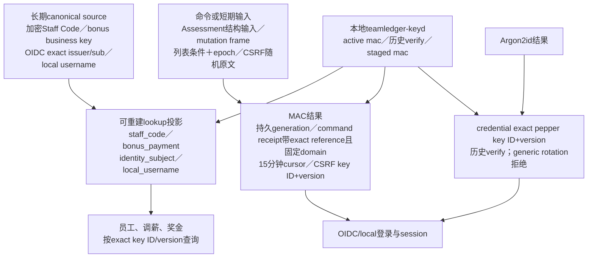

3. 特殊授权有批准、范围、目的、有效/撤销状态，权限变更、敏感读取/修改/导出及授权拒绝按最小必要信息审计；审计不得记录工资数值、面谈正文或模型prompt。
4. 独立部署使用本地`teamledger-keyd`：API授权后通过Unix socket请求有限wrap/unwrap/rewrap/mac/verify；API不能读取root/keyring。CSPRNG RAW32 root解锁versioned keyring，包装/MAC/backup domain按用途和版本分离。
5. root、keyring和持久lock与DB/DB backup分开；缺文件/锁、owner/mode/长度、认证、material generation或历史依赖时敏感能力关闭。
6. staged和activated generation各有独立验证artifact；A2、keyd active map与DB ack一致后才写。恢复旧包装active先转decrypt-only。
7. 本地文件方案支持无人值守启动且阻止API UID直接读取长期key；但获准API进程被攻陷后可通过窄接口取得其允许domain明文。方案不抵御host root、离线副本持有人或该授权调用方，不把keyd冒充业务授权边界。
8. 部署必须选择且只能选择`local`或`oidc`身份模式；首次bootstrap后模式固定入库，配置不符不ready。切换是显式维护动作，会撤销全部会话并审计；登录失败不尝试另一模式。
9. `local`模式无公开注册：fresh空库由maintenance profile一次性创建唯一集团、首个active subject/account及固定`bootstrap_policy.v1`最小组织/PII维护权；输入不能选择金融、面谈、审计、导出或grant管理权。其后维护者只把唯一username绑定既有active subject；后续subject创建本身不授职责。登录错误、未知或停用账号给相同提示并指数延迟；密码更改/重置/停用撤销该主体全部会话。正常登录只建立会话，不创建角色、grant或员工绑定。
10. `local`模式当前没有MFA/step-up，所有要求MFA的授权管理、敏感导出等操作保持`MFA_REQUIRED`不可用；不得用再次输入密码或bootstrap身份冒充第二因素。DEV-030已批准由TeamLedger独立完成的TOTP＋一次性恢复码，但在实际部署v12 source/checksum、备份恢复和v13双数据库migration验证完成前仍是未实装目标；当前页面明确显示“MFA未提供”，不提供伪开关。
11. Compose内置receiver是独立进程但与业务共用DB：业务事务先原子写安全事件/outbox，forwarder以mTLS投递；receiver先构造/签名receipt，再将ledger与完整signed receipt在同一事务INSERT/commit，commit后才返回，forwarder验签才确认outbox。服务中断保留事件重试，同event/digest逐byte返回已持久化原receipt；forwarder另以5秒mTLS探测写单例heartbeat，API仅接受本部署ID且成功状态不老于15秒。此同库方案不宣称抵御DBA/host root。
12. root/keyring离线副本每次同时导出到两份分别加密、分离保管的可移动介质；停止写入并锁定同一generation，inventory包含全部active/staged/decrypt-only/verify-only key entry状态与每domain active pointer，A/B都经隔离只读hash/auth/完整probe后才登记成功。副本不含DB或audit/OIDC私钥，不是完整灾备，当前不承诺RPO/RTO。

输入为互斥identity mode、认证身份、授权条件、敏感对象/版本和受控运维动作；输出为local或OIDC会话、授权内容或安全失败，以及无正文审计/恢复状态。DEV-019 local身份固定代码C [`c8b4da4`](https://github.com/r404r/team-ledger-pub/commit/c8b4da4e93920e272bec7a0462f3ccbfe797aaa9)已完成真实双库/API/Docker验证并push；DEV-020同库receiver已固定交付；DEV-021双份离线密钥介质已实装真实CLI export→pair verify→isolated restore→恢复keyd ready，交付固定中。OIDC客户端和在线keyring lifecycle继续保留。

### 边界、状态与错误

- 权限、grant、keyd可用性、keyring/DB material generation和恢复核对状态分别呈现；进程存活不等于敏感业务恢复。
- 数据库metadata仍可能泄漏结构；本地keyd不是端到端加密。API UID不能直接读root/keyring，但获准API可请求允许domain的解密；API宿主、root或离线副本失陷可能暴露明文/长期key。
- 身份认证不等于授权；keyd的peer UID/domain矩阵不理解employee/grant。API必须先做业务授权，但keyd不能防御已攻陷的获准API调用方。
- 密文/AAD、root/keyring认证、peer identity、domain/key version或恢复授权任一失败均安全失败，不输出部分明文。
- 加密不能独自防旧密文回放；版本、审计、恢复manifest及全部KEK/MAC/backup依赖必须共同核对。
- `local`与`oidc`账号不自动关联；username、password、OIDC subject、email/title/group都不能单独产生业务授权。账号停用不删历史subject/audit，username owner不转移。
- receiver不可用时已提交业务事实不伪装回滚；outbox超过门限后新敏感释放/credential mutation以`AUDIT_BACKLOG`暂停。SQLite同文件只有进程/接口隔离，PostgreSQL另有最小角色；两者都不是独立信任域审计库。
- 任一离线介质或口令本身不能恢复服务；还需匹配DB backup、generation/active map/A1/A2及另行保管的非对称信任材料。

### 授权、导出与审计交互

P-SEC-01查当前delegated范围内安全grant/authority，不授业务正文。v12 relation只允许reporting_line/job_assignment；R3 typed `object_ref`保持interview/note_head/note_version/action_item及有限能力/category/purpose，按canonical owner核对，exact旧版本不暗授head。

OP-SEC-02授权表单只允许批准身份、可委派capability、org/department/employee scope、对象/category、purpose、有效期和批准依据。服务端只接受管理者当前management∩authority交集，不靠“HR/管理员”文本升级。授予后重查OP-SEC-06；列表不代替授予/撤销时重验。

目标须为approved active subject并有职责资格，不自授、不替目标建角色。绑定grant须精确同org `reporting_line`或`job_assignment`，actor由subject_employee服务端导出；department不继承，当前assignment覆盖employee。撤销不要求目标仍active；恢复资格/再任职不复活旧grant。v11 team/team_membership授权事实不进入v12空库。

成功命令重取当前会话/列表；409手工刷新确认，不自动重批。断连仅明确重放原key/body，当前管理权/MFA/authority与canonical digest先于receipt；已提交确认不要求旧epoch复活，新签发仍需当前职责资格。离页/拒绝/授权变化销毁草稿/旧回包。R7已把奖金/AI typed能力、PII/AI有限导出与独立audit read接入同一有限组合；仍不把某一金融子范围或页面可达误称生产启用。

扩大读者只经独立授权；note发布不写grant，作者/参与者不保留永久权。relation-bound按当前IANA日与确切不可变任期/subject_employee复核，结束/到期/替代/再任职不复活旧ref；独立对象grant按自身期限/purpose/资格生效。R6 AI派生消费者已接入同事务source/grant失效，真实外传许可仍未取得；金融能力不能relation-bound，不把薪资批准作为AI外传批准。

OP-SEC-05各入口逐对象当前read/export/MFA先于keyd，prepare审计先提交、逐chunk释放再验；仅内存且无明文temp。历史R7 KMS实现是旧证据，目标不得回退外部KMS。

P-SEC-02 通过 OP-SEC-04 按时间窗口、actor/object/action/purpose/结果和 request ID 过滤分页，审计 scope 独立检查；没有工资/笔记/模型输入输出。查看审计不默认解锁关联业务详情。异常只给安全原因/request ID，定位服务故障不能借“调试日志”读取正文。

| 源 | 动作 / OP | 前置 | 目标 / 不可变事实 | 拒绝及边界 |
| --- | --- | --- | --- | --- |
| 当前/未来/撤销/过期grant事实 | list/detail / OP-SEC-06 | 当前grant管理能力、delegated scope、允许条件/分页 | 仅可管理授权的安全metadata，原批准/撤销事实不变 | 超范围不枚举，读取列表不获得业务正文/PII/audit权 |
| 无 grant | grant / OP-SEC-02 | 有权委派者、批准依据、有限purpose、范围/类别/期限、必要MFA | effective/未来有效grant、批准审计 | 自提权、超委派范围、空目的、未准类别不保存 |
| effective grant | revoke / OP-SEC-03 | 撤权能力、当前 revision | revoked＋epoch/来源失效；原批准/撤销事实保留 | 无权/旧版；不能patch回effective |
| future / effective grant | 当前日跨有效期边界 | 每次请求按当前日检查 | 未生效/expired不可用；不依赖scheduler | as_of旧日、历史身份不能绕过 |
| 无导出 | export / OP-SEC-05 | 当前read＋export/purpose/MFA、限量对象、审计可记 | 仅本次获准数据释放，记录安全结果 | 无权/缺MFA/不可用先拒绝；已下载不能撤回 |
| 恢复待核对 | 受控运维核对 | DB包＋独立root/keyring artifact、完整inventory、非对称清单、授权/撤权 | 隔离逐项probe；旧包装key只decrypt；A1/A2＋DB ack后开放写 | keys随DB包、缺artifact/generation、猜active、旧grant复活或失败目标接流量 |
| fresh local空库 | one-time local-bootstrap | maintenance protected file＋request ID；DB无org/subject/account/mode/receipt | 原子创建唯一org、首subject/account、mode、固定OrgR/OrgW/PIIR/PIIW最小能力/grants及审计；断连同key返回原安全IDs | 任一事实已存在、输入自选权限、匿名HTTP或部分提交拒绝；不解锁MFA路径 |
| 无local credential | subject/account create/reset/disable/password change | maintenance受控文件或当前会话；非bootstrap账号须既有active subject；username唯一；审计可写 | subject create不授职责；credential绑定owner；reset/change/disable撤全部会话 | argv/env/stdin密码、账号转移、公开注册、隐式grant、部分提交一律拒绝 |
| 无会话 | local login | 部署mode=local；原始密码满足格式；keyd/DB/audit可用且未限流 | 只建立8h/30m opaque session；不创建grant；成功可升级credential参数 | 未知/停用/错误统一401；mode不符不fallback；依赖失败503 |
| pending audit outbox | receiver投递/重放 | forwarder mTLS、event digest、receiver ledger/signer可用 | frame签名＋ledger/完整receipt同Tx commit；commit后返回；同event同digest逐byte返回原receipt；验签后CAS ack | 同ID异digest、签名/commit失败、损坏原receipt、旧claim或伪receipt拒绝；达到backlog门限暂停敏感操作 |
| 在线root/keyring | 双介质export/isolated restore | 停止writer、取得持久lock；两份加密介质与分离口令保管 | 同export UUID/generation及完整key entry/state/active pointer inventory；A/B隔离只读验证后登记 | 单份成功、遗漏历史/暂存entry、hash/probe不符、覆盖既有目标、DB generation不匹配均不ready |

撤权保证针对**新的授权判断/提交/派发/发布及之后尚未释放的导出数据**，具体线性化点与有界批次检查由技术规范规定；提交或读取释放前复核 epoch/revision，客户端撤权后清空旧敏感内容并丢弃在途旧响应。不能保证把已释放/已下载、用户截图记忆或 provider 已接收数据抹去；应用宿主已失陷不在字段加密承诺内。

### 权限与验收

F-SEC-001唯一验收登记：本地root/keyring、包装生命周期、Docker独立卷、local身份、独立audit receiver、双介质离线副本、OIDC/local canonical source、长期MAC索引重建及CSRF activate前撤session均已实装并有永久测试。RPO/RTO明确为当前scope外；生产身份、物理介质保管、容量和发布责任仍需部署批准。

| 验收 ID | 页面 / 操作 | 合成输入、动作与可观察结果 |
| --- | --- | --- |
| AC-SEC-01 | 敏感写入与DB/备份观察 | 合成marker写入后DB/WAL/DB backup无敏感明文、root或keyring；必要metadata如实存在 |
| AC-SEC-02 | 授权＋keyd unwrap | 无权者在keyd停止时仍先拒绝；API不能读key files，但攻陷获准API可取得其domain明文 |
| AC-SEC-03 | local/OIDC登录、bootstrap、MFA、批准、导出 | fresh local空库无需IdP即可一次性生成首subject/account与固定最小权，断连幂等；任一既有事实/自选扩权拒绝。mode入库且不匹配拒启动；local正确credential签有限session，未知/disabled/错误响应一致并限流，reset/disable/change撤全会话；OIDC不fallback local。local无MFA时所有MFA操作稳定拒绝 |
| AC-SEC-04 | 文件/包失败 | symlink/hardlink/owner/mode/size、并发init、lock竞争及非规范frame/AAD/KWP篡改均拒绝 |
| AC-SEC-05 | 协议/inventory | 未知peer/op/domain拒绝；每个key family固定caller/probe/version/retire，所有必需加密payload均命中唯一schema/AAD owner registry。日志无key/password/MAC输入/正文 |
| AC-SEC-06 | receiver与隔离恢复 | receiver签名frame与ledger/完整receipt同Tx commit，commit后返回；同ID重放原bytes，异digest/签名或commit失败/伪签名/旧claim拒绝。双介质inventory覆盖全部key entry/state/active pointers并逐项probe；缺任一介质验证、历史key、A2/generation或DB/非对称资产拒切流；不声称RPO/RTO |
| AC-SEC-07 | 生命周期与崩溃 | stage+A1→activate停写+A2→DB ack；MAC staging/index CAS各崩溃点、并发manifest、中断rewrap/restart均安全恢复；CSRF换键撤销旧session |
| AC-SEC-08 | P-SEC-01；OP-SEC-01/06/02/03授权查授撤 | 管理者A仅可委派exact Department D1，列表/详情仅D1安全metadata，不继承BG/Division/子Department，D2已知ID拒绝且无隐藏数量。逐项复核当前scope/category/purpose/期限/资格/typed ref；旧任期再任职不复活，按revision撤销/冲突；管理权不授业务正文或keyd权限。真实keyd与生产身份/审计分别验收 |

## 8. F-DB-001 · SQLite/PostgreSQL共同产品语义

### 用户目标

小型嵌入式部署与采用PostgreSQL的部署提供相同功能、权限、历史、金额及错误语义；后端差异不能改变组织约束、审批结果或敏感保护。

### 流程与输入/输出

1. 部署时明确选择一种后端，检查支持的应用/数据库/迁移版本，不把换DSN当作完整兼容；后端各有对应DDL及可执行迁移，均属于 `team-ledger`。
2. 所有功能经同一业务接口和授权规则执行；双持久化适配实现相同业务契约。对组织/薪酬/审批/权限等组合写使用原子事务和必要并发约束。
3. 更新时使用版本比较；并发/锁忙或序列化失败不会悄悄成功，也不能覆盖过时状态。底层数据库错误映射为共同业务错误类别，技术细节由技术规范定义。
4. 自2026-10-15既有环境通知起，任何持久化变化先只读登记实际应用commit、schema version/checksum及支持矩阵，再从每个支持的既有版本前向迁移；不得假定空库、改写已部署migration、自动清空或用重导数据代替升级。
5. 升级或SQLite到PostgreSQL迁移按实际版本运行校验：对象ID/所有权、有效期关系、金额/币种、审批/纠错链、版本、receipt、grant、密文/key metadata和审计引用保持一致；迁移不是重新审批或解密导出明文的捷径。
6. 迁移/恢复后由实际行为证据确认产品语义与权限，再切换部署。中断/失败状态明确保留，不报告已完成迁移。

输入为部署选择、版本/迁移、与其他feature相同命令和查询；输出为相同业务对象/状态/错误类别及迁移核对结果。备份和运维各按后端实际机制，不要求两种数据库底层锁/SQL完全相同。

**DEV-029当前兼容政策**：现行v12程序仍只接受其exact checksum，本次规则变更没有虚构一个尚不存在的v13 migrator。当前v12 baseline自本政策生效起冻结；下一项schema/AAD/index-key/持久化语义变化必须新建版本和SQLite/PostgreSQL migration。实际环境版本无法只读确认、备份恢复未验证或source不受支持时，升级保持阻塞并安全停留原版本。

**R2当前数据库状态**：双方言只新增v5迁移、v1-v4 bytes/checksum不改。真实有数据v4→v5两库核对17旧表67原行所有旧列精确一致，原profile/KMS解密和原receipt确认保持；v5追加team/关系/lifecycle/结构change与密文载荷、typed scope/任期grant、不可改绑subject_employee、结构receipt及target_employee审计。全窗口拟图校验＋per-owner当前权＋graph CAS、epoch、事实/receipt/audit同短Tx；SQL目录当前scope在LIMIT前、窄GraphState查询。两库重启后未来事实/录入历史/撤权保持；九个原敏感marker及最终三个姓名/title/code markers在各29原生表无明文/hex镜像，SQLite physical DB/WAL亦未见、API log为空。以上是DEV-007受控观察，两轮审查闭环且固定代码C已push，不代全产品换库、备份恢复、生产批准或容量证明。

**R3当前数据库状态**：v6追加typed面谈对象/source批准、事件/密文/receipt及OIDC intent；有数据迁移保留旧列、旧AAD、旧receipt及原profile/key解密语义。不可变事实与可变head/状态投影分开；授权guard/release/audit、双后端head竞争、compiled migrate/API重启、CLI bind/unbind撤session、敏感marker扫描以及Go/Vue永久测试均覆盖当前边界。SQLite DB/WAL已检查，PostgreSQL物理页/备份未检查；受控测试吞吐不代表生产容量。

**R5固定代码数据库状态**：v8目标/奖励/批准/支付及冲销、有限扩展、密文包、幂等receipt、HMAC状态与staging在SQLite/PostgreSQL采用共同服务语义。支付事实不可变，对账余额/异常从获准事实派生；索引迁移严格`ready → migrating → ready/blocked`停写，先解密并以目标key重建staging，完整验证后原子切换，失败不翻转active key。代码固定于C [`1c769d0`](https://github.com/r404r/team-ledger-pub/commit/1c769d0d5781eaf6cc797c46ab4ffc11d3940c95)，不代生产密钥保管、备份恢复或容量证明。

### 行为、状态与错误

- 同一fixture在两后端应得到相同可观察业务结果：有效期和图约束、薪酬金额/历史、分区权限、授权先于解密、版本冲突及失败原子性。
- 对组织区间约束进行受保护的并发变更检查；薪酬变更避免两个事务批准相互冲突的基准。不能先无锁读取合法性再分别写入。
- 不依赖某一后端特有默认精度、时区、排序或外键默认配置来决定业务规则；双端对应DDL必须真正执行必要约束。
- 过时版本/逻辑冲突与暂时写锁忙分开提示。应用不可用、锁忙或迁移中断不是业务成功；不能静默丢失写入或留一半调薪/历史。
- 迁移未完成/验证未通过时不能把目标库当已上线库；失败恢复和兼容限制写进实际运行手册，不假定所有DDL都可通用回滚。

### 跨页面失败反馈与运行状态

F-DB-001 是上述所有业务页/OP 的横切，不另造公开 SQL 管理操作。迁移、备份、后端选择和服务 readiness 属受控运维状态；主导航不得让普通管理员直接改 DSN 或切库。支持版本/迁移不匹配时拒绝启动或明确服务不可用，不以旧 schema 提供“部分正常”敏感写入。

| 源 | 动作 | 前置 | 目标 / 不可变事实 | 失败 |
| --- | --- | --- | --- | --- |
| 可写业务状态 | 任一已授权变更 OP | revision/guard、业务完整检查 | 提交一个完整结果＋历史/审计/失效 | 业务冲突/写锁忙/取消/断连不留半写，不伪显示保存 |
| 正在升级/切换 | 受控迁移 | 固定版本、停写/备份、授权运维 | 待核对目标部署 | 失败保持不启用，不能另一库fallback冒充同次成功 |
| 待核对部署 | ID/金额/历史/密文/权限校验＋真实API/UI smoke | 两后端各自适用证据/恢复路径 | 明确候选部署通过其验收才启用 | 行数相同不足，缺后端或外部服务记阻塞 |

P-ORG-01 的图冲突、P-INT-01 的 head 冲突、P-COMP-01 的 basis 冲突、P-BONUS-01 的幂等冲突和 P-AI-01 的失效输入均使用共同安全错误语义；锁忙与业务版本冲突分别呈现，SQL错误不直达用户。成功表示服务器确认提交；连接在响应前断开需查询原对象/幂等事实核对，不自动重发批准等非幂等动作。

### 权限与验收

以下为F-DB-001唯一验收登记；全产品仍需两后端分别运行。R2-R7可达机制及v12员工主数据、Salary Range和normal/special调薪批次均已实装；这不等于真实生产设施、身份、介质责任、容量或恢复目标已批准。每项覆盖状态以§1.1、当前迁移、源码与永久测试为准，不能用某一切片证据外推全产品。

| 验收 ID | 页面 / 操作 | 合成输入、动作与可观察结果 |
| --- | --- | --- |
| AC-DB-01 | 全部业务页；全部适用OP | 同一v12合成fixture在SQLite新文件和PG空schema分别得到相同正常/拒绝/权限/历史结果；缺一后端不得skip/fallback算通过 |
| AC-DB-02 | P-ORG-01/P-COMP-01/P-SEC-01；OP-ORG-09/10、OP-COMP-05、OP-SEC-03 | 原子变更注入取消/失败，两库均无半对象/条款/grant/audit；UI不显示成功 |
| AC-DB-03 | P-ORG-01/P-INT-01/P-COMP-01；OP-ORG-09/10、OP-INT-05、OP-COMP-05 | 两真实连接争同旧revision/相冲突关系/薪资基准，过时请求拒绝且成功事实不覆盖 |
| AC-DB-04 | P-COMP-01/P-BONUS-01/P-ORG-01；OP-COMP-01、OP-BONUS-01、OP-ORG-01 | `9007199254740993`金额、精确费率、相邻区间及未来生效在两库一致 |
| AC-DB-05 | P-ORG-03/P-INT-01；OP-ORG-09/10、OP-INT-06 | 跨org/FK、自环/中间窗口环、无效区间及错误AAD/tag均真实拒绝，不以源码关键词代替 |
| AC-DB-06 | 所有业务页；v12 startup/readiness | v11/未知目标两端只读preflight后`SCHEMA_VERSION_UNSUPPORTED`且文件/catalog/sidecar零变化；不存在SQLite path或空PG目标可安装；已有业务数据但version/checksum合法的v12可正常重启，不能被“非空拒绝”挡住 |
| AC-DB-07 | 所有业务页；受影响读写OP | 写锁忙、断连、baseline安装中断、备份恢复绑定代码/schema：无半写、未验证目标不接流量；双库smoke不替代完整验收 |

## 9. 全量验收、文档与证据协作

实际开发采用 [DEVELOPMENT_RULES](DEVELOPMENT_RULES.md) 中的TDD与测试门禁，各feature按本规范可观察行为形成正常、边界、负向权限、状态转换及并发/失败测试。双库各自运行同一业务契约，Vue交互/显示与Go授权/业务证据不可互相替代。

功能、技术、开发规则、源码、测试、契约和迁移统一在本 `team-ledger` 仓库维护。同一task同步更新代码、当前规范、图示与可执行证据；历史Task ID不替代当前源码和测试。

主执行者提供真实源码/测试/迁移/运行证据并完成核对；整体task两轮串行luna review，不对分工步骤递归审查，不要求只读review agent运行测试。自动文档lint、链接/ID、source-text检查仅证明文档相应范围，不能替代上面七项产品行为验收。

### 9.1 按既有 TDD 顺序的窄纵切与退出证据

以下保留全量开发顺序/切片边界；R1-R7及DEV-015至DEV-022已交付员工、调薪、canonical授权、本地keyd/payload wrapper/A1/A2、内置身份、独立receiver、离线恢复和长期MAC/index安全边界。每项按真实用户行为RED→最小真实GREEN→绿灯REFACTOR；实际task的Ready须代码目录/版本、适用政策批准和真实环境，永久测试/代码仅在`team-ledger`。

| 既有顺序 / feature | 最窄可交付纵向行为与页面/OP | 退出证据（当前覆盖见§1.1，未来部分仍须提供） |
| --- | --- | --- |
| 1 / F-SEC-001＋F-DB-001，复用最小 F-ORG-001 对象 | 一名获准者在 P-SEC-01 用 OP-SEC-06 查询委派范围、OP-SEC-02 明确授权，在 P-ORG-02/03 用 OP-ORG-05/06 持久化/重载最小加密资料；另一身份拒绝。不是全量人员模块 | 同一行为真实RED/GREEN；先授权/错上下文/keyd不可用/超委派列表拒绝；真实SQLite文件与PG契约/迁移；最小Vue行为＋真实程序/页面smoke，无明文marker。本地keyd、实际IdP/独立审计生产验收仍需第7项，前期机制不冒充通过 |
| 2 / F-ORG-001 | 以全新v12空库实现固定BG→Division→Department，再做全集团Staff Code、法分公司/三地点、employment、三档education、单一job assignment与直属主管/HOD同事实；OP-ORG-01/04..10，OP-ORG-02/03移除 | v11库启动明确拒绝且不升级/merge；两库空安装、固定目录/最高学历/双语姓名、换号/同employee rehire复用、跨employee永不复用、HOD同事实、全窗口及组合写原子失败；真实API/资料页且不用真实员工数据 |
| 3 / F-INT-001 | 先P-INT-01一份shared新版本保存/重载，再三分区、行动与限定交接；OP-INT-02/05/04/06/07/08、OP-SEC-02/03 | 旧版冲突、分区直达拒绝、完成仍逾期、旧经理撤权/在途响应不复活；真实API＋双库＋Vue交互/交接E2E，不能只测隐藏按钮 |
| 4 / F-COMP-001 | 个人initial/adjustment/correction已交付；DEV-016已实现salary range、normal/special candidate/整批激活及batch correction，当前做固定验证；OP-COMP-01..11 | Text-cell exact lexical解析、混币increase分组、全批授权、固定service冲突零部分写、个人换币完整correction、range重叠拒绝；Compa Ratio不计算/不返回；双库/API/真实页面 |
| 5 / F-BONUS-001 | 先P-BONUS-01目标→award批准→一真实payment，再异常/冲销/幂等与有限扩展；OP-BONUS-01至OP-BONUS-08 | 目标/批准/支付分离，部分支付/超额/异币种/未匹配不藏事实，同键冲突、冲销边界，扩展allowlist；API双库＋Vue精确往返/失败反馈 |
| 6 / F-AI-001 | 先P-AI-01显式周期→规则事实，不接LLM也可用；再一个批准最小输入→worker草稿→人审发布；OP-AI-01至OP-AI-08 | 未知/partial_access与失败不伪正常；真实最小化/权限service＋可控provider I/O观察；来源更新/撤权、过期fence、人审引用/编辑/发布并发；双库与页面发布E2E。真实模型质量另有评估 |
| 7 / F-SEC-001＋F-DB-001（含F-AI-001启用） | 受控部署/轮换/恢复/授权/导出审计；本地root file＋keyd纵切 | 安全初始化/lock、获准调用方威胁边界、完整inventory、规范byte grammar/AAD/KWP、A1/A2/generation、MAC重建/CSRF撤session、崩溃恢复及DB备份隔离；可选真实IdP及目标部署audit receiver另验 |

各feature的上述AC表是唯一登记；开发PLAN选择全部受影响行并关联真实测试名、层、后端和运行revision，不把自然语言措辞、源码断言或覆盖率数字当证据。最终产品必须取得真实行为、安全拒绝、双库/API/UI及适用外部服务证据；代码、文档和版本闭环由同一task完成。

## 10. 待确认政策及安全默认

下列是需用户/业务/安全负责人作决定的实际政策边界，不是让研究代为决定的空功能。其余可定义功能如上完整，涉及未确认分支时采取受限默认，不构造虚假答案。

| 待确认项 | 影响功能 | 当前边界/默认 |
| --- | --- | --- |
| 适用法域、税制、税社保、数据保留/删除及跨境要求 | F-COMP-001、F-BONUS-001、F-SEC-001、F-AI-001 | 不做税社保计算或合规认证；不擅自删除历史或外传未获许可数据 |
| 薪资币种/金额口径与奖金计划 | F-COMP-001、F-BONUS-001 | 薪资已批准CNY/JPY scale0、税前固定月薪、ROUND_HALF_UP及同Branch可混币；不FX/年化。Bonus允许币种、scale和计划口径仍待批准，不从薪资规则推定 |
| 面谈周期/日历时区、必需记录字段及跟进窗口 | F-INT-001、F-AI-001 | 可按确认配置调度/计算；未配置显示未知/未配置，不判员工逾期或评分 |
| 员工自助、shared具体读者、本人可见历史 | F-INT-001、F-COMP-001、F-SEC-001 | shared非公开；本人/参与者不自动放行，确认前不启用未约定自助 |
| 换经理/离职的历史面谈交接policy、私有笔记保留 | F-ORG-001、F-INT-001、F-SEC-001 | 默认撤旧管理grant，新经理无全历史继承；显式批准最小必要交接 |
| 多职位/多部门归属、主归属、虚线循环及历史更正审批 | F-ORG-001 | 已批准primary-only：每时点最多一个canonical job assignment，secondary/兼任拒绝；行政唯一经理且无环，HOD同事实；dotted同org/非self/区间包含但允许循环 |
| Staff Code、rehire入职日口径、组织目录及HOD | F-ORG-001、F-COMP-001 | 工号全集团跨历史owner唯一，可换号且同一employee rehire可复用本人旧号；Branch=`法分公司`；Location=Shanghai/Wuxi/Tokyo；层级固定BG→Division→Department；学历Master>Bachelor>Diploma；HOD=直属主管。rehire页面同时显示首次入职日和本次employment spell起始日 |
| 个人薪酬与奖金审批职责、自批限制、追溯纠错及支付证明规则 | F-COMP-001、F-BONUS-001 | 个人提案/奖金仍分离查看、提出、审批、导出/支付并默认拒自批；normal/special批次由DES-005明确无人工审批，不能把该决定外推到个人提案/奖金 |
| Special原因目录、批次技术容量与导入文件保留期 | F-COMP-001、F-SEC-001 | 原因目录从部署薪资policy受控配置、未配置为空，每行另有必填加密文本；最多500名唯一员工/`.xlsx`压缩10MiB、展开50MiB、ZIP entry 10,000；candidate当前TTL 24小时待业务接受。系统不保存原XLSX，系统外留存/删除责任仍待批准 |
| 身份、密钥、特殊权限批准者/MFA、AI与外传 | F-SEC-001、F-AI-001 | 已批准内置账号/密码模式、本地root/keyd、同库独立audit receiver、离线副本介质及本地TOTP＋恢复码方向；TOTP仍待既有v12 preflight和v13双数据库migration实装，当前本地账号不冒充高保障身份；生产职责及AI provider仍待后续政策 |
| 部署位置、人数/并发、可用性与恢复目标 | F-DB-001、F-SEC-001 | 每部署一个DB后端；root/keyring必须与DB backup分离，并另存两份加密可移动离线介质；灾备RPO/RTO明确在当前scope外 |

政策确认或撤回通过真实task/决定记录更新当前完整功能与技术规范及验收；稳定ID保留，历史在Git/必要ADR中追溯，不另开一份并行现状规范。

### 10.1 具体启用前提与不受阻部分

- **目录/组织维护**：确认最小PII字段、管理者授权scope、业务日历/时区与主归属建议是否接受，才能启用真实人员操作；未批准兼任不启用，确定的半开区间/图不变量可先以合成数据开发。若规模要求全局姓名搜索超过有界扫描能力，需真实容量/威胁决定，不暗增明文或盲索引。
- **面谈/交接**：批准三个分区的实际读者、发布责任、交接对象范围、保留/法定访问处理；确认前没有全员shared或新经理全历史继承。行动项最小描述不能代替保密政策审批。
- **财务**：薪资CNY/JPY scale0、month/monthly/gross及ROUND_HALF_UP已由DES-006批准；同Branch可混币但同员工有效terms单币种，批次按币种分组且不FX。仍须确认个人追溯纠错责任、奖金币种/scale/award更正/payment凭证、自批/MFA等生产职责。本系统不执行银行、税社保或汇率计算。
- **员工主数据剩余项**：v12候选实装与合成数据验证已完成；真实Business Group/Division/Department及job family/career level code由管理员经受控目录维护。生产启用仍需真实人员授权、目录内容、容量与运维批准；rehire页面已同时显示首次与本次入职日期。
- **年度调薪批次剩余项**：DEV-016代码已覆盖Salary Range、normal/special、24小时加密candidate、Y/Y−1次数、整批activation及NC/SC correction并完成固定交付。Special原因从部署薪资policy受控配置，未配置即为空；Compa Ratio保持禁用。系统不保存生产导入原文件，其外部留存/删除责任仍待批准；若24小时candidate TTL不适用，需业务批准新值后版本化。
- **身份/密钥/审计**：DEV-018已固定本地root/keyring、包装生命周期和独立maintenance备份/隔离恢复；DEV-019/020已固定内置账号和同库独立audit receiver。DEV-021已实装无外部服务的双份离线介质export/pair verify/isolated restore，真实保管人、物理介质与解锁职责仍须生产部署批准；长期MAC/index、OIDC identity canonical source及CSRF换键撤session由DEV-022交付。
- **周期/AI**：确定窗口/日历/必需字段后启用规则逾期；缺配置仍unknown。AI另需明确provider/模型/区域/端点、数据出境/处理/保留批准、最小输入确认者与人审发布者、模型评估接受标准；未准外传不调用。真实provider协议/人工质量评估未做，不能把合成provider成功当批准。
- **部署/恢复/迁移**：确认主机/存储、人数/并发写量、可用性、备份/keys分离、法域/删除与撤权重放政策；实际演练绑定支持的代码/DB版本。灾备RPO/RTO在当前scope外，不承诺恢复时限；每部署仍仅一种后端。

上述条件是具体外部决策/环境门禁，而非未实现占位功能；默认和状态机已在本文完整定义，但**建议默认不是用户已批准政策**。任何获准政策改变同一task更新两份权威规范、AC及受影响流程，不用新增并行文档替代现状。

## 11. 关联文档与来源

- [TECHNICAL_SPEC](TECHNICAL_SPEC.md)：当前完整技术架构、数据、安全、部署和运行边界。
- [DEVELOPMENT_RULES](DEVELOPMENT_RULES.md)：TDD、双数据库、安全回归、审查与交付规则。
- [README](../README.md)：Docker首次安装、持久化、备份、密钥与audit运维入口。
- [DEV-024](plans/DEV-024.md)：本次public文档归并范围和验证。

**S1 · OWASP Authorization Cheat Sheet**：[第一方来源](https://cheatsheetseries.owasp.org/cheatsheets/Authorization_Cheat_Sheet.html)，查阅 **2026-10-10**。支持最小权限、默认拒绝、每请求/每对象服务端检查、属性/关系授权及安全失败原则；本规范具体role/scope/object/purpose、交接与AI边界是项目设计建议/用户约定，不把该来源当已完成工具、安全或合规保证。其他协议来源与项目技术边界集中在[技术规范](TECHNICAL_SPEC.md)，避免重复维护。
