# TeamLedger · 整体最新技术文档

- 当前修订日期：**2026-10-17**。本文件与源码同属 `team-ledger`，是当前架构、HTTP语义、安全边界和运行设计的唯一公开技术说明。
- 当前实现基线：Go模块化单体、Vue、SQLite/PostgreSQL schema v19、本地keyd、local密码＋首次改密＋TOTP/OIDC互斥身份模式、standalone/Staff关联账号、org级受控学历目录、Normal/Special及指定日期工资基线批次、`identity.manage`用户管理、bootstrap管理员38项当前可委派authority、同库独立audit receiver及Docker Compose独立部署。
- 历史Task ID用于说明实现阶段；历史私有计划、审查会话、本机路径及旧文档commit台账不属于public文档。实现事实以本仓库源码、v19迁移、永久测试和当前文档为准。
- 功能/page/OP/AC登记见[功能规范](FUNCTIONAL_SPEC.md)，开发与验证门禁见[开发规则](DEVELOPMENT_RULES.md)，Docker操作见[README](../README.md)。

## 1. 架构、部署与信任边界

**选择：Go模块化单体API＋Vue＋SQLite或PostgreSQL＋应用层envelope encryption；同部署本地`teamledger-keyd`持有root/keyring，API不读长期key文件。** AI worker保持独立受限进程。每部署一个DB后端。

### 1.1 上下文与数据流

R7历史实现使用受控外部Transit adapter；DEV-018已用本地keyd替换生产KMS依赖，保留并收窄envelope/AAD/用途分离接口。DEV-019交付内置账号密码，DEV-020交付Compose内置同库audit receiver，DEV-035在v14交付本地TOTP、恢复码、step-up及18-domain keyring，DEV-038在v15交付管理员固定安全权限、本地用户管理及首次改密，DEV-041在v16补齐初始管理员全部38项当前可委派authority，DEV-043在v17交付Staff关联账号及本人/一层直属下属最小默认访问。本地keyd和receiver均为同一安装包组件，不抵御整机root。

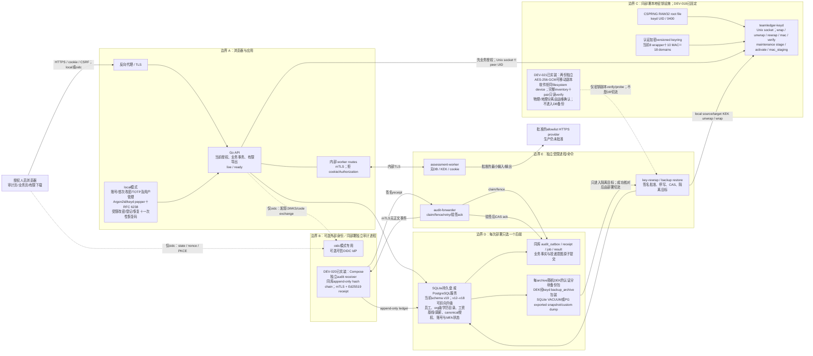

DB/备份持有人看得到必要metadata但看不到敏感正文或root/keyring；这不是端到端加密。本地keyd阻止API UID直接读取长期key，但已攻陷的获准API可经允许domain取得明文，keyd不验证employee/grant。host root、离线副本持有人或获准调用方失陷均在方案C边界外；worker仍无DB/key/cookie。

### 1.2 两种部署形状（互斥备选）

```mermaid
flowchart TB
    subgraph sqlite["方案 A：SQLite单机独立部署"]
        sproxy["TLS代理"]
        sapi["Go API<br/>identity mode=local|oidc"]
        sfwd["audit-forwarder"]
        srecv["audit receiver<br/>独立UID；应用隔离"]
        skeyd["本地 teamledger-keyd"]
        skeys["root 0400＋keyring＋lock"]
        sdb["同机DB / WAL<br/>业务＋receiver ledger"]
        sworker["可选assessment-worker"]
        sbackup["DB备份；不含keys"]
        sproxy --> sapi
        sapi --> sdb
        sfwd -->|"mTLS event / signed receipt"| srecv
        srecv -->|"同文件；无可信角色隔离"| sdb
        sapi <-->|"Unix socket"| skeyd
        skeys --> skeyd
        sapi <-->|"内部API"| sworker
        sdb -->|"一致备份"| sbackup
    end
    subgraph postgres["方案 B：PostgreSQL部署"]
        pproxy["TLS代理"]
        papi["同OS主机一或多个Go API进程<br/>identity mode=local|oidc"]
        pfwd["audit-forwarder角色"]
        precv["audit receiver<br/>独立DB角色"]
        pkeyd["该主机唯一teamledger-keyd"]
        pkeys["唯一root＋keyring＋lock"]
        pdb["PostgreSQL<br/>业务schema＋append-only ledger"]
        pworker["可选assessment-worker"]
        pbackup["PG备份/PITR；不含keys"]
        pproxy --> papi
        papi -->|"TLS / 业务角色"| pdb
        pfwd -->|"mTLS event / signed receipt"| precv
        precv -->|"最小INSERT/SELECT角色"| pdb
        papi <-->|"Unix socket"| pkeyd
        pkeys --> pkeyd
        papi <-->|"内部API"| pworker
        pdb -->|"一致备份"| pbackup
    end
```

每次部署只选一种DB后端。当前独立profile限定一个API OS主机；多个API进程共享唯一keyd/socket/key directory。跨主机key material一致性须另设计。DB backup不打包root/keyring。

仍不需要Kubernetes、Redis或消息中间件。DEV-019的内置账号已消除local模式的外部身份依赖；DEV-020同库独立audit receiver已实装。可选OIDC和AI provider仍是显式外部集成；DEV-018已消除外部KMS依赖。

## 2. Go/Vue 责任与依赖方向

实际组合根包含`cmd/teamledger-keyd`和`cmd/keyctl-local`；`cmd/api`、identity、key-rewrap、backup及MAC消费者使用本地keyd，生产Vault adapter与URL/token/CA配置已删除。API以`crypto_control`核对generation/digest/active key map；包装轮换执行stage/A1、activate/A2、DB ack、keyd ack和全库引用为零后的retire。backup恢复只写隔离目标，先通过keyd解包随机archive DEK并探测数据库业务wrapper样本；DEV-021另提供完整双介质inventory恢复门禁。

R2固定C实际路径：[organization契约](https://github.com/r404r/team-ledger-pub/blob/5a19d632a5c0ea15ecf20eed3340e2c984c69fa4/internal/organization/structure_contracts.go)、[service](https://github.com/r404r/team-ledger-pub/blob/5a19d632a5c0ea15ecf20eed3340e2c984c69fa4/internal/organization/structure_service.go)、[逐owner权限](https://github.com/r404r/team-ledger-pub/blob/5a19d632a5c0ea15ecf20eed3340e2c984c69fa4/internal/organization/structure_authority.go)、[queries](https://github.com/r404r/team-ledger-pub/blob/5a19d632a5c0ea15ecf20eed3340e2c984c69fa4/internal/organization/structure_queries.go)、[graph](https://github.com/r404r/team-ledger-pub/blob/5a19d632a5c0ea15ecf20eed3340e2c984c69fa4/internal/organization/graph.go)、[cursor](https://github.com/r404r/team-ledger-pub/blob/5a19d632a5c0ea15ecf20eed3340e2c984c69fa4/internal/organization/cursor.go)；[HTTP handler](https://github.com/r404r/team-ledger-pub/blob/5a19d632a5c0ea15ecf20eed3340e2c984c69fa4/internal/httpapi/structure.go)与[store](https://github.com/r404r/team-ledger-pub/blob/5a19d632a5c0ea15ecf20eed3340e2c984c69fa4/internal/store/structure.go)承接现有事务。上述固定代码已实际push，不再用漂移main定位代替版本。查询尽量使用窄`GraphState`/employee关系/SQL候选，不为目录和history读取全org图；写与tree的窗口图仍由组织模块负责。

R3当前源契约：`internal/interview/{contracts,commands,reads,export,service,state}.go`、`internal/store/interview.go`/`interview_tx.go`、`internal/httpapi/interviews.go`、`web/src/InterviewPage.vue`/`interviewDTO.ts`及`internal/authz/object*.go`。当前空库顺序安装至`internal/store/migrations/*_v19.sql`；`*_v6.sql`仅保留历史迁移校验，不是当前安装终点。

R4及员工薪资批次当前源：`internal/compensation/`、`internal/store/compensation*.go`、`internal/httpapi/compensation*.go`、`internal/value/financial.go`、`web/src/CompensationPage.vue`/`CompensationBatchPage.vue`及`cmd/api/finance.go`。当前schema v19；`*_v7.sql`/`*_v13.sql`保留历史迁移校验，`*_v19.sql`只追加工资基线批次关系子类型。
R5当前代码源：`internal/compensation/bonus*.go`、`internal/store/bonus*.go`、`internal/httpapi/bonus.go`、`web/src/BonusPage.vue`/`bonusDTO.ts`、`cmd/bonus-hmac`及`cmd/api/finance.go`。当前schema v19；`*_v8.sql`只保留历史迁移校验。
R6a/R6b当前代码源：`internal/assessment/`、`internal/store/assessment*.go`、`internal/httpapi/assessment*.go`、`web/src/FollowupPage.vue`/`assessmentDTO.ts`、`internal/authz`、`internal/providerapproval`及`cmd/assessment-worker`。当前schema v19；`*_v9.sql`/`*_v10.sql`只保留历史迁移校验。

DEV-025前端视觉基础集中在`web/src/styles.css`并由`main.ts`静态导入；Vite production build生成内容hash CSS/JS，由Go静态服务同源返回。`App.vue`负责品牌栏、sticky主导航和当前路由状态，`IdentityGate.vue`负责认证态会话条及未认证/首次改密/MFA gate；10个业务页面继续使用原生语义/ARIA和既有scoped专属布局。无远程字体、CSS框架、图标CDN、分析SDK或运行时主题服务；全局层只改变呈现，不缓存或扩大敏感DTO。

DEV-026把`IdentityGate.checkSession`区分为破坏式显式/生命周期核对和路由后台核对。DEV-039将已有`authenticated`会话收到`popstate`或window focus/pageshow时统一为后台请求：仍使用`no-store`并参与generation/AbortController竞态控制，但不提前增加`protectedGeneration`或切换`phase=checking`；pending期间保持身份壳层和业务组件实例，重叠focus由`resumeCheckPending`合并，返回相同subject、org及auth epoch时确认继续。401调用统一`expireSession`，context变化/敏感期限失效进入`changed`，transport/非成功响应进入`unavailable`，这些失败路径仍清空session并卸载slot。初始checking、新pagehide后的恢复及用户显式“重新核对”继续采用先销毁后核对语义。

DEV-030把认证态`IdentityGate`的原生`details/summary`经deferred Teleport放入`App.vue` sticky顶栏固定target，默认closed且不写local/session storage；浮层absolute定位，不推动业务layout，动态视口限高并内部滚动。DEV-035加入本地TOTP后，未登记/恢复session只渲染账号安全页；business session的本地step-up、factor替换和恢复码重发在模态框完成，不卸载受保护页面，也不自动重放命令。二维码由浏览器本地生成，不调用外部服务；secret/code只保存在当前Vue内存并在取消、失效、离页时清除。

DEV-040把P-SEC-01的客户端grant契约拆分为可签发与可读取集合：`grantCapabilities`加入经bootstrap authority批准的`identity.manage`；`readableGrantCapabilities`另含不可普通签发的`access_grant.manage`。`validPersistedGrantPair/Object`只接受无对象限制的`access_grant.manage / audit / security_administration`固定事实，命令预览仍使用较窄`validGrantPair/Object`，因此不会把读取兼容误变成委派权。bootstrap响应中的合法管理grant不再使整个DTO进入伪503；未知tuple仍fail closed。筛选器同步覆盖`audit`、`security_administration`及两项安全能力。

DEV-041把`grantCapabilities`与服务端`authz.SupportedPair`收敛为精确38个当前可委派tuple：组织metadata 2、PII 2、安全2、面谈/评估metadata 7、三分区note 9、shared action 2、financial 8及按目的拆分的`sensitive.export` 6。`access_grant.manage`仍只在`readableGrantCapabilities`中读取bootstrap固定事实，不能由OP-SEC-02签发。assessment与bonus/extension仅允许无对象grant；interview policy只允许interview对象；薪资proposal/event/term继续按读写能力区分。未知tuple或对象组合在客户端预览和服务端/数据库三层均fail closed。

DEV-028 T1在`GET /session`增加规范Date字段`business_date`，由handler使用同一次授权时钟和snapshot中的组织IANA timezone计算；timezone缺失/不可加载时fail closed。`IdentityGate`验证后以其初始化session级`globalViewDate`，通过受保护slot交给`App.vue`顶部日期控件及Profile/Organization/Compensation页面；单一合法`as_of`深链接优先初始化该内存值，内部导航保留，session销毁时清空。相关页面仍向既有API发送`as_of`并在全局值变化后取消旧请求、清敏感投影、重新读取；授权服务继续使用独立当前业务日，客户端值不参与scope判断。

DEV-028 T2的`OrganizationPage`继续只调用OP-ORG-04 `POST /orgs/:id/employees/query`，PII能力由重读后的scoped session决定：有`pii.read`才发送`include_profile=true`及允许`q`，无权时不发送姓名查询。筛选表单与已应用查询快照分离，opaque cursor历史只保存在页面内存，实现上一页/下一页且不推导总数；新查询或全局日期变化清空cursor历史并回到第一页。DEV-033把同日catalog与每个employee投影组合为No.、Staff Code、双语姓名、Location、Branch、BG、Division、Department、Education、Employment Date、Position、Job Family、Career Level及HOD宽表；BG/Division仅沿Department父链派生，不持久化副本，容器自身横向滚动。

DEV-046后的`PersonnelImportPanel.vue`只在P-ORG-03创建态且当前session同时含org级organization/PII read/write时挂载。模板、XLSX preview和JSON review由`internal/httpapi/personnel_import.go`转入`internal/organization/personnel_import.go`；唯一`Employees`工作表固定18个双语表头。`internal/xlsx`先实施ZIP/XML/公式/宏/外部关系及size/count边界，再暴露Text/Number/OOXML Date/Boolean/Error语义类型、原始lexical value和`workbookPr@date1904`。结构拒绝以422 `workbook_error`＋request ID返回；行错误与安全转换分别进入`errors`/`warnings`，日志只含request ID/sheet/cell/row/field/code。

人员parser仅把无符号十进制整数Staff Code转文本；decimal/scientific/sign值保留raw并阻断，Excel已丢失的前导零不猜恢复。J/O日期列接受既有确定文本格式、按实际1900/1904系统转换的整数serial及OOXML ISO date/零时刻datetime；1900 serial 60、fraction、负数或带非零时间阻断。其他numeric cell保留lexical值并警告；boolean/error与非日期列date保留raw但要求编辑。Location大小写可唯一规范；非空Branch/BG/Division/Department/Job Family/Career Level先按code，再按trim＋ASCII case-insensitive的唯一code/获准解密label解析，重名不猜。学历、职位、Job Family、Career Level为空时不报字段错误；前四项组织目录及Staff Code/姓名/Location/入职日仍必填。公式、宏、外部关系始终拒绝。

XLSX preview和`POST /orgs/:org/employees/import-review`都返回`rows/errors/warnings/education_levels`，并返回当前行入职日可用的`legal_entities/business_groups/divisions/departments/job_families/career_levels`候选并集。页面18字段均可编辑；任何input使preview dirty并禁用创建，review JSON不接受resolved ID，由服务端重新执行字段、重复工号、主管环、日期、目录、父链及revision解析。仅errors为0、revision齐全且最后一次编辑已重验时才放行`import-commit`整批事务流程。unknown education不自动写库；操作者须明确名称与1..10000唯一rank，通过OP-ORG-09追加当前org目录，再重验。

DEV-048的目录适配不新增后端旁路：客户端仅从`unknown_catalog_code`聚合可编辑draft，先用当前preview revisions调用OP-ORG-09创建操作者确认的目录，再用回执ID和重新review后的resolved ID创建新Division/Department的父链，最后再次review。目录与父链是两个各自原子的CAS命令；网络结果不确定时不宣称成功、不开始员工创建，要求在组织树核对后重验。同一新子节点对应多个上级、任一409或仍有error均阻断。该流程复用既有structure change/receipt/audit，无schema migration。

DEV-049在导入边界新增唯一的`organization.NormalizeHODStaffCode`（Web镜像为`web/src/hodStaffCode.ts`）：非空且含`-`时取第一个`-`之前并trim，其余值（含空值）原样返回；`validatePersonnelRow`在preview解析与`import-review`重验中都调用它，规范化结果再经`NormalizeStaffCode`校验，发生提取时返回`hod_staff_code_extracted` warning，前缀为空则`invalid_staff_code`。HOD列原始长度上限放宽为320字节以容纳`工号-姓名`，提取后的工号仍受64字节Staff Code上限约束。`validatePersonnelReferences`在构建本批次工号集合后报告`manager_self_reference`与`manager_cycle`；`Service.resolvePersonnelManagers`对不在本批次的主管经`staffCodeLookup`（与identifier写入共用的keyed MAC）调用只读`WorkforceReader.StaffCodeExists`，按`org_id、kind=staff_code、lookup_key_id/version、lookup_digest`查询`employee_business_identifier`，缺失则该行`manager_not_found`。该检查只读、不加锁，也不替代提交时按入职日对主管有效性的重新核对；preview/review不写库。页面提交`POST /orgs/:org/employees/import-commit`，JSON为`{rows, expected_catalog_revision, expected_graph_revision}`，rows同review契约，body≤5MiB，必须带UUID Idempotency-Key。服务先按OP-ORG-05授权，事务取得组织guard、graph和subject锁，重验授权、目录、行字段与冻结revision；先检查同key的回执，原命令精确重放，改参409。Pass 1按原行序创建所有employee/profile和initial workforce事实，建立完整`staff_code → employee_id`映射；Pass 2解析本批次映射和入职日有效的现有Staff Code（keyed MAC查询，不按姓名模糊认领），复用OP-ORG-10 endpoint/环/有效期验证统一绑定。返回201 workforce结果，其中`items`按输入顺序包含`{kind:"employee",id}`，`employee_revisions`覆盖整批；`id`指向真实structure change。整批回执复用`workforce_command_receipt`的OP-ORG-10空间，digest包含import入口区分，任何后续失败回滚全部员工、PII密文、事实、成功audit及receipt。Web保留单一冻结key/body，502/504/网络失败只重放整批，不显示部分成功；确定冲突显示整批未创建。无schema migration，不改既有migration。

DEV-049的验证收敛同时缓存SQLite的可信参考schema：仅按版本缓存本程序内嵌冻结migration成功生成的定义，每次`CheckSchema`/`Migrate`仍读取目标库的实际catalog、ledger与foreign key状态，drift仍拒绝且不自动修复。测试fixture可复制进程内的空schema字节，随后执行真实schema校验并独立创建组织、凭据和合成业务事实；真实升级测试仍执行DDL。API启动smoke编译实际程序并验证TLS/keyd接受与拒绝，service/API并发逻辑由race套件覆盖。SQLite身份事务取得mode writer后才读mode，继续按mode→org→subject顺序重验，以避免并发回调/拒绝审计之间的WAL读快照升级失败；PostgreSQL仍使用mode行FOR UPDATE。

DEV-034的`CompensationBatchPage.vue`以批次header和默认3行工作表取代技术字段表单。法分公司来自当天catalog；Staff Code失焦时只用组织目录及个人薪资读取即时填充姓名、组织和当前工资，最终employee/basis解析仍由财务preview完成。手工JSON与XLSX均进入同一`compensation.batch_import.v1` candidate：服务忽略全空行，按全集团唯一Staff Code解析employee、冻结current term/range/任职，返回Special次数及`SALARY_BEFORE_MISMATCH`警告。OP-COMP-09要求逐employee确认全部工资差异后才生成draft/manifest；OP-COMP-10最终重验，并在一个事务先写必要`correction_replacement`、再写adjustment及batch/audit/outbox。页面将Salary Range和已激活批次纠错保留在折叠高级区，宽表仅在自身容器滚动。
DEV-047在同一批次聚合根中加入领域类型`baseline`。页面只提交Staff Code、CNY/JPY及指定日工资；服务端按header统一日期解析employee/任职/current term，不复用客户端回填作为依据。`GET /compensation-adjustment-batches/import-template?adjustment_type=baseline`返回受权限/MFA保护、`no-store`的三列XLSX；手工/XLSX仍进入同一加密candidate。preview在同日不同term或目标日后已有term时拒绝；freeze/submit重验basis。激活按首条`initial`、不同值`adjustment`、相同值`no_change`写不可变历史，batch event固定`counts_as_adjustment=false`，因此不进入Normal/Special近两年次数。


| 拟定 Go package | 职责 / 依赖 |
| --- | --- |
| `cmd/api`、`cmd/assessment-worker` | API组合根；identity mode严格取local或oidc；worker无DB/keyd/cookie |
| `cmd/audit-receiver`、`cmd/audit-forwarder`、`cmd/audit-bootstrap` | 同库receiver ledger/签名receipt、outbox claim/验签/CAS ack及一次性本地PKI bootstrap；独立UID与最小DB权限 |
| `cmd/teamledger-keyd` | Unix socket；读取root/keyring、持有persistent lock，按peer UID/op/domain执行inventory窄操作和maintenance状态机；无业务授权推断 |
| `cmd/keyctl-local` | 初始化/离线artifact验证及generation-bound双介质export/isolated restore；必须与keyd竞争同一持久lock，normal startup不建key |
| `internal/httpapi` | handler/DTO/CSRF；调用service，不读root/keyring、不自己解密 |
| `internal/identity` | 互斥local/OIDC adapter、session、OIDC step-up及local credential生命周期；登录不创建授权 |
| `internal/authz` | capability/scope/category/grant/purpose/MFA唯一判定；必须在调用keyd前通过 |
| `internal/organization` | 组织/员工/assignment/reporting |
| `internal/interview` | 面谈状态、版本、行动与来源 |
| `internal/xlsx` | 不依赖业务域的单工作表XLSX生成/有界读取；拒公式、DTD/XInclude、外部relationship、宏及多工作表；保留安全cell kind、lexical value和1900/1904日期系统，由人员/薪资业务层分别决定可接受类型；不访问网络/文件系统 |
| `internal/compensation` | 薪资/批次/奖金业务 |
| `internal/assessment` | 规则、job、worker、人审 |
| `internal/sensitive` | schema/AAD/DEK及keyd client窄接口；不读key文件、不推断授权 |
| `internal/audit` | 安全元数据、业务事务outbox、receiver canonical frame/ledger/receipt；无正文/prompt（F-SEC-001） |
| `internal/store/sqlite`、`internal/store/postgres` | 两种方言的 repository/guard/事务实现、SQL错误归类（F-DB-001） |
| `internal/value` | UUID、业务日期、Money/decimal 与有界校验；不放万能框架/全局 mutable context |
| `cmd/identity`、`internal/configfile` | 受控OIDC bind/unbind；local fresh-bootstrap、subject/account create/reset/disable、mode-switch维护CLI；secret只经0600 regular input file，不接受argv/env/stdin |

依赖方向保持handler→service→authz/sensitive/audit→repository。组合根向`internal/sensitive`注入仅Unix-socket keyd client，不注入root bytes；外部IdP/provider适配器独立。业务service不调用keyd绕过授权，keyd也不读取业务DB来猜权限。

### 2.1 Vue 路由、DTO 与状态

| 页面 ID | 建议前端路由 | 模块/按需 DTO |
| --- | --- | --- |
| P-ORG-01 / P-ORG-02 | `/orgs/:org_id/tree` / `/orgs/:org_id/employees` | tree/as_of、目录 cursor；PII labels 独立许可，不带金额/笔记 |
| P-ORG-03 | `/`、`/employees/:employee_id/:tab?` | 单人完整初建/详情及profile history；创建态另有18列人员XLSX模板、typed preview、18字段编辑、服务端review、显式学历目录追加及整批事务及逐行结果；人员DTO不含薪资 |
| P-INT-01 | `/interviews`、`/employees/:employee_id/interviews`、`/interviews/:id` | 当前选择/列表/安排与详情；独立metadata、可见版本/heads、行动、有限操作hint及NDJSON内存输出 |
| P-COMP-01 | `/employees/:employee_id/compensation`、`/orgs/:org_id/compensation-adjustments` | employee as_of/schedule/change chain；同一工作台创建Baseline/Normal/Special，默认3行Staff Code录入，Baseline可下载三列模板，手工/XLSX同构preview candidate、冻结draft及显式submit；Baseline显示指定日前权威工资且不计调薪次数，Normal/Special保留工资差异确认、参考预算和近两年次数；Salary Range/调薪纠错为高级区；Money一直为字符串 |
| P-BONUS-01 | `/employees/:employee_id/bonuses` | targets/awards/payment/anomaly 分列、有限 extension |
| P-AI-01 | `/employees/:employee_id/followup` | R6a policy/facts与R6b job/result/source review、人审发布已接通；生产provider未批准时外传disabled |
| P-SEC-01 / P-SEC-02 | `/security/grants` / `/security/audit` | 可委派 authority 和安全 grant DTO / sanitized cursor audit |

共同 login/MFA/denied/unavailable/conflict 弹层不是员工门户；DSN/密钥配置在受控运维，不提供任意 SQL 管理页。TypeScript 的 `MoneyDTO.amount_minor`/revision 使用字符串，转换金额只用 exact 整数/decimal，不用 `Number`。`/session` 只影响按钮/导航提示，handler 仍逐请求授权；`identity_available`在OIDC verifier可用或local内置密码/TOTP模式可用时为true，不能把local误报为“设施未启用”。

R2-R5页面保持；R6a FollowupPage与R6b最小输入/job/result/source review、人审发布均已接通，P-SEC-02独立audit页面也已交付。审计页在session预检阶段区分近期MFA过期与缺少`audit.read`；前者只引导`audit.read` step-up，后者不调用事件API且不显示筛选工作台；查询后的403/404清空为授权变化。页面只显示获准事实/覆盖与明确生产阻断；真实provider质量、外传许可及生产设施未批准时调用disabled，不把“生产未启用”误写成机制未实装。

全局仅保留安全 session/capabilities、非敏感筛选与 request generation；敏感 DTO 在对应页面短时内存，禁止 localStorage/sessionStorage/IndexedDB、service worker、跨页 Pinia缓存、分析 SDK/console/trace 截取正文。路由离开/登出/401/403/404/epoch变化清空；取消 fetch并以 generation＋employee ID 丢弃乱序旧响应，撤权提示不得被晚回包重新显示。`Cache-Control: no-store`；笔记/AI仅文本呈现，禁止模板解释/未经清洗 `v-html`。[S4] 这些降低残留，不承诺回收截图/下载或浏览器已获得明文。

## 3. 共同值、协议与失败

### 3.1 类型与输入上限（本 task 建议）

- ID：服务端随机生成规范小写 UUID 字符串，不透明/不复用；body 不能指定 `org_id` 来改变 owner。路径 ID 从 DB 解析 canonical owner，再匹配 session范围。跨org引用不靠客户端声明；employee-owned 关系同时核对员工。
- `Date`：真实 Gregorian `YYYY-MM-DD`，有效期半开 `[valid_from, valid_to)`；`null valid_to` 为未结束。`Timestamp`：RFC3339 UTC `Z`，最多六位小数，写入统一微秒；reject多余精度而非静默截断。业务日期从组织明确 IANA timezone 推导，不依赖浏览器本地时间；计划/实际/录入/批准时间分开。
- `revision`/`expected_revision`：正 int64 的十进制字符串；创建 singleton 用 `"0"` 表示预期不存在，此后从 `"1"` 起。`basis_revision` 指 employee compensation aggregate，`expected_graph_revision` 指组织图，不能用 proposal revision 替代。state转换枚举见第6节。
- Money共同wire为`amount_minor`规范非负int64字符串、currency及scale；当前薪资契约只接受CNY/JPY、scale0，`amount_minor`必须匹配`0|[1-9][0-9]*`，任何小数点/指数/正负号（含`100.0`）拒绝。整数表示元/日元且不经float。Bonus仍用独立未决policy；salary可零，payment/reversal须正；无FX。
- exact decimal量化为薪资Money只用decimal/integer实现的`ROUND_HALF_UP`。验收向量100.49→100、100.50→101、100.51→101、0.5→1、9007199254740993.5→9007199254740994；量化后超int64拒绝。Money输入本身绝不舍入；Compa公式未批前没有该计算入口。
- JSON `snake_case`、UTF-8、拒未知/重复字段/非法枚举；普通body≤256KiB，人员import-review/import-commit因100行可编辑profile上限为5MiB，profile/extension单项≤16KiB、worker目标输出≤64KiB、嵌套≤8。结构变更/薪资纠错≤100。人员导入最多100行、`.xlsx`压缩体≤5MiB、展开≤20MiB、ZIP entry≤1,000；调薪批次最多500名唯一员工、压缩体≤10MiB、展开≤50MiB、entry≤10,000。共同XLSX读取器在构造对象前限制row/cell/XML node数量，并按`workbook.xml`＋relationship确认唯一worksheet；两类工作簿均拒公式、外部relationship、宏和多工作表。人员导入按本节安全转换Number/Date；调薪Money仍仅接受Text并拒numeric/date serial。扩大上限须先完成容量/锁时长验证。
- 字符串limits默认UTF-8 bytes；一般原因≤4096、姓名各≤256、staff code规范化后1..64、财务理由≤4096。敏感正文/原因/身份/凭证不入URL/log。一般列表默认50最大100，R3列表默认20/详情默认100；所有查询有界，有限sort/完整范围。

### 3.2 响应、分页、cursor 与幂等

成功普通查询 `200`，创建`201`，状态/patch/put`200`，assessment排队`202`，无可领job`200`且 `job:null`。写响应含安全 `id/status/revision`；只有本次满足读取要求才返回已准许的payload投影，不因为创建就泄露其他域。GET metadata仍要scope/capability；不存在或不可读 `404`。

列表形状 `{"items":[],"next_cursor":null,"as_of":"2026-10-10","consistency":"current"}`；cursor为服务端认证的opaque token，绑定主体/org/安全filter metadata/as_of/sort/last-key/相关epoch，15分钟有效。姓名q只以独立用途、版本化key的HMAC绑定，不放原文/裸hash；下一页body重发同q再比digest，不能从cursor获得搜索词。cursor key保留至相应短期token到期，缺key/版本变化要求安全刷新而非放松绑定。metadata按 `(recorded_at,id)` 或目录`id`明确稳定keyset，不默认姓名/金额排序；每页重新授权，无隐藏类别count/总数，不跨页承诺永久snapshot。

目录OP-ORG-04统一为只读POST查询，全部筛选在JSON body；q≤256 UTF-8 bytes，仅PII授权scope内有界解密filter，不建明文姓名镜像/未声明blind index。body/q不得进浏览器URL/history/跨页store、客户端分析、代理/access/debug日志、error或audit；关闭请求体/敏感header日志与trace采集，TLS传输并no-store。只保存安全filter metadata/用途HMAC，短时页面内存退出或撤权清空。POST查询需session/CSRF，不是业务mutation，不要求Idempotency-Key或生成业务receipt；敏感read audit/release顺序不变。每页至多500授权候选，search_incomplete和scan cursor明确范围，超限要求收窄。

所有业务 mutation 使用 `Idempotency-Key`（随机UUID）。作用域 `(org_id,subject_id,op_id,key)`，记录命令canonical digest/结果ID/安全状态；重复相同命令重新授权后返回原安全结果，异内容`409/IDEMPOTENCY_MISMATCH`。salary/approval/payment事实键长期随事实保留，草稿命令键建议保留7日（启用前与保留政策确认）；不承诺任意过期重试去重。敏感输入digest用独立用途HMAC，不把低熵金额裸hash变数据库字典；canonical包含操作、对象、expected revision、全部显式字段，日期/decimal按协议规范化。重放不能绕过当前grant，也不重复审计为新批准。

付款另有 employee范围 `business_payment_key`（受控来源＋外部事实ID，完整键在不可变payment payload中加密）；派生版本化HMAC索引随事实保留，在第3.2.1节维护/独立密钥恢复门禁成立时防同一业务事实跨请求key重复，不承诺缺key/损坏索引仍可写。命中业务键后，按当前授权解密原payload，逐字段比较规范事实employee/kind/Money/paid_date/award/original/ref等，不含B/transport key/request time，也不复用包含B的receipt digest；换command key/更新B同事实仍原ID，异事实冲突。第一次记录后断连可同key确认；先当前授权与业务事实查重，不因B变化新增付款。HMAC等值关系/频次为已声明metadata风险；worker另用attempt/fence。

### 3.2.1 HMAC索引版本、维护与恢复

付款索引key、请求payload digest key、身份lookup key、AI generation key、cursor key分别用途隔离且版本化，保存受控key_id/version，不把KEK rewrap当HMAC换键。AI source digest例外：它按§8.2固定为结构JSON的unkeyed SHA-256，既不引用MAC key/version也不参与换键。receipt用其记录的digest key版本复核，不拿新key与旧digest误比；必需旧版本独立保留/备份至相关事实、receipt和可恢复备份依赖全部结束，禁止启动时丢失就随机生成“替代key”。

付款唯一性在可重建`bonus_payment_business_index`投影，非immutable payment事实字段：`(org,employee,domain,key_version,digest)`唯一并复合FK到同employee payment。`hmac_index_state`记录domain/active key_id/version、epoch、ready/migrating/blocked、snapshot/checkpoint与staging manifest。digest为独立付款域HMAC-SHA256，输入明确版本＋length-framed org/employee/受控来源/外部ID；不用分隔拼接，key_version不作为业务身份。ready时先核对active版本/完整性/key可用，再计算当前digest查重；唯一索引＋共同guard在同版本防竞争。新事实及index/receipt/audit同Tx，commit重验index epoch。

**历史R5初版证据**只支持受控停写换键、外部manifest及单Tx索引切换，不做双版本在线写；其具体旧key-file/CLI流程不进入DES-007目标。目标仍保留完整staging索引、事实集合/摘要/checkpoint验证与停写原则，但keyd `mac_staging`、A1/A2及DB ack顺序唯一以§7.4为准。

目标恢复必须核对用途独立MAC key版本、active epoch/维护状态、完整index manifest、原加密业务键和receipt依赖。缺key/索引/版本或维护未完成即`503/HMAC_INDEX_UNAVAILABLE`；旧key保留verify_only到事实/receipt/备份依赖结束。identity、local username、Staff Code和bonus payment lookup通过各自受控入口停写全量重建，CSRF换键先撤旧session，cursor缺key只安全失效；生产轮换与中断恢复仍须在目标部署演练。

当前维护顺序如下；`mac_staging`只读staged key，在线`mac`在维护 generation 中拒绝写。CSRF不重建索引，而是在activate前撤销旧version全部live session。

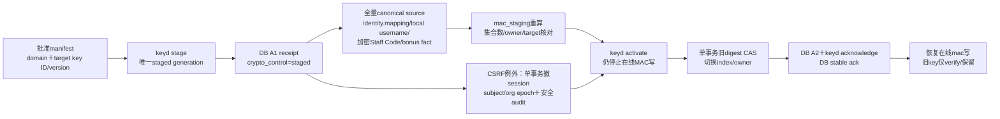

identity subject重建只从AAD绑定`mapping_id/org/subject`的`identity.mapping.v1`密文恢复exact canonical issuer/sub；local username从自身认证加密source恢复；Staff Code从`pii.employee_identifier.v1`恢复。三者不从当前digest、email、group或展示字段猜测。集合漂移、缺source、错manifest、错误target key ID/version、CAS冲突或任一解密/MAC失败均停止，不部分切换。cursor最长15分钟，active变化允许旧token安全失效；local password credential保存pepper key ID/version并以历史`verify`核对，成功后才惰性升级。
**DES-007/008目标key inventory（穷举；新增family须改表和恢复manifest）**：

| domain / type | caller与唯一允许操作 | 持久引用、退役与恢复probe |
| --- | --- | --- |
| `pii_payload` / wrap | API `wrap/unwrap`；maintenance `rewrap`；覆盖profile/identifier/education/org-unit与legal-entity label/position/structure schema | payload存key id/version/dek id；所有在线/备份wrapper消失后decrypt_only可退；固定合成DEK round-trip |
| `interview_payload` / wrap | 同上，仅interview UID/domain policy；覆盖note/action/reason schema | 同上，跨domain/schema拒绝 |
| `assessment_payload` / wrap | assessment API `wrap/unwrap`；maintenance `rewrap` | input/result存key/version/dek；按来源/结果保留退役；跨assessment domain拒绝 |
| `financial_payload` / wrap | 同上，仅financial获准UID；覆盖terms/range/proposal/batch line/correction/import raw+rows/bonus/memo schema | 同上，Money/raw rows不进probe/log；跨schema拒绝 |
| `identity_transaction` / wrap | identity API仅wrap/unwrap随机transaction DEK | oidc_transaction存key/version/dek/wrapper；proof到期且备份无依赖后退役；合成state payload round-trip |
| `identity_mapping` / wrap | identity bind/read与maintenance reindex仅wrap/unwrap canonical issuer/sub source | subject_identity存payload ref；映射/备份全失效后退役；exact owner/schema round-trip |
| `backup_archive` / wrap | backup/restore maintenance UID；每archive随机DEK | archive header存key/version/dek/wrapper；保留archive清单决定退役；只probe合成DEK，不送archive正文 |
| `staff_code_lookup` / MAC | organization API `mac`；maintenance `mac_staging` | owner/index存exact key ID/version；停写全量重建、旧key verify_only；固定规范化合成code known-answer |
| `bonus_payment_lookup` / MAC | compensation API `mac`；maintenance `mac_staging` | 不可变payment fact与active/staging index均存exact key ID/version；按§3.2.1重建；固定合成business key known-answer |
| `identity_subject_lookup` / MAC | identity API及identity-maintenance UID可对active `mac`；rotation maintenance另用`mac_staging` | mapping source/index存exact key ID/version；从全部mapping加密source重建，inactive/historical也须齐全；owner/digest/active全集相等才CAS |
| `command_receipt` / MAC | 各service仅对canonical command `mac` | 每个持久receipt存exact key ID/version。receipt无到期/重建policy，故通用stage/activate一律拒绝；在专用历史verify或完整重建协议交付前此domain固定，不允许产生重放歧义 |
| `assessment_generation` / MAC | assessment API仅对canonical generation `mac` | input/job存exact key ID/version。generation是去重事实且当前无安全重建source，故通用stage/activate一律拒绝；source digest仅存SHA-256值，无key rotation依赖 |
| `csrf_token` / MAC | HTTP API只用当前active `mac/verify` | session存exact key ID/version；rotation停写并按旧exact reference原子revoke全部live session/推进epoch后才activate；页面reload/多tab统一401重登录 |
| `cursor_token` / MAC | API按页面domain子上下文`mac` | token≤15分钟且只在当前active下验证；key变化允许旧token立即失效；固定安全filter known-answer |
| `local_username_lookup` / MAC | local identity API `mac`；maintenance `mac_staging` | account/identity存exact key ID/version；从`identity_mapping` wrapper加密ASCII canonical username重建，全集/CAS同identity lookup；固定合成username known-answer |
| `local_password_pepper` / MAC | local identity API `mac`并按credential exact reference调用历史`verify` | credential存pepper key ID/version＋Argon2id PHC；成功登录惰性升级已实现，但credential dependency maintenance入口尚未提供，故通用stage/activate拒绝；不持久化password或MAC digest |

API生成每次payload/transaction/archive DEK并AES-GCM加密正文，keyd只包装DEK；session opaque token只存SHA-256 hash。root/keyring artifact覆盖长期对称key；OIDC client secret、TLS/receipt签名私钥及批准公钥另列runbook。历史对称key-file配置clean cutover删除。


### 3.3 错误契约

```json
{"code":"CONFLICT","request_id":"synthetic-request","reason":"REVISION_STALE","field_errors":[{"field":"expected_revision","code":"STALE"}]}
```

上例只有合成安全结构，不是契约源。稳定主码：`401 UNAUTHENTICATED`；`404 NOT_FOUND`；`403 FORBIDDEN`；`409 CONFLICT`；`422 INVALID_INPUT`；`503 UNAVAILABLE`（DB/keyd/key generation/MAC索引/必要审计不可用）。其他HTTP framing保持原契约；错误不得含SQL/key/prompt/hidden counts。

授权拒绝必须先于keyd可用性判断，不能借不可用响应枚举敏感对象。UI冲突后人工重取；SQLite busy/PG死锁整Tx rollback为`503/WRITE_BUSY`，不无限重试或把基础设施失败伪装revision冲突。

### 3.4 R2已实现HTTP窄契约（不是第二份DDL）

具体字段源为§2链接的`structure_contracts.go`/`structure.go`；以下均有`/api/v1`前缀、当前session/purpose、no-store，POST含CSRF/Origin/Fetch Metadata。未知/重复字段和不适用于该action的有限字段拒绝，不隐式补关系。

| 路由 | 已实现输入与结果边界 |
| --- | --- |
| POST `/orgs/:id/teams` | `code`为1..64 ASCII `[A-Za-z0-9_.-]`；必填`lifecycle:{valid_from,valid_to}`半开日期（null终点），可选`label`非空≤256 UTF-8 bytes并加密；UUIDv4 Idempotency-Key。201 `{id,graph_revision,auth_epoch}`，非team revision；无隐式parent |
| POST `/orgs/:id/structure-changes` | `expected_graph_revision`正十进制字符串、可选`reason`≤4096 bytes并加密、`changes`1..100原子项。201同安全结果另`items:[{kind,id}]`；新命令图CAS，失败无部分写 |
| GET `/orgs/:id/tree` | 必填`as_of`，可选canonical `root_team_id`、`depth`1..10默认10、`limit`1..100默认100、`include_labels`布尔。nodes＋edges＋employees使用同一个累计snapshot预算≤limit；先完整metadata预算再解密获准label，超界拒绝要求收窄，不静默截断 |
| POST `/orgs/:id/employees/query` | body `as_of,team_id,employee_id,lifecycle,q,cursor,limit,include_profile`；lifecycle仅active/inactive/all；limit默认50最大100。q≤256 UTF-8 bytes且须include_profile=true；返回当前许可IDs/可选PII、next_cursor/search_incomplete，不产生业务receipt |
| GET `/employees/:id/organization-history` | 仅`from,to,cursor,limit`；from/to同时省略或成对合法Date，解释为**UTC recorded_at `[from 00:00Z,to 00:00Z)`**，不是effective_date/as_of过滤；默认50最大100，按`(recorded_at,id)`keyset |

结构item的action为`add/end/replace/lifecycle`；kind为`team_parent/membership/position/reporting_line/team_lifecycle/employee_lifecycle`。add/replace含显式lifecycle，replace另含旧`ref`；end仅kind/ref/end_date。team_parent含team_id/parent_team_id；membership含employee_id/team_id/is_primary=true；position含employee_id/is_primary=true/position与可选team_id；reporting_line含employee_id/manager_employee_id/reporting_kind（administrative/dotted）；lifecycle仅对应team_id或employee_id和新区间。R2拒绝非primary任职；不提供第二任职policy捷径。

所有授权使用服务器捕获的组织IANA**当前业务日**，响应`authorization_date`与业务`as_of`分开。tree只释放安全team/employee IDs与授权team label，绝不包含employee profile。detail/directory/history的当前PII许可独立；metadata投影省略profile/profile_revision/position正文/reason；history reason另需org PII，position需该employee PII。SQL先以当前可读scope约束候选再LIMIT；每页至多500候选解密，额外第501条只peek不解密，search_incomplete及scan cursor表达扫描未完成。

cursor用途分域HMAC并有独立cursor key，15分钟；绑定caller/org/subject epoch、当前业务日、auth epoch、graph revision、完整安全query（含as_of/limit）及q用途HMAC与last key。下一页重发原body/q，不能从cursor取raw q；q不进入URL、浏览器持久storage、日志或审计。日界/图/权限/query变化、到期均安全失效，不承诺跨页永久snapshot。

### 3.5 R3已实现HTTP与导出窄契约

所有业务路径带`/api/v1`、当前cookie/有限purpose、no-store；POST有CSRF、Origin/Fetch Metadata与UUIDv4 Idempotency-Key。JSON拒未知/重复key、缺必填字段、null代布尔/数组、非法typed ref/时刻；nullable字段显式null，数组始终`[]`，next_cursor始终null或token。revision是规范十进制字符串。

| 路由 / 契约 | 当前已实现边界 |
| --- | --- |
| GET employee interviews | from/to为成对Date半开窗口，按actual_started_at、未发生时scheduled_at过滤；有限status、cursor、limit默认20/1..100；SQL当前授权scope先于LIMIT，只metadata；permissions只本列表IntR及employee-level可新建IntW，不以exact已有interview grant暗授新建 |
| POST employee interviews | 五必填：scheduled_at、typed participants（≤20，同org）、backfilled布尔、nullable actual_started_at/actual_ended_at；普通scheduled，明确backfilled+过去有序actual可直接completed；不建grant |
| POST interview transitions | 六必填：action start/complete/cancel、expected_revision、nullable actual times、backfilled、reason；取消reason非空并独立加密，读reason另需shared NoteR；终态不重开，scheduled complete须显式补录 |
| GET interview detail | include_sections有限三个category列表、include_actions布尔、category/cursor/limit1..100默认100；IntR metadata独立，正文逐NoteR、行动逐ActR。只有当前head NoteR才返回section/note的head_id及head revision/current pointers；exact version-only无head_id，即便该版本恰好current也不透露指针。permissions只当前可见对象/类别，release重验 |
| POST interview note-versions | 九必填：nullable head_id、category、expected_head_revision（初次0）、text、edit_reason、save_draft/publish action、nullable supersedes_version_id、source_refs、confirm_minimized布尔。已有head append须同head supersedes和非空理由；head CAS。text≤12288、reason≤4096 UTF-8 bytes，实际JSON加密payload≤16384 bytes |
| GET note-version | 规范version ID、无query；独立当前NoteR，不要求目录/IntR；head_id是仅有当前head NoteR才出现的optional string，无权时省略而非空/null，直接读/详情/导出一致；source对无源read者省略，无永久作者例外；释放前重验整个已准备投影 |
| POST interview action-items | 六必填：expected_revision（interview）、minimal_shared_text≤12288、typed owner、nullable due_date、source_refs、confirm_minimized；实际payload≤16384；非终态新建，推进interview revision，不改其状态历史 |
| POST action transitions | action start/complete/cancel、expected_revision、safe_blocker_text≤4096；wire complete对应done，不保留done action别名；仅新事件加密blocker，原最小共享正文/due保留 |
| POST sensitive-exports（面谈分支） | `{objects:[{kind,id,expected_revision}],format:"ndjson"}`，kind只interview/note_version/action_item，1..100去重对象；逐对象解析同org的canonical employee所有权，可跨已获准employee。逐对象read＋export类别grant与近期MFA。≤8MiB是最终编码含newline/header/terminal预算，不是正文估值；并发原key准备仅保留胜出receipt ID，必要重编码所有event，UUID等长预算不变 |

source_refs只`{kind:"note_version",id,expected_version}`，≤10且已published/同employee；跨category必须当前source read、现有目标grant的source批准与人工confirm_minimized。字段present/null规则及DTO由代码契约唯一维护，不复制一份JSON schema。

流式事件header/object/complete或partial均有**同一个export_id**；正常encode前赋值，预算和输出复用同一EncodedJSON。并发同key另一请求先提交时使用胜出receipt ID，必要重编码全部event；UUID等长、预算不变。prepare审计/安全receipt先commit再header，每chunk守卫重验当前权限/版本并审计。prepare receipt不含正文；原key/body重放也先原对象当前read/export/MFA及digest，然后保持原export ID、重新授权读取。revision变化或撤权不把旧receipt变成放行票据。partial只有ACCESS_LOST/REVISION_STALE/AUDIT_UNAVAILABLE/DEPENDENCY_UNAVAILABLE/WRITE_FAILED等有限安全原因，write/short write/flush/ctx取消不假称complete。

OP-SEC-05按purpose和对象类型分派：面谈、金融、PII profile及AI result均只接受显式≤100对象/8MiB NDJSON，独立read＋export＋MFA，prepare及逐chunk release重验，不构造跨模块混合正文；不提供全文笔记搜索，日期/状态/授权版本分页不泄隐蔽数量。

### 3.6 R4已固定HTTP、明确policy及金融有限导出

`comp_revision`是员工薪资aggregate的规范非负int64字符串，初次无批准为`"0"`；proposal/term/event revision仍为正字符串。term/event的revision来自各自真实不可变version/sequence，不拿B替代。OP-COMP-01指定`as_of`，future_limit默认20/最大100；原生reader按(org,employee,effective_date) PK定位nearest past LIMIT1与future LIMIT≤100，最多101投影行，释放点相同有界窗口/aggregate版本重验，不全量读取员工排程。OP-COMP-02普通proposals/approvals给成对UTC `from/to`，窗口筛recorded_at而非生效日期；scope先SQL LIMIT，cursor绑定筛选/当前权限与版本。approved history的`valid_to:null`不是可改原term端点；当前/未来区间来自可重建schedule。

第二轮修正的clean契约已实装：ProposalView/提案列表/写结果/选定proposal导出只含当前确切snapshot，不内嵌所有revisions。完整不可变修订另走同OP-COMP-02显式`record_kind=proposal_revisions`：必填proposal_id，仅另允许cursor/limit，默认20/最大100，不接受from/to/status；顶层revisions只本页revision DESC，proposals含唯一获准当前head、approvals空，next_cursor明确继续更旧页；普通模式revisions空。底层同proposal `revision<before ORDER BY revision DESC LIMIT≤101`，peek不解密；释放再验相同有界metadata/current head。cursor另绑定mode/proposal/head/当前授权，不跨对象或变化后拼接。页面只保留一页，完整原史不删、不把部分称全部，人工重查才接受新head。批准历史只取已分页获准approval的有界scope events，不全量加载employee事件。当前范围、版本和限制以本节、源码与永久测试为准，不代生产发布。

DES-005扩展同一OP-COMP-02的`record_kind=batch_adjustments`：只允许`effective_year,cursor,limit`，返回该employee指定年份已激活且`increase_amount>0`的`mode=adjustment`原始batch event，按`(effective_date,event_id)` DESC keyset，含normal/special、business_code、increase和当前correction_status；correction事件和0增量`no_change`行不作为次数行。首响应另给exact count，cursor绑定employee/year/当前授权与comp revision；不得与from/to/status/proposal_id混用。P-COMP-01按服务端组织当前业务年Y和Y−1分别调用，不把最近20条当完整历史。

完整body/required/null/one-of/array bounds由代码唯一契约维护；普通body≤256KiB、terms.components≤20、correction.members≤100、reason/decision_reason≤4096 UTF-8 bytes。initial/adjustment的members明确空数组；submit的decision_reason必须空字符串，approve/reject/withdraw明确理由。提交/批准freeze R/B，409后必须人工重载及重新确认；不自动补闭包或rebase。

`TEAMLEDGER_COMPENSATION_POLICY_FILE`是protected/versioned严格JSON。v12薪资固定CNY/JPY scale0、monthly/gross、ROUND_HALF_UP且无Branch默认币种；值不一致拒启动。Bonus口径独立未决。缺policy则服务disabled；启用另要求本地keyd financial domain、目标KEK版本及DB期望generation一致ready。

`TEAMLEDGER_COMPENSATION_BATCH_POLICY_FILE`保持独立/默认disabled并绑定salary policy revision；只含固定service authority、技术上限/TTL、template、special受控原因目录。XLSX仅接收Money Text，压缩包/XML安全错误整次拒绝；业务行错误形成加密`invalid`候选及有限错误，不改draft；`valid`候选须返回受控解析行供应用前预览，再显式apply并以base revision替换全草稿。Normal/Special manifest冻结每行Staff Code owner及identifier/employment/assignment/terms/range revision、before currency/scale0、目标生效日和全批`increase_totals_by_currency`。Baseline manifest冻结相同员工/任职/current term依据但不要求Salary Range，`salary_before`只由服务端填充，`increase_amount`为空；同日不同term或目标日后已有term阻断。submit以固定manifest进入`submitted_preparing`并在单事务锁员工和薪资聚合后重验；Normal/Special另锁range。依赖不可用持久化`activation_blocked`供相同manifest人工重试，事实冲突持久化`activation_conflict`并要求重新导入。activated adjustment correction继续只适用于Normal/Special；Baseline历史纠错走个人完整correction流程。

金融`category=financial`、许可purpose=`compensation_management`、密文AAD purpose=`financial`；compensation.read/propose/approve与sensitive.export独立，全部近期MFA，关系绑定禁止。个人exact对象只允许compensation_proposal/event/term；exact proposal提供其历史修订与对象hint，不授aggregate/new proposal。exact event省略共享group reason/decision/members且不反向授权batch/line/sibling；before/after term正文逐项独立当前read/export。

批次读取/导出要求org-scope FinR覆盖全部employee，否则整体404并省略count/摘要/manifest；导出另须Export，不须CompW。Normal/Special摘要唯一为稳定排序`increase_totals_by_currency:[{currency:"CNY",scale:0,amount_minor:"..."},…]`；Baseline摘要为空且禁止伪造增量、grand total或预算。全部类型均禁止FX和跨币种金额排序。

OP-SEC-05批次请求只接受单个完整frozen batch，不能选择行或跳过无权员工；8MiB最终编码预算必须在首个正文byte前验证。prepare和逐chunk/final重验；撤权/断连/revision变化后不再释放chunk，记录partial/aborted且不称complete，已释放bytes不可追回。其余金融对象仍遵循有限object规则。


## 4. 逻辑数据字典、索引与约束

本节完整逻辑目标保留；实际DDL以本仓库migration为唯一源，不在文档复制生产DDL。必要metadata明文、敏感payload密文、typed复合owner FK；v10 AI、v11 audit/outbox、v12员工主数据/Salary Range/初版调薪批次及v13业务化批次header均已实装，当前状态以源码和永久测试为准。

### 4.1 组织与面谈

| 实体 | 字段/关系（除共同字段） | 必要索引 / 不变量 |
| --- | --- | --- |
| `organization` / `organization_guard` | 当前部署唯一active `org_id`就是corporate-group根/全部法分公司的所有权边界；timezone、lifecycle、graph/auth guards | SQLite/PG均以DB约束＋bootstrap事务拒绝第二active org；Branch是其下legal entity而非org。未来多集团须新设计隔离，不得另建Staff Code namespace绕开全集团唯一 |
| `employee` / `employee_lifecycle` | active/inactive合法区间、profile_head_id、employee_guard_id | `(org,id)`；不以姓名作key；停用不删历史 |
| `employee_profile_version` | employee_id、version_no、payload_id、supersedes_id、recorded_at；employee另存profile_revision/head | `(org,employee,version_no)`唯一；头指同employee版本；OP-ORG-05创建，OP-ORG-08 append完整替换payload＋profile头CAS，不改org graph |
| `employee_business_identifier` / `employee_identifier_owner`（v12已实装） | identifier含employee_id、kind=`staff_code`、valid_from/to、encrypted exact text payload、lookup key/version/digest、revision；owner永久绑定规范Staff Code digest→employee_id | staff code接受NFC UTF-8 text 1..64，保留大小写、内部空格和前导零，拒首尾空白；唯一active org即整个集团，`(org,kind,key_version,digest)`跨全部历史只能绑定一个employee。页面初建经OP-ORG-05、后续换号经OP-ORG-10，二者复用同一owner和密文规则；本人可换号/rehire复用旧号且区间不重叠，owner永不转移/删除 |
| `legal_entity` / `work_location`（v12已实装） | legal entity稳定code、`kind=branch_company`（界面业务名`法分公司`）、加密display name/lifecycle；location固定code/lifecycle/catalog revision | legal entity `(org,code)`唯一且kind不可变；location只允许`Shanghai`、`Wuxi`、`Tokyo`，大小写固定；未知值拒绝，停用不删除 |
| `org_unit` / `org_unit_parent_history`（v12已实装） | type严格为`business_group`、`division`、`department`，含code、加密label、生命周期及typed父子有效期 | `(org,type,code)`唯一；只允许BG→Division、Division→Department；不得跳级/第四层；完整窗口无环/单父 |
| `employment_spell`（v12已实装） | employee、legal_entity、work_location、valid_from/to、kind hire/rehire/transfer、recorded/change refs、revision | employee/date；同一时点仅一个primary spell；rehire保持新区间和同employee；first/current日期分开投影 |
| `education_level` / `education_record`（v12引入、v18 org化） | `education_level(org_id,code,rank)`为org级受控目录；每个既有/新org默认Master=3、Bachelor=2、Diploma=1，可经OP-ORG-09 append新code/rank；record含employee、level、加密payload、recorded/supersedes | `(org,code)`及`(org,rank)`唯一；只可显式追加，不由preview自动创建；record复合FK同org目录；Highest按rank、award date、stable ID排序 |
| `job_assignment`（v12已实装canonical assignment/position） | employee、department、family nullable、level nullable、`position_payload_id` nullable、valid_from/to、change/supersedes refs、revision、is_primary恒true | employee/from、department/from；同一时点最多一个；同时是组织membership、position和job assignment的唯一事实。无position明确unclassified；family/level缺失不可匹配salary range；secondary/重叠拒绝 |
| `salary_range` / `salary_range_payload`（v12 DEV-016已实装） | legal_entity/location/family/level/currency、valid interval、revision；加密min/mid/max | currency仅CNY/JPY，金额为scale0非负整数且`min≤mid≤max`；完整维度含currency，同一时点最多一个有效range。写事务先按稳定顺序锁legal entity，同entity并发写串行后再查重叠；activation另锁并重验所冻结range。保留end/replacement史；ratio不存储、不计算 |
| `org_unit` v12 baseline边界 | baseline仅建BG/Division/Department及canonical assignment | 不建team/team_parent/team_membership/position_assignment兼容表、mapping或legacy ref；v11数据不导入/merge |
| `reporting_line` | employee_id、manager_employee_id、kind administrative/dotted、区间、change_id | employee/kind/from、manager/from反查；同org、非self；administrative每时点最多一个且无环，是Direct Manager与HOD的唯一共同事实；不建独立HOD表。dotted不硬套无环 |
| `structure_change` / `structure_change_item` | graph_before/after、actor、operation type、被替代关系refs、区间、reason payload | `(org,recorded_at,id)`；历史更正保留原关系，由有效关系投影取代，不悄悄删原change |
| `employee_guard` | employee_id、revision、comp_revision、bonus_revision、source_epoch | `(org,employee)`唯一；跨薪酬/来源并发基准 |
| `interview` / `interview_participant` | employee_id、scheduled_at、actual_started_at/ended_at、backfilled、status、revision、reason payload；participant subject/employee FK | employee/scheduled、employee/status；参与者唯一；actual/recorded分开，参与者不是grant |
| `interview_note_head` | interview_id、employee_id、category、draft_version_id、published_version_id、revision、acl_epoch | `(org,interview,category)`唯一；draft/published指同分区/employee版本；普通编辑不改category |
| `interview_note_version` | head_id、version_no、draft/published事实、supersedes_id、payload_id、author、recorded_at、content_digest | `(org,head,version_no)`唯一；immutable，每次修改新版本；发布不覆盖已发布事实 |
| `action_item` / `action_item_event` | interview/employee、owner、due_date、todo/in_progress/done/cancelled、revision、shared payload、source_ref_ids；transition事实 | employee/status/due、interview/id；owner与source同org；不得因面谈完成自动关闭 |
| `source_reference` | owner kind/id、source kind/id/version、employee_id、category、approved_slice_id、source_epoch | `(org,source_kind,source_id,version)`逆向索引；引用不包含正文；严格typed FK关系而非任意字符串跳转 |

历史关系原事实与有效投影有明确对应；structure change允许add/end/replace及lifecycle原子typed set，原始事实不能被更正区间抹掉。授权只取当前有效投影。position/title、姓名、联系方式默认加密；org-unit code/必要relation type等metadata也只对授权scope公开。
DEV-015的v12采用**全新baseline而非v11前向迁移**。SQLite当时要求不存在的新DB文件，PostgreSQL要求空的专用schema/database；该历史决定解释为何v1-v11仍不支持。v12 migration bytes/checksum现已冻结，不能再覆写。

DEV-034分配schema v13并同时提供SQLite/PostgreSQL v12→v13 migration。迁移精确保留v12全部表、行和既有密文，只追加业务化调薪批次header/ref与约束；既有批次用明确legacy投影读取，新v13批次必须有加密header。v13迁移bytes/checksum冻结。

DEV-035分配schema v14并提供SQLite/PostgreSQL v13→v14 migration。`session`新增`access_kind=business|mfa_enrollment|mfa_recovery`且旧值为business；新增`local_mfa_account/factor/enrollment/recovery_code/recovery_receipt/reset_receipt`。迁移为每个active本地账号建立`enrollment_required`并撤销其既有session，OIDC session及全部业务事实保持。启动只读preflight接受exact v14或登记的exact v13升级；v12须先按冻结顺序升v13。v1-v11、未知版本、checksum drift、业务表与schema记录不一致或迁移失败均阻塞并保全原库。

DEV-038分配schema v15并提供SQLite/PostgreSQL v14→v15 migration。`session.access_kind`扩展`password_change`，`local_account`新增`password_change_required`且既有行固定false；新增immutable `bootstrap_admin_policy`和`local_user_create_receipt`，授权约束加入`identity.manage`及OP-SEC-07/08。仅存在`local_bootstrap_receipt`的local部署补齐`identity.manage`、`access_grant.manage`、`audit.read`的org assignment/direct grant，以及`identity.manage`/`audit.read`的`bootstrap_admin.v1` authority；批准者固定为bootstrap主体自身并撤销其旧session。SQLite迁移重建受约束父表时先暂存并恢复`session_auth`、`oidc_transaction`、grant receipt/approval和audit outbox等子事实，恢复必要parent unique index后再插回，整Tx失败回滚。v1–v14 migration bytes/checksum保持冻结。

DEV-041分配schema v16并提供SQLite/PostgreSQL v15→v16 migration。`BootstrapLocal`对fresh local安装创建38项org级、`mfa_required=true`、100年期限的`bootstrap_admin.v1` authority；migration只对存在`local_bootstrap_receipt`的主体以完整tuple `NOT EXISTS`补齐v15缺少的36项，保留已有两项及所有非bootstrap authority。v16不新增业务grant/assignment、不撤session、不改OIDC组织，也不把`access_grant.manage`变成可委派能力。v1–v15 migration bytes/checksum不变；升级前仍须备份恢复验证，未知版本、漂移或备份缺失保持fail closed。
DEV-043分配schema v17并提供SQLite/PostgreSQL v16→v17 migration。新增immutable `staff_account_access(org_id,subject_id,employee_id,policy_version,created_by,created_at)`，同时外键约束既有local account及同一`subject_employee`映射，并保持一名employee最多一个Staff关联账号。migration只建表并登记checksum，不从既有账号或`subject_employee`推断政策。OP-SEC-07显式区分`standalone|staff`；staff用规范Staff Code MAC精确解析当前有效employee，账号、绑定、政策、凭证、receipt和审计同事务提交。`Security`按服务端当前组织日实时加载本人和当前administrative一层直属下属；默认仅放行员工metadata/PII、面谈metadata及OP-INT-02创建，不放行通用`interview.write`、笔记、行动、评估、薪资或导出。v1–v16 migration bytes/checksum冻结。
DEV-046分配schema v18并提供SQLite/PostgreSQL v17→v18 migration。原全局`education_level`复制为每个既有org的三档目录；`education_record`重建/变更为`(org_id,level_code)`复合外键并逐行保留；新organization触发默认三档；`structure_change_item.kind`加入`education_level`。OP-ORG-09仅允许append新学历code及显式rank，推进catalog revision并写既有change/receipt/audit；无end/replace或preview自动创建。v1–v17 migration bytes/checksum冻结。
DEV-047分配当前schema v19并提供SQLite/PostgreSQL v18→v19 migration。为避免重建有大量子外键的`compensation_adjustment_batch`，迁移保留父表`adjustment_type=normal|special`约束和所有v18行，只新增`compensation_salary_baseline_batch(org_id,batch_id)`关系子类型及`compensation_salary_baseline_counter(org_id,cycle_year,next_sequence)`。创建Baseline时父行存储为normal兼容值并在同一事务插入标记；所有repository读取以`EXISTS`投影领域/API类型`baseline`，Normal列表显式排除标记行。`B-YYYY-NNNN`使用独立counter，不消耗N/S编号。v1–v18 migration bytes/checksum冻结。


OP-ORG-10是v12唯一跨员工主数据/组织任职命令：一个1..100项typed set可同时处理identifier、employment、education、job_assignment（含membership/position）及administrative/dotted reporting和employee lifecycle。请求携带graph/catalog及每个affected employee revision；服务端先规划全部owner/endpoints，按§6.1锁org graph/auth→subjects→employee UUID→facts，逐owner重验OrgR/OrgW及PII、全窗口/目录/Staff Code owner/单一assignment/reporting无环，然后在**一个事务**写全部facts、canonical projection、graph/catalog/employee revisions、auth/source epochs、一个command receipt、audit/outbox；任一项失败全部rollback。OP-ORG-03在v12不再是writer，不能把两个HTTP请求拼成“原子”。

DEV-033扩展OP-ORG-05初建组合模式：请求除`staff_code`、可选`manager_employee_id`及配对的catalog/graph revision外，可携带`employment{legal_entity_id,location_code}`、`education{level}`和`job_assignment{department_id,job_family_id?,career_level_id?,position?{title}}`。服务在事务外按OP-ORG-10 schema准备PII密文和typed workforce计划；事务按graph→subject锁顺序重验Staff Code owner、目录有效期、Department固定父链、单一任职及manager endpoint，创建employee/profile后调用共同workforce commit。`command_receipt`保存profile/workforce/graph revision，重复原key/body精确返回原结果；任一失败同事务回滚employee/profile/workforce/receipt/audit。TeamLedger单人创建仍要求完整业务字段；DEV-048批量导入允许省略学历、职系、职级和职位，绝不以空字符串或虚构ID写事实。

DEV-046后模板仍固定唯一`Employees`工作表及18个双语表头；空模板无示例人员或租户数据。`GET .../import-template`、`POST .../import-preview`和`POST .../import-review`均属OP-ORG-05辅助入口，要求同等权限和same-origin＋CSRF；不保存原XLSX，review只收18个可编辑业务字段和原row number，不收resolved ID。结构/容量错误422；字段/目录/层级错误以200有限code列表返回；warnings不阻断但必须展示。

日期及Staff Code输入兼容只发生在导入边界，进入API创建和数据库前均为规范文本/ISO日期。字段错误为200用于回显可编辑row，不表示可执行；dirty、errors非零或revision不全都阻断创建。解析到未知学历时，preview只返回错误和当前org目录；显式OP-ORG-09追加成功后必须重新review。其他未知目录同样只允许选择现有code或明确OP-ORG-09新增目录/父链；每次写入后使用新revision重验，不复用旧resolved ID。

批量确认复用v19表，采用DEV-049整批两阶段事务；preview冻结解析时的catalog/graph revision。employment和Department assignment必填；education、job family、career level、position仅在非空且已解析时出现，因此数据库分别保持无education记录、NULL分类或无position payload。任一行工号冲突、目录过期、主管窗口或关系校验失败，全部员工与关系回滚，不保留“主管待维护”的部分批次，不认领冲突工号。网络结果不确定只重放整批原key/body；页面刷新后内存key丢失，不自动恢复或认领未知提交。

Staff-code HMAC唯一性按唯一集团`org_id`的永久owner维护：创建/换号/rehire查完整owner mapping；digest属于本人仅可加不重叠区间，属于他人永久拒绝。物理索引含key version；换键必须停写、以旧完整索引逐条解密/规范化后重建全部owner与identifier digest，跨版本验证normalized code→同一owner一对一，再原子切唯一active版本并删除旧写资格；不存在两个可写key namespace。批次冻结resolved employee/identifier/owner/revision/date，不把明文工号放普通metadata。

R2 v5实际字典补充：

| 实体 / 实际列 | 事实与投影边界 |
| --- | --- |
| `team`；`team_lifecycle_history` / `employee_lifecycle_history` | team code、当前valid_from/to、label_payload_id；lifecycle历史含id/object/change_id/supersedes_id。追加历史并更新当前窗口，原employee v4窗口初始化为历史，不补造旧change |
| 四类关系表 | 原id/owner/valid_from/valid_to/change_id/supersedes_id及position payload不可改；`effective_to/end_change_id`、`superseded`是有效投影。end不重写原valid_to；replace追加新事实并指旧ref，旧事实保留且不能重新活化 |
| `structure_change` / `structure_change_item` | actor subject、UTC recorded_at、graph_before/after、reason_payload_id；ordinal0..99、typed action/kind/relation与owner/date/替代refs。typed owner触发器/FK防错org关系，审计历史可追溯原与生效投影 |
| `organizational_payload` | team_id / employee_id+position_id / change_id的exact owner、record_id/version_id、object_kind/purpose/schema、format_version/algorithm、dek_id/kek_id/kek_version、wrapped_dek、sealed_bytes（nonce/ciphertext/tag包）及created_at；immutable，复合owner FK约束不可交换密文对象 |
| `subject_employee` | `(org,subject)`唯一、`(org,employee)`唯一；显式批准一对一不可转绑，对应关系不是角色/grant，不由email/name推导 |
| `staff_account_access` | `(org,subject)`主键、`(org,employee)`唯一；policy固定`staff_default.v1`，created_by/at留痕；同时FK到local account及同一`subject_employee`；immutable，不从既有映射自动推断 |
| `structure_command_receipt` | subject/op/key、32-byte digest与version1、result_json、result_team_id或result_change_id、graph_revision/auth_epoch、`authority_targets_json`。存原受影响owner的capability/category/kind/id，重放不靠已结束旧任期或旧图CAS |
| v5 authorization / `audit_event` | capability/authority/grant新增exact team FK；grant用有限relation_kind及reporting_line_id/membership_id/`relation_actor_employee_id` typed绑定，reporting target为既有employee_id，membership scope为team_id。audit新增`target_employee_id`，与actor subject/维护UID/host及target subject分离 |

R3 v6实际字典补充（上方逻辑目标命名与当前表名不混称）：

| 实际实体 | 当前事实 / 投影与约束 |
| --- | --- |
| `interview` / `interview_participant` / `interview_event` | employee-owned status/revision/计划实际/补录；author/recorded/计划/参与者原事实不可改。typed同org participant与有界ordinal，事件phase唯一、终态唯一；行动新建造成aggregate revision间隔不伪造额外状态事件 |
| `note_head` / `note_version` | 每interview/category一个head；独立revision/acl_epoch、typed draft/published同owner指针。immutable version_no/status/author/recorded/payload/supersedes/digest/source_epoch，追加更正不覆盖旧draft或published |
| `action_item` / `action_item_event` | shared、typed owner、原due/文字payload/作者不可变；state/revision投影与immutable事件分开。transition仅新blocker payload，不反复复制原正文 |
| `interview_payload` | finite note三个category/action/reason object_kind与`interview.note.v1`/`interview.action.v1`/`interview.reason.v1`；purpose=interview、schema/format1、AAD exact org/employee/record/version；独立KEK envelope，不改旧PII AAD |
| `source_reference` / `access_grant_source_approval` | typed owner_note_version或owner_action_event one-of与源note_version复合owner/category/published FK、≤10。source只追溯，不授权；approval依原grant/authority批准事实，无第二套审批人/时间镜像 |
| v6 `access_grant` / authority / assignment | 有限17 R3组合/purpose及nullable typed对象列，object FK/canonical lineage/category不能退化为全employee。旧NULL scope grant保留，旧列原值保持 |
| `interview_receipt` / audit / OIDC proof | 原actor/op/key用途digest、安全result JSON无正文；扩8 INT与有限export审计/operation。OIDC仅增加两种有限step-up意图，原proof/旧receipt与v1-v5 checksum保留 |

§4.2薪资与金融授权、奖金/v8、assessment v10、audit/恢复v11、v12员工/初版批次及v13业务化调薪header均已实装。本地keyd、local/OIDC canonical identity source、长期MAC索引重建、CSRF换键撤session、同库独立receiver和离线key恢复由DEV-018至DEV-022交付；真实生产身份、介质责任、容量和恢复目标仍需部署批准。

### 4.2 薪资、奖金与有限扩展

| 实体 | 字段/关系 | 索引 / 不变量 |
| --- | --- | --- |
| `compensation_proposal` / `compensation_proposal_revision` | employee、kind initial/adjustment/correction、effective_date、state、revision、basis_comp_revision、before_term_id、draft terms/reason payload、correction_group_id | employee/state/recorded；draft可追加修订并CAS头；submitted冻结内容；terminal不可改 |
| `compensation_approval` | proposal_revision FK、employee、approver、approved_at、basis_comp_revision、decision payload | `(org,proposal_revision)`唯一；不可更新/删除；默认approver≠proposer |
| `compensation_event` | approval_id或batch_line_activation_id严格one-of、kind initial/adjustment/correction_replacement/correction_reversal、effective_date、before_term_id（initial可null）、after_term_id（reversal后无terms可null）、corrects_event_id/group、sequence、reason payload | employee/effective/sequence；before/after FK同时同employee；批准event immutable；batch event必须回指activated batch line；reversal是批准撤销标记而非负金额 |
| `compensation_terms_version` | employee、approval/event或batch activation FK、version_no、payload_id、schema_version | payload恰含一个CNY或JPY scale0的税前固定月薪组件（month/monthly/gross）；employee每时点仅一币种。奖金/浮动/加班/一次性/非固定津贴不进该组件；不可覆盖 |
| `compensation_correction_group` / `correction_member` | employee、proposal/approval、basis_revision、mode replace/reverse、original_event_id、replacement_or_reversal_event_id、replacement_before_ref、显式依赖refs | `(org,group,original_event)`唯一；一个员工；同次原子批准；替代图无环，无重复active替代，依赖闭包完整 |
| `compensation_schedule_projection` | employee、valid_from/to、selected_term_id、selected_event_id、projection_revision、derived_group_id | employee/valid_from唯一；无重叠、无歧义；可重建/改端点，不改原批准事实 |
| `compensation_adjustment_batch`（v12引入、v13扩展、v19关系子类型） | cycle_year、不可变business_code、normal/special存储类型、legal_entity、legacy默认日、state、revision、manifest_digest、creator、批次专属service subject及v13 `header_payload_id` | 领域类型为Baseline/Normal/Special；v19 Baseline通过标记表投影，编号`B/N/S-{year}-{seq}`；draft、activation_blocked/conflict、activated、withdrawn；current revision CAS |
| `compensation_salary_baseline_batch` / `compensation_salary_baseline_counter`（v19） | `(org,batch)`一对一标记及`(org,cycle_year)`独立next sequence | 只追加子类型，不改v18父行/约束；标记行的父batch必须存在；B编号与N/S互不消耗 |
| `compensation_batch_header_payload`（v13） | batch exact owner的`compensation.batch_header.v1` envelope；name、default effective date；Normal/Special参考预算，Special code/text；Baseline只用统一工资时点 | immutable且参与key inventory/rewrap；Special原因校验policy；Baseline禁预算/原因；CNY/JPY scale0预算仅参考，不参与activation约束 |
| `compensation_batch_number_counter` / `compensation_batch_correction_counter` | org、cycle_year、type、next_sequence | adjustment分配N/S，activated batch correction分配NC/SC；Baseline用v19独立counter；最少四位且自然扩展；counter与创建事务共同提交 |
| `compensation_batch_payload` / `compensation_batch_line` | revision化加密规范行、employee、result、ordinal；payload冻结Staff Code/组织/current terms basis，Normal/Special另含Range、工资差异确认及revision | 每revision≤500且employee唯一；CNY/JPY scale0。Normal/Special要求before＋increase=after；Baseline要求server before、空increase、after=指定日工资；相同值`no_change` |
| `compensation_batch_import_candidate` | batch/base revision/subject、手工或XLSX canonical digest、`compensation.batch_import.v1`加密payload、state valid/invalid/applied、line_count、24小时expiry | 不保存原XLSX；全空行忽略；Baseline只收三列并阻断同日冲突/未来term；candidate本身不改draft |
| `compensation_batch_activation` / `compensation_batch_event` / `compensation_batch_state_history` | manifest、固定service subject、激活时间、生成event关联、`counts_as_adjustment`、状态轨迹 | salary event/term/schedule、activation、receipt/audit/outbox同一最终事务；Baseline写initial/adjustment/no_change且固定不计调薪次数；旧event/term保留 |
| `bonus_target` / `bonus_target_version` | employee、period_start/end、draft/confirmed/withdrawn、revision、payload（目标口径/amount或ratio/reason） | employee/period/status；version历史；target非债项/非payment |
| `bonus_award` / `bonus_award_revision` / `bonus_approval` | employee、target_id nullable、period、proposal状态/revision、corrects_award_id nullable、payload、immutable approval | employee/state/period；批准revision唯一；corrects复合FK同employee；有效替代投影每原award最多一个批准后继、无环且只有链尾计入有效批准额，不改原approved事实 |
| `bonus_payment` | employee、award_id nullable仅unmatched、kind payment/reversal、original_payment_id nullable、paid_date、payload（含完整business key）、command_id | employee/paid_date、award索引；immutable，reversal FK同employee/原kind payment；业务key查重经独立派生索引 |
| `bonus_payment_business_index` / `hmac_index_state` | domain、key_id/version、digest、employee/payment FK；active版本/epoch、ready/migrating/blocked、snapshot/staging manifest | `(org,employee,domain,key_version,digest)`唯一；索引派生可重建，不改原payment；维护时拒写、完整单版本active，第3.2.1节跨版本门禁 |
| `bonus_reconciliation_projection` / `bonus_anomaly_fact` | original_award/payment refs、effective_award_id、projection_revision、anomaly enum unmatched/unapproved_award/payment_before_approval/overpay/currency_mismatch/scale_mismatch、detected/resolved refs | employee/award、payment/anomaly；effective_award_id沿明确批准替代链派生，每payment/reversal仅归集一次，原关联不改；异常事实保留，无假FX余额 |
| `compensation_extension_version` | employee、schema_type/version、supersedes_id、payload_id、aggregate_revision | employee/type/version；有限schema、append-only；inherit compensation grant |
| `command_receipt` | subject/op/key、aggregate owner、payload_hmac及digest key_id/version、result_id/status、recorded/expires | `(org,subject,op,key)`唯一；命令/business fact与receipt同Tx；旧digest用其版本key复核，不静默换key |

薪资terms不在明文列存currency/amount/rate；生效日期和批准关系是必要metadata。before指当日拟定链中前一有效approved terms，而非客户端任意数；查询返回解密后的完整before/after及原审批/替代图。

R4 v7实际新增aggregate/proposal及immutable revision/approval/event/terms/payload、correction group/member、可重建schedule及金融receipt。`compensation_event.created_term_id`是生成列：reverse恒null，其余等于after_term_id，用复合owner FK仅允许非reverse创建其自身terms；reverse的after_term_id引用本次完整模拟后该日剩余terms或null，不新建terms、不被当排程项。member的after与同组event exact after复合绑定；新旧term都同employee/org。schema physical drift/immutable triggers与两库真实升级消费者一起验证。


密文 schema v1（拒绝任意额外JSON）：

| 类别 | 明确载荷字段 / 限制 |
| --- | --- |
| `pii.profile.v1`（仅历史v11代码；v12不存在） | 历史display_name payload；v12 baseline不含decoder/data |
| `pii.profile.v2`（v12） | `local_name`、`english_name`分别可选但至少一项非空，各≤256；有限work_contact/profile_summary/edit_reason |
| `pii.employee_identifier.v1` / `pii.education.v1`（v12） | identifier含staff_code并由集团永久owner digest绑定；education严格Master/Bachelor/Diploma及可选institution/field/award_date；exact employee AAD、有限字段/大小、append-only |
| `pii.org_unit_label.v1`（v12） | `{label}`非空≤256 UTF-8 bytes；AAD绑定exact org-unit/type |
| `pii.legal_entity_label.v1`（v12） | `{display_name}`非空≤256 UTF-8 bytes；只用于`kind=branch_company`，AAD绑定exact legal entity |
| `pii.job_assignment_position.v1`（v12） | `{title,position_code?,description?}`有限长度；AAD绑定exact org/employee/assignment/department |
| `pii.structure_reason.v1`（v12） | `{reason}`≤4096 UTF-8 bytes；AAD绑定exact structure change |
| `interview.note.v1` | text、edit_reason、显式approved structured facts/slice refs；category在不可变上下文，不由text变更 |
| `interview.reason.v1` | cancel reason必填≤4096 UTF-8 bytes；只属于对应transition event，按shared NoteR读取 |
| `interview.action.v1` | minimal_shared_text、safe_blocker_text；私有source引用不把原文复制进shared |
| `compensation.terms.v1` | 薪资恰一个`monthly_base_salary`：Money为CNY或JPY/scale0，unit=month、pay_frequency=monthly、tax_basis=gross、rounding=ROUND_HALF_UP；拒奖金/浮动/加班/一次性/非固定津贴组件及额外币种/口径。同一terms不得双币种 |
| `compensation.salary_range.v1`（v12） | min/mid/max为规范非负int64字符串，统一绑定record的CNY或JPY/scale0/month/monthly/gross；`0<mid`、有序且无额外currency/scale字段。ratio policy未批时不在payload中 |
| `compensation.proposal.v1` / `bonus.target.v1` / `bonus.award.v1` / `bonus.payment.v1` | terms或显式target/award/payment Money、reason、必要凭证ref、纠错说明；不能把凭证原文/金额作日志字段 |
| `compensation.batch_header.v1` / `compensation.batch_line.v1` / `compensation.correction_member.v1` | header含业务名和统一日期；Normal/Special另含参考预算，Special含原因。adjustment line含Staff Code、before/increase/after、日期/参考字段、冻结basis及工资纠正确认；Baseline line以`salary_after`承载指定日工资、server填before、increase为空。correction member显式target/dependency、source kind/owner/head/witness及replacement |
| `compensation.batch_import.v1` | 手工/XLSX同构candidate：规范rows、冻结basis、Special计数、调薪工资差异warnings或Baseline同日/未来term errors；AAD绑定exact batch/candidate，invalid candidate仍用同一context；不保存原工作簿或把正文/digest写日志 |
| `compensation_memo.v1` | `memo`必填≤2000 Unicode字符、`source_reference`可选≤200，整体≤16KiB；拒未知字段，不从备注计算金额 |
| `identity.mapping.v1` / `identity.transaction.v1` / `identity.local_username.v1` / `identity.local_mfa_factor.v1` / `identity.local_mfa_enrollment.v1` | mapping为canonical issuer/sub；transaction为nonce/verifier/action/return/binding；local username为账号owner绑定source；MFA payload只含TOTP secret。factor/enrollment AAD绑定org/account、factor或enrollment ID、generation、purpose与schema；不得跨owner/mode互换或进入日志/普通审计 |
| `assessment.input.v1` / `assessment.result.v1` | 最小已批准结构事实/片段；result仅facts/support_needs/followups/source citations/caveats；无score/rank/诊断/隐藏推理 |

### 4.3 身份、权限、AI与审计

| 实体 | 字段/关系 | 索引 / 不变量 |
| --- | --- | --- |
| `subject` / `subject_identity` | v12存approved org/subject/active、lookup MAC id/version/digest及`identity.mapping.v1`加密canonical issuer/sub payload ref；不存明文。DEV-006仅HMAC无source是历史证据，不进入v12空库 | lookup唯一；owner永不转移。换MAC前解密全部active/inactive source，验证ID/owner全集与旧index一一对应再CAS；缺一保持blocked，不从email/group推断 |
| `session` / `session_auth` / `oidc_transaction` | session保存随机token hash、subject/org、absolute/idle/MFA、CSRF hash/version、subject epoch/revoked及`access_kind=business|password_change|mfa_enrollment|mfa_recovery`；session_auth存auth_time/ACR/AMR/identity digest；transaction存OIDC proof | 仅business进入普通session loader和业务授权；三种受限session只由对应identity loader读取。business为8h absolute/30m idle；受限session为10分钟；轮换/revoke与审计原子 |
| `identity_mode_state` / `local_account` / `local_credential` / `local_login_throttle` / `local_bootstrap_receipt` | mode固定`local|oidc`；account绑定subject、加密username source/lookup及v15 `password_change_required`；credential为Argon2id PHC＋exact pepper；throttle/receipt持久 | fresh bootstrap/新用户flag=true，v14既有账号迁移false；模式不匹配拒绝，username owner不转移，未知账号走fake PHC及同类throttle |
| `bootstrap_admin_policy` / `local_user_create_receipt` | v15固定bootstrap admin、self-approved `bootstrap_admin.v1`及创建用户命令subject/op/key/digest/result；v16同一policy固定38项当前可委派authority | bootstrap自批例外只适用于固定policy；创建同key/body返回原结果，异body冲突；新subject/account/MFA/receipt/audit同Tx，默认无业务grant或assignment |
| `local_mfa_account` / `local_mfa_factor` / `local_mfa_enrollment` | account状态仅`enrollment_required|active`且generation单增；factor保存`identity_mfa` envelope及持久`last_accepted_step`；每账号最多一个10分钟pending，mode为initial/replace/recovery并绑定受限session hash | 首次改密flag必须false才能建立initial enrollment；active账号恰有当前generation factor；TOTP确认最多5次；错AAD/tag/key/version拒绝；同step在登录/step-up/替换/重发之间不能重复接受 |
| `local_mfa_recovery_code` / `local_mfa_recovery_receipt` / `local_mfa_reset_receipt` | recovery只保存`local_recovery_code` exact key reference＋MAC；恢复开始receipt绑定request/input digest/pending；reset receipt保证离线命令幂等 | 每账号最多一个未消费码；消费与session撤销/pending创建同Tx且并发单赢家；同request同input可恢复响应，异input冲突；原文不可回读 |
| `capability_assignment` / `access_grant` | subject、有限capability、scope kind为`org`、`department`或`employee`、category/object/purpose/validity；grant另有relation ref/authority/revision | relation ref仅`reporting_line`、`job_assignment`或null；当前关系/assignment及主体/对象/scope资格逐请求核对；结束/替代不跟随successor |
| `delegation_authority` | 批准者、manager subject、capability/category/purpose、scope kind为`org`、`department`或`employee`、validity/MFA/policy；v16 bootstrap矩阵精确38项 | 与当前management capability/grant及目标assignment取交集；不自授、不从职位推导；`access_grant.manage`不进入authority；v12无team兼容 |
| `authorization_guard` | org auth/policy epoch，subject auth epoch（global主体需按顺序锁） | 唯一guard；当前授权权威在DB，epoch缓存不是权限真相 |
| `interview_policy_version` / `interview_policy` / `followup_window` / `assessment_command_receipt` | v9起：employee、revision、显式cadence/anchor/timezone/due/pause/purpose、ai_mode；v10可选standing policy并由API scheduler扫描到期窗口 | employee唯一当前policy＋immutable版本；employee/policy_revision/window_start唯一；无配置不建伪月度窗口；多实例由generation唯一键去重 |
| `assessment_standing_policy` / `approved_assessment_input` | v10实装：service主体、批准人、audience、expires、provider policy、template；proposed/approved/consumed/invalidated结构输入、generation/source digest、有限facts JSON | 常设策略不授grant；requester不得自批；generation唯一；源/grant变化不复活旧输入 |
| `assessment_job` | v10实装：employee/window/input/provider/audience、generation/source digest、queued/leased/completed/failed/cancelled、attempt/fence/token hash/lease/deadline/error | `(org,generation)`唯一；有效token/fence/期限CAS；当前generation一个accepted result |
| `assessment_job_receipt` | v10实装：worker、OP-AI-05/07、idempotency key、digest、job/result | immutable；claim相同key稳定返回同lease token，result断连重放返回原result；异内容拒绝 |
| `assessment_result` / `assessment_result_revision` / `assessment_payload` | v10实装：draft/published/discarded/invalidated、append revision、source digest及独立envelope密文 | job completed不等于published；human edit append；面谈/行动/笔记/grant变化同事务invalidated |
| `audit_event` / `audit_outbox` | v12 baseline把每个事务审计事件与同库outbox意图原子写入；outbox持pending/inflight/acked、attempt、claim token/期限及独立receipt ID/digest。event只含request/actor/object/category/op/purpose/outcome、UTC时间与安全metadata，无正文/金额/prompt；actor kind限application/local_maintenance/service等v12类型 | `audit-forwarder`有界claim/fence/retry，以mTLS HTTPS发送并验证独立Ed25519 receipt后持久ack；崩溃/超时可重领且旧claim不能确认。应用层append-only与独立receipt不能抵御业务DB和外部审计设施同时被控制；真实设施保留/告警/抗管理员强度仍需部署验收 |
| `audit_receiver_chain` / `audit_receiver_ledger` | receiver按deployment持有sequence/head hash，并独立追加event/receipt ID、payload digest、sequence/previous/entry hash、received_at、signer key ID及完整signed receipt bytes；不含业务正文 | head、ledger与receipt同Tx；同ID同digest逐byte重放，异digest冲突；ledger trigger拒UPDATE/DELETE。PG receiver角色只读schema version并对专属表SELECT/INSERT、对chain UPDATE；API/forwarder无ledger写权；离线maintainer仅以ledger/outbox SELECT证明signer退役条件。SQLite只有应用/trigger隔离，不冒充文件持有人不可篡改 |
| `audit_receiver_status` | 单例`id=1`、当前deployment、ready与checked_at；只含设施状态 | forwarder每5秒以同一mTLS客户端探测receiver ready并UPSERT；API只读且要求`ready=true`、heartbeat≤15秒，missing/false/stale均503；切换deployment覆盖单例，不接受旧deployment残留冒充 |

**历史固定版本证据（不适用于v12 baseline）**：v3曾追加`session_auth`并保留v1/v2 bytes，v4曾为旧维护事件增加`legacy_unattributed`分型，v11曾追加audit outbox。v12只从空目标创建当前表和新事实，不导入、保留或解释这些旧行。2026-10-15既有环境通知已经发生：兼容义务从实际登记的已部署v12 baseline开始，后续版本必须升级它；该通知不追溯恢复v1-v11支持。

### 4.3.1 独立授权的批准 authority 与资格（DEV-003实装契约）

委派authority是受控批准事实：集团org、manager subject、有限capability/category/purpose、typed org/department/employee scope、validity/MFA及批准provenance。HTTP仅引用已有`authority_id`，不能上传说明创建权利。target必须active且有对应职责capability；management另须`access_grant.manage` capability/grant、security_administration purpose及当前MFA，并与authority求交；不得自授或委派管理能力。v16初始管理员的38项org authority只扩大可批准范围，不给管理员或目标主体自动建立assignment、grant或正文读取权。

Org覆盖本集团；department只覆盖exact department；employee只覆盖exact employee。relation-bound grant只引用exact `reporting_line|job_assignment`，由subject_employee核对actor/scope/当前资格；关系不自动赋权，end/replace后successor或rehire新ID不匹配。金融能力永远不能relation-bound。

数据库用department/job-assignment复合FK表达scope/ref；SQLite/PG在guard内按当前日核对事实状态、主体资格及capability/grant/authority交集。v12全新baseline没有team scope、team_membership ref、mapping或legacy decoder；未知组合拒绝。
只撤PII而metadata读grant仍有效时，已有ORG-06继续200 metadata-only（无PII/私有revision、不KMS）；metadata也失去才404。在途已进入解密的请求仍按release Tx重验撤权/epoch，不把降投影与允许释放旧正文混淆。


### 4.4 DB约束与应用跨行职责

DB必须执行 PK/NOT NULL、复合org/employee FK、有限state/kind/category CHECK、revision>0、date起<终、非self的可表达CHECK、receipt/business-key/approval/generation唯一索引。所有可引用子表必须有匹配unique composite key，不用“全局UUID难碰撞”代替ownership FK。typed source ref用具体关系表/FK或有限source kind分别校验，不能仅存多态字符串而宣称DB已有FK。

应用在guard锁下负责：区间包含/重叠与全窗口图、当前关系、权限交集、AEAD schema内Money/同币种检查、完整纠错依赖/投影、状态机、reversal累计、来源完整性。两库共同基线不靠PG exclusion/RLS才成立；PG可加等价约束纵深但SQLite仍要同样拒绝。敏感amount在密文里，DB CHECK不能校验金额，应由真实服务在解密/授权后检查并防直写权限。普通业务DB角色不能绕过API；DBA/宿主篡改不属于应用不变量保证，独立审计与恢复核对另覆盖。

## 5. 唯一 HTTP 操作注册

共**53个稳定OP ID**：ORG10、INT8、COMP11、BONUS8、AI8、SEC8；当前v17中OP-ORG-02/03退休且无路由，因此可调用51项。辅助模板、preview和options端点归入对应稳定OP，不另造操作ID。

### 5.1 权限与输入记号（适用于每一行）

- `O`：v12引入且v13保留的grant，其org/department/employee scope由DB owner和当前canonical assignment求交；department exact不继承。操作数据类别必须explicit object/scope grant（`G`）；`P`由`X-Access-Purpose`指定有限policy purpose。
- 所有行同时满足行内capability＋scope/category/G＋当前资格＋purpose＋所需MFA。`OrgR/OrgW`、`PIIR/PIIW`、`IntR/IntW`、`FinR`、`CompW/CompApprove`等保持既有定义；CompApprove只用于个人薪资proposal，不用于normal/special批次。service-only `BatchActivate=compensation.batch.activate`只能由batch policy固定非人类subject及明确authority使用，不能relation-bound、委派给人类或由CompW/CompApprove推导。
- 人类金融路径要求FinR、financial G和近期MFA；批次service另验固定authority。实际IdP/service identity未批准，或本地keyd financial domain/generation未ready时路径disabled。
- `R`、`B`、`I`及原子rollback语义保持；新对象/错误不得泄露未授权正文。
- 所有适用失败含格式、授权、keyd/version/budget及audit失败；授权先行，不能用keyd状态枚举对象。

### 5.2 公开组织与面谈

| OP ID | 方法 / 路径 | 能力、类别与读取要求 | 关键输入 | 成功投影 / 版本、幂等与主要失败 |
| --- | --- | --- | --- | --- |
| OP-ORG-01 | GET `/orgs/:org_id/tree` | OrgR/O/G/P；label另exact PII read | as_of、root_department_id nullable、depth1..3、limit1..100、include_labels | graph/auth revision、当前授权日、bounded BG/Division/Department nodes/edges/employee IDs及可选labels；无employee profile/team层 |
| OP-ORG-02 | **v12移除** | — | — | 路由不存在；不保留team创建shim |
| OP-ORG-03 | **v12移除** | — | — | 路由不存在；canonical员工/任职/reporting组合写只经OP-ORG-10 |
| OP-ORG-04 | POST `/orgs/:org_id/employees/query` | OrgR/O/G/P；profile/search另PIIR/G；cookie CSRF | JSON as_of/department_id/employee_id/lifecycle/q/cursor/limit/include_profile；team_id拒绝 | 200 IDs/准许PII/scan状态；SQL current scope先于LIMIT，≤500解密＋peek |
| OP-ORG-05 | GET `/orgs/:org_id/employees/import-template`；POST `/orgs/:org_id/employees/import-preview`；POST `/orgs/:org_id/employees/import-review`；POST `/orgs/:org_id/employees/import-commit`；POST `/orgs/:org_id/employees` | OrgW＋OrgR＋PIIW＋PIIR/O/PII G/P；manager另需其OrgR | 固定18列双语空XLSX；≤100行typed preview；review仅18业务字段＋row number；单人完整主数据及revisions | preview/review零DB写并返回errors/warnings/org学历目录/规范rows；数字工号、Excel日期、唯一label按固定规则规范，歧义阻断；create 201并原子写该员工事实。批量import-commit在同一事务先创建全部员工再绑定主管，整批幂等/原子回滚 |
| OP-ORG-06 | GET `/employees/:employee_id` | OrgR/O/G/P；profile/identifier/education另PIIR/G | as_of、include枚举profile/identifiers/employment/education/assignment/reporting；未知include（含独立`hod`）拒绝 | 指定日唯一获准projection及profile/employee/catalog/graph revisions；reporting DTO用同一administrative fact同时提供`direct_manager`和展示别名`hod`，ID/revision必须相同；无PII省略对应字段/版本，不含薪资 |
| OP-ORG-07 | GET `/employees/:employee_id/organization-history` | 当前OrgR/O/G/P；profile/identifier/education/position/reason逐类PIIR | 成对recorded from/to、kinds有限枚举、cursor/limit | typed immutable/effective历史、fact IDs/revisions/替代refs；manager/HOD同一administrative reporting事件只返回一次，不含薪资 |
| OP-ORG-08 | PATCH `/employees/:employee_id/profile` | PIIW＋PIIR/O/PII G/P | expected_profile_revision、完整v2 local/English name/contact replacement、edit_reason | 200 append profile version；I；v12仅v2，未知/旧schema拒绝 |
| OP-ORG-09 | GET `/orgs/:org_id/workforce-catalogs`、POST `/orgs/:org_id/workforce-catalog-changes` | GET需OrgR org scope，labels另PIIR；POST另OrgW，labels另PIIW＋PIIR | GET kind/as_of/history/cursor/limit；POST revision＋1..100目录变更；`education_level`只接受create code＋rank，其他目录维持原生命周期命令 | 任意成功推进catalog；教育rank/code按org唯一且不推进graph；未知/重复/旧revision整组拒绝并保留既有教育记录 |
| OP-ORG-10 | POST `/orgs/:org_id/workforce-changes` | 每affected employee及reporting endpoint OrgW＋OrgR；identifier/education/profile核对及position payload另PIIW＋PIIR | expected graph/catalog及每employee revisions、1..100 typed add/end/replace identifier/employment/education/job_assignment/admin-or-dotted reporting/employee lifecycle；I | 201一份change/receipt及facts/graph/catalog/employee revisions/epochs；全org永久staff-code owner、spell、canonical assignment/position、manager环和fixed refs同一guard Tx；任一失败零事实。独立HOD kind、secondary/重叠、旧revision拒绝 |
| OP-INT-01 | GET `/employees/:employee_id/interviews` | IntR/O/metadata G/P | from/to Date半开计划窗口、status、cursor/limit默认20 | 可见metadata/revision及有限list permissions；scope先于LIMIT，无正文/隐蔽count；不要求目录read |
| OP-INT-02 | POST `/employees/:employee_id/interviews` | IntW＋IntR/O/metadata G/P | scheduled_at、typed participants、backfilled、nullable actual start/end | 201 scheduled或明确backfilled completed/recorded事实；I；不自动grant，跨org/时间422 |
| OP-INT-03 | POST `/interviews/:id/transitions` | IntW＋IntR/O/metadata G/P | action start/complete/cancel、R、actual times/backfilled、reason | 200 status/revision；I；终态409，scheduled complete须明确补录；cancel reason加密，取消不关actions |
| OP-INT-04 | GET `/interviews/:id` | IntR metadata；每section逐NoteR、actions逐ActR | include_sections/actions、有限category/cursor/limit | metadata/events＋只准许版本/heads/actions/permission hints；exact version不露head或其他history，reason另shared NoteR |
| OP-INT-05 | POST `/interviews/:id/note-versions` | NoteW＋NoteR；publish另NotePub/MFA；source另当前read/批准 | category、nullable head_id、expected_head_revision初次0、text/edit_reason、save_draft/publish、supersedes/source refs/minimized | 201 immutable version/head revision；I；已有head明确supersedes/reason，终态后更正不重开；不接audience/grant、不写grant、category不改、旧head409 |
| OP-INT-06 | GET `/note-versions/:id` | 独立NoteR/O/版本category G/P；不要求IntR/目录read | 无query | 当前获准历史version/author/recorded/reason；无源read省略source，作者不自动放行 |
| OP-INT-07 | POST `/interviews/:id/action-items` | ActW＋ActR/O/shared G/P；source另read/批准 | interview R、minimal_shared_text、typed owner、nullable due_date、source_refs/minimized | 201 action＋interview revision；I；终态不新建，当前源/最小化或crossowner拒绝；不改面谈状态事件 |
| OP-INT-08 | POST `/action-items/:id/transitions` | ActW＋ActR/O/shared G/P | action start/complete/cancel、R、safe_blocker_text | 200 action status/revision；I；complete→done，done/cancelled不重开，旧R409；原due/文字/源保留 |

### 5.3 公开薪酬与奖金

| OP ID | 方法 / 路径 | 能力、类别与读取要求 | 关键输入 | 成功投影 / 版本、幂等与主要失败 |
| --- | --- | --- | --- | --- |
| OP-COMP-01 | GET `/employees/:employee_id/compensation` | FinR/O/financial G/P/MFA | as_of、future_limit≤100 | 当日及未来获批terms；薪资仅CNY/JPY scale0的month/monthly/gross，不做Branch默认或FX；无terms明确未建立 |
| OP-COMP-02 | GET `/employees/:employee_id/compensation/changes` | FinR/O/financial G/P/MFA；proposal及原修订同样须object grant | approvals/proposals按recorded；proposal_revisions需proposal_id；batch_adjustments只收effective_year；cursor/limit | 有界历史；batch行保留自身CNY/JPY币种，correction/0不另计次数，不做跨币种合计 |
| OP-COMP-03 | POST `/employees/:employee_id/compensation/proposals` | CompW＋FinR/O/G/P/MFA | kind/date/B/before、after terms/reason；correction members | initial/adjustment遵循salary policy且adjustment同币种；个人correction replace可显式人工CNY↔JPY完整terms，不FX，须完整处理所有后继 |
| OP-COMP-04 | PATCH `/compensation/proposals/:id` | CompW＋FinR/O/G/P/MFA | R、B、draft字段/完整纠错members | 新draft revision；对个人换币及全部后继重验闭包；非draft不可编辑 |
| OP-COMP-05 | POST `/compensation/proposals/:id/transitions` | submit/withdraw CompW；approve/reject CompApprove；均FinR/O/G/P/MFA | action、R、B、decision reason | submit与approve重验CNY/JPY scale0、固定口径和换币完整闭包；self-approval/basis错误拒绝 |
| OP-COMP-06 | GET `/compensation-adjustment-batches`、GET `/compensation-adjustment-batches/:batch_id`、GET `/compensation-adjustment-batches/options` | org-scope FinR/G/P/MFA及全员工覆盖；options/list不解密员工行；不要求CompW | cycle_year/type/limit、batch_id | header含业务名/默认日/Special原因/参考预算；详情≤500行、按币种increase摘要、special Y/Y−1次数；options返回稳定排序原因目录；全批解密前/后授权门禁；无grand total/FX |
| OP-COMP-07 | POST `/compensation-adjustment-batches` | org-scope CompW＋FinR/G/P/MFA；salary policy enabled | name、cycle_year、normal/special、legal_entity、default_effective_date、budget CNY/JPY scale0；Special另有reason code/text；I | 封存`compensation.batch_header.v1`；同Tx分配N/S编号、批次专属service subject及空draft R1；调用者不选编号，参考预算不成为限制 |
| OP-COMP-08 | POST `/compensation-adjustment-batches/:id/previews`；POST `/:id/imports?revision=R` | org-scope CompW＋FinR/MFA | manual JSON lines＋R，或XLSX body＋R；I | 两者建立同构candidate；全空行忽略；服务端解析Staff Code/current basis、Special原因/次数和金额关系，工资差异返回warning；安全包/XML错误422，字段错误为invalid candidate；draft不变，TTL 24小时 |
| OP-COMP-09 | PATCH `/compensation-adjustment-batches/:id/draft` | org-scope CompW＋FinR及全员工覆盖 | R＋candidate_id＋`confirm_salary_corrections[]`；低层完整lines路径保留给受控API调用；I | invalid/expired拒绝；candidate冻结basis逐项重验，所有工资差异须逐employee确认；replace-all到新draft/manifest并返回混币摘要；任一失败旧draft不变 |
| OP-COMP-10 | POST `/compensation-adjustment-batches/:id/transitions`；POST `/:id/corrections` | CompW＋FinR/全覆盖/MFA；无CompApprove | submit/withdraw＋R/manifest，或reason＋完整typed correction lines；I | submit以固定service subject重验；已确认工资差异先追加`correction_replacement`历史，再在同Tx整批激活adjustment；旧term/event保留，任一失败零部分事实。503/block、basis/conflict明确；batch correction分配NC/SC并复用完整closure |
| OP-COMP-11 | GET `/orgs/:org_id/salary-ranges`、POST `/orgs/:org_id/salary-range-changes` | GET需org-scope FinR/G/P/MFA；POST另需CompW | GET完整维度/date；POST expected revision＋1..100 add/end/replace及整数min/mid/max | CNY/JPY scale0固定口径；同完整维度有效期不重叠，同Branch双币种合法；服务端不计算Compa Ratio |
| OP-BONUS-01 | GET `/employees/:employee_id/bonuses` | FinR/O/G/P/MFA | period_start/end、record_kind targets/awards/payments/extensions、record_id optional、分列cursor/limit | 无record_kind是一次有界对账视图：每列不得超过本次limit，返回可见targets/含draft及原批准史的awards、payments/reversals/anomaly、唯一链尾批准额及同口径balance，超界要求选择类型；指定record_kind使用数据库keyset页遍历该类型完整immutable历史，不加载/受阻于其他类型，typed页不跨页重算balance/anomaly。有限extension当前/历史版本＋aggregate revision；无跨币种总余额、不把extension日期强套bonus period |
| OP-BONUS-02 | POST `/employees/:employee_id/bonus-targets` | BonusTargetW＋FinR/O/G/P/MFA | period_start/end、B、target payload、initial_state draft/confirmed | 201 target/revision、bonus revision；I；仅BonusW不得创建/确认目标，target不变award/payment |
| OP-BONUS-03 | POST `/employees/:employee_id/bonus-awards` | BonusW＋FinR/O/G/P/MFA | B、target_id optional、period、Money/reason、corrects_award_id optional | 201 draft/revision；I；target/correction refs跨org/员工拒绝，不暗生payment |
| OP-BONUS-04 | PATCH `/bonus-awards/:id` | BonusW＋FinR/O/G/P/MFA | R、B、allowed draft payload/refs | 200新draft revision；I；非draft409 |
| OP-BONUS-05 | POST `/bonus-awards/:id/transitions` | submit/withdraw BonusW；approve/reject BonusApprove；均FinR/O/G/P/MFA | action、R、B、decision reason | 200state/bonus revision/approval refs；I；默认拒自批；批准纠错只可替代当前有效approved链尾，分叉/环/旧B拒绝；替代及支付归集/异常/audit同Tx |
| OP-BONUS-06 | POST `/employees/:employee_id/bonus-payments` | PayW＋FinR/O/G/P/MFA | B、business_payment_key、kind、positive Money、paid_date、award_id nullable、original_payment_id仅reversal、凭证ref/reason | 201 immutable payment/reconciliation；I＋永久业务key；异常如实保存，不拒真实超额/币种异常，非法reversal/跨org422 |
| OP-BONUS-07 | POST `/bonus-targets/:id/transitions` | BonusTargetW＋FinR/O/G/P/MFA | action confirm/withdraw、R、B、reason | 200state/bonus revision；I；terminal不重开，仅BonusW不得维护目标，不自动award/payment |
| OP-BONUS-08 | POST `/employees/:employee_id/compensation/extensions` | CompExtW＋FinR/O/G/P/MFA | B（comp aggregate）、schema_type/version、supersedes_id optional、payload | 201 append extension/comp revision；I；仅CompW不得维护扩展，unknown schema/fields/oversize422、旧basis409 |

### 5.4 AI、受限内部worker与安全

| OP ID | 方法 / 路径 | 能力、类别与读取要求 | 关键输入 | 成功投影 / 版本、幂等与主要失败 |
| --- | --- | --- | --- | --- |
| OP-AI-01 | PUT `/api/v1/employees/:employee_id/interview-policy` | PolicyW＋IntR/O/metadata G/P/MFA；standing service另须当前request/read资格及配置provider policy | R（首次0）、cadence/anchor/timezone/due/window/pause/purpose/ai_mode/required fields；periodic可带service/audience/expires/provider/template | 200 policy revision；I；policy/window/standing/receipt/audit原子。standing不授grant；缺项时periodic为blocked |
| OP-AI-02 | GET `/api/v1/employees/:employee_id/interview-status` | IntR/O/metadata G/P；actions另ActR、笔记完整度另shared NoteR | window_id，或成对from/to，或有界当前policy窗口 | deterministic facts、coverage及disabled/awaiting/blocked/ready；无AI推断 |
| OP-AI-03 | POST `/api/v1/employees/:employee_id/assessments/request` | `assessment.request`＋`assessment.read`及当前employee scope/purpose | window_id；调用端不能提交自由来源正文 | 201 proposed结构输入；stable generation/source digest；不排队、不调用provider |
| OP-AI-04 | POST `/api/v1/employees/:employee_id/assessment-inputs/approve` | 独立`assessment.input.approve`＋`assessment.read`；MFA；不能是requester；provider policy/audience有限且当前 | input_id、provider_policy_id、audience | 201 queued job；input approved＋job＋audit原子；过期/失效/自批拒绝 |
| OP-AI-05 | POST `/internal/v1/assessment/jobs/claim` | mTLS证书digest映射的worker allowlist；拒cookie/Authorization；无DB/KEK | 空严格JSON、worker header、Idempotency-Key | 200一个lease/minimal DTO；attempt/fence/token/expiry；claim receipt同key稳定重放，旧lease不复活 |
| OP-AI-06 | POST `/internal/v1/assessment/jobs/heartbeat` 或 `/fail` | 同一mTLS worker、有效token/fence/期限 | lease；fail另有限error code | 200 bounded续期或204安全失败/重新排队；过期/旧fence 409 |
| OP-AI-07 | POST `/internal/v1/assessment/jobs/result` | 同一mTLS worker、有效lease/fence；当前job/source未取消 | lease、有限summary/claims、仅当前window精确citation | 201 encrypted draft＋job completed；accepted receipt同key稳定重放；伪引用/旧lease拒绝 |
| OP-AI-08 | GET `/api/v1/employees/:employee_id/assessment-jobs`、GET/POST `/assessment-results/:id` | GET需`assessment.read`；POST edit/publish/discard均另须`assessment.publish`；employee scope/purpose、全部当前来源read及审计 | result_id、expected_revision、action edit/publish/discard、edit document | 当前有权任务/解密draft；edit append revision；publish/discard终态；最终Tx重验publish/source/grant，改变后invalidated且不复活 |
| OP-SEC-01 | GET `/session` | 有效session、自身安全摘要；employee目录上下文仍另须OrgR | 可选canonical employee_id；面谈用无employee通用session | 当前有限hints/epoch/MFA/identity_available/CSRF内存及sensitivity_valid_until；无原始credentials；面谈动作以自身List/Detail当前提示为准 |
| OP-SEC-02 | POST `/access-grants` | GrantW/管理scope/P=security_administration/MFA＋真实现有authority；source批准另源NoteR | 原13必填字段（object_ref已改nullable typed）；可选approved_source_refs≤10；expected_revision为org auth epoch | 201安全grant/epoch；I；typed类别/owner/职责当前核对，source批准限employee/已published/同owner；不授角色、不自批；audit/receipt/epoch同Tx |
| OP-SEC-03 | POST `/access-grants/:id/revoke` | GrantW/管理scope/P/MFA | R、expected_auth_epoch、safe reason | 200revoked/epoch；I；已撤销相同命令重放，旧revision409；current relation立即检查 |
| OP-SEC-04 | GET `/audit-events` | AuditR/独立audit scope/G/P=`security_administration`/近期MFA；不隐含金融read | safe actor/object/op/time filters、cursor/limit | sanitized events/outcomes；缺MFA直接API拒绝；无Money/note/prompt |
| OP-SEC-05 | POST `/sensitive-exports` | 当前独立read＋Export/类别grant/O/P/MFA；batch另要求org-scope FinR和全员工覆盖，不要求CompW | 单个完整frozen batch或既有有限objects；format=ndjson、I | batch不可选行；≤500行且首byte前验证8MiB。流中撤权/断连可partial/aborted并停止后续chunk；两币种/adjustment increase摘要原样，correction无金额摘要，不造grand total |
| OP-SEC-06 | GET `/access-grants` | GrantW/明确delegated管理scope/G/P=`security_administration`/MFA；非默认AuditR/PIIR | subject/scope/category/purpose、state current/revoked/expired、grant_id optional、cursor/limit | 200范围内grant列表/详情、revision、有效期/撤销状态、可委派authority摘要；不返回所指对象正文/PII，范围外grant与不存在同404 |
| OP-SEC-07 | POST `/api/v1/security/users` | `identity.manage`/org scope/audit G/P=`security_administration`/近期MFA；local mode | strict username、initial_password、显式`account_type=standalone|staff`；staff另需精确Staff Code；I | 201 subject/account ID、account_type、可选employee_id及安全状态；standalone默认零业务权限；staff原子绑定当前有效唯一employee并建立`staff_default.v1`，重复/未知Staff Code零部分事实；密码/Staff Code不回显 |
| OP-SEC-08 | GET `/api/v1/security/users` | 同OP-SEC-07读取授权 | limit1..100、签名cursor | 200账号/subject ID、解密username、account_type、可选employee_id、active、首次改密/MFA状态、created_at；无password/Staff Code/digest/envelope/factor，cursor绑定caller/org/epoch |

### 5.4.1 DEV-003独立授权查授撤 wire 契约

本小节在v12只保留当前查授撤wire；旧DEV-003/R2行为由固定历史revision说明，不进入新baseline。人类grant只接受各OP明确能力/category/purpose，scope严格`org|department|employee`，relation只`reporting_line|job_assignment`。team/legacy_team/team_membership输入在通用schema校验即拒绝；无旧row、mapping或receipt decoder。

- `/session`与列表authorities返回原批准scope及其与当前management capability/grant的规范去重`delegable_scopes`；表单只能据交集新签。
- GET `/access-grants`保留subject/scope/category/purpose/state/grant_id/cursor/limit与安全DTO；范围外/不存在同404，不返回正文/PII。
- POST新签body只接受`scope:{kind:"org"|"department"|"employee",id}`；relation_bound=true只接受exact reporting_line/job_assignment且owner一致；false要求null。team/team_membership、BatchActivate与exact compensation_batch拒绝。
- POST revoke继续按grant revision/auth epoch、当前management∩authority/MFA及有限reason，receipt/grant/epoch/audit原子。
- 不确定命令只重放v12原key/body：先重验同subject/org、当前manage/MFA/authority/覆盖与digest，再查receipt；异内容或无receipt按当前命令语义拒绝，不存在v11 body确认分支。
- v12 cursor只经keyd `cursor_token` MAC domain/version，不存在`TEAMLEDGER_CURSOR_KEY_FILE`。15分钟token绑定主体/org/filter/as_of/epochs/last-ID；篡改、过期、换主体/filter/epoch刷新。cursor key不与CSRF/receipt共用，版本和probe按§3.2.1 inventory。
- R3可选`approved_source_refs:[{kind:"note_version",id}]`≤10，仅目标note.publish/相应category或action.write/shared、已published同employee来源；批准者须当前源read与目标管理权。v12将字段省略/null/[]规范为同一空数组并参与v12 canonical digest。
- Grant列表增加有限object_kind/object_id筛选并绑定v12 cursor；安全DTO不带正文，当前management与receipt确认顺序不变。


### 5.5 Supporting协议路由（不是额外业务OP）

身份Supporting协议都以`/api/v1`为前缀，不增加53个业务OP；启动时只启用DB固定mode对应路由，另一模式不fallback。匿名`GET /health/live`只证明进程handler存活；`GET /health/ready`检查当前v17 schema/DB、identity mode、18-domain keyring与DB ack、业务wrapper、审计outbox及receiver heartbeat。missing/false、heartbeat超过15秒、积压超过1000或最老超过5分钟均not-ready；敏感依赖不可用必须fail closed。

| 方法 / 路由 | 输入与前提 | 成功 / 拒绝边界 |
| --- | --- | --- |
| GET `/auth/login` | 仅`oidc` mode；单值可选`return_to`，无测试trust/客户端IdP token入口 | 302真实受信authorization URL与独立`__Host-teamledger_oidc_binding`；设施disabled则503；local mode拒绝且不fallback |
| GET `/auth/callback` | 仅`oidc` mode；一次性code/state与同浏览器binding；协议例外不以普通body CSRF替代PKCE/nonce | 成功才轮换opaque session/CSRF并302批准站内路径；401/403 MFA_REQUIRED/503均不签新cookie，不把code/token返回或写日志 |
| POST `/auth/local/login` | 仅local；strict `{username,password,totp_code?,return_to}`、TLS/Origin/Metadata | `password_change_required`且密码正确返回202受限改密cookie/CSRF；否则`enrollment_required`返回受限登记；active缺TOTP返回403 `MFA_REQUIRED`；密码＋未重放TOTP签business session。未知/disabled/错误/限流统一拒绝；依赖故障503 |
| POST `/auth/local/initial-password` | 仅`access_kind=password_change`受限session＋CSRF；strict `{current_password,new_password}` | 新密码须符合规则且不同；原子更新credential、清flag、推进epoch并撤全部session，204清cookie；不能签business或MFA登记session |
| POST `/auth/local/recover` | strict `{username,password,recovery_code,return_to}`及UUID `Idempotency-Key` | 密码＋恢复码原子消费，撤账号session/pending，建立recovery enrollment/受限session/receipt并202；同request/input恢复同pending，不同input冲突；不能直接进入business |
| POST `/auth/local/mfa/enrollment`、GET `/auth/local/mfa/pending` | 仅对应受限session＋CSRF，且首次改密flag=false；enrollment POST body `{}` | 建立/读取10分钟initial或recovery pending并返回no-store Base32 secret、otpauth URI、mode/expiry；改密session和普通business API均拒绝 |
| POST `/auth/local/mfa/confirm`、POST `/auth/local/mfa/cancel` | strict `{totp_code}`或`{}`；受限initial/recovery，confirm也支持business replace pending | confirm原子切generation、factor/recovery/session并返回新business cookie/CSRF及只显示一次的恢复码；cancel删除pending并撤受限session，recovery/replace保留旧factor |
| POST `/auth/local/mfa/replace`、POST `/auth/local/mfa/recovery-code` | local business session、CSRF，strict `{current_password,totp_code}` | 未重放TOTP＋密码建立replace pending，或轮换恢复码与session/CSRF；恢复码原文只在成功响应一次显示 |
| POST `/auth/local/password` | 仅local business；当前cookie/CSRF，strict `{current_password,new_password}` | 重验当前密码，原子换credential、推进epoch并撤全部session；active factor保留，须以新密码＋原TOTP重新登录 |
| POST `/auth/step-up` | 当前business cookie/CSRF；OIDC为`{action,return_to}`，local另要求`current_password,totp_code`；action在固定allowlist | OIDC返回受信authorization URL；local验证密码＋未重放TOTP并轮换session/CSRF、签10分钟MFA。不授业务权、不自动重提命令 |
| POST `/auth/logout` | business或受限session；cookie/CSRF/Origin/Metadata，body仅`{}` | 原子revoke本session＋safe audit后204并清cookie；失败不可假确认 |

`return_to`有限`/`、`/security/grants`、`/security/audit`、`/security/users`、canonical员工/组织R2路由、R3面谈路由、`/employees/<id>/compensation`及`/compensation/adjustment-batches[/<id>]`；只各自定义安全query，无任意host/fragment/PII/转义path。cookie Secure/HttpOnly/Lax/Path=/、无Domain，callback no-referrer/no-store。`identity_available`只配置hint。`sensitivity_valid_until`为服务端下一组织IANA日界、会话绝对/idle、MFA及未来grant生效/失效的保守最早期限；UI到期销毁并显式重验，不承诺在线撤权推送。

## 6. 事务、历史与并发算法

### 6.1 统一锁顺序与两阶段敏感处理

为容易实现/复核，初版每次业务mutation/敏感release的短事务**先锁组织authorization guard**（同组织串行；负载成本明确，不宣称高吞吐），仅结构/lifecycle图命令再取organization graph guard；随后按canonical UUID升序锁subject guards（actor/被授予人/worker），再employee guards；需要业务编号时再按`kind,scope`锁allocator/counter guard；最后aggregate/profile/head/job/result/grant guards按`kind,id`排序。OP-ORG-08只取授权/subject/employee/profile guards，不取图guard或bump graph_revision。任何路径均不得把counter提前到authorization/subject前；PG/SQLite、job/请求和成功/冲突路径相同。

PG在Tx用guard行 `SELECT ... FOR UPDATE`，SQLite用 `sql.Tx`内第一条guard无害UPDATE取得writer再读；不对`sql.DB`散发BEGIN，也不在Tx混用DB方法。[S5] 多组织命令不在本scope，禁止通过跨org复合命令绕锁。所有writer（调度/lease/revoke/graph/approval）同入口同顺序。

1. 请求认证/CSRF/类型limit → 仅metadata解析owner → 当前授权（类别、purpose、MFA）→ 获取immutable version/epochs/aggregate基准。
2. **Tx外敏感预处理**：KMS unwrap所需已授权版本、校验schema/业务计算、创建新随机ID/DEK并encrypt/wrap。KMS/provider网络不跨长期写事务，不能先无权解密。短时间预处理建议上限30秒，超时重新开始；不缓存明文DEK为全局权限捷径。
3. 短Tx按统一顺序锁 → 重新读取session/subject/org epochs、current relation（当前business date而非as_of）、grant有效期/MFA、来源head和B/R → 完整业务校验；预处理基准不符丢弃payload返回409或授权拒绝，不自动改before。
4. 原子写业务事实/history/投影/receipt/revision＋audits＋source invalidation，commit成功才能报告成功。commit错误/取消不能回成功；幂等结果可供断连后重查。所有错误rollback，释放预处理明文/新DEK（Go GC不保证物理内存零化，需控制内存/禁core dump）。

授权epoch变化不能只更新缓存。grant新增/撤销、subject停用、管理关系生效、policy变更在同Tx bump有关epoch、写audit、invalidated派生当前指针。未来到期/经理变更到日后，即使scheduler晚，authorization也每次取当前date/expiry，因此不会等定时撤权才拒绝。epoch是防TOCTOU/version cache工具，不是“epoch同就不查时限”的许可。

### 6.2 敏感读取、审计与撤权线性化

读操作先授权/取immutable密文metadata，Tx外unwrap/decrypt并准备有界响应。随后release Tx同顺序锁组织/主体/员工/source guards，重新授权及版本/epoch/当前时间，写成功敏感读取audit并commit，**commit前不输出任何正文/响应头**。这次commit是授权披露的线性化点；revoke用同guard，若revoke先commit则读拒绝；若read先commit而撤权后到，已批准输出可能仍到达。不能承诺追回已送浏览器/provider的明文。

同库audit写失败则不release，`503/AUDIT_UNAVAILABLE`。若未来部署声明“独立抗管理员审计”，敏感read/export还需**不同信任域存储**的receipt确认后才release（网络在DB Tx外）；DES-008 Compose receiver与业务共用DB，明确不满足该声明。业务mutation连同audit/outbox原子commit，receiver投递失败不回滚已批准事实；达到部署配置的backlog门限后暂停后续敏感操作，不降级为“无需receipt”。没有不同信任域设施时不声称抗DBA篡改。

授权拒绝只记录最小actor/request/op/purpose/outcome，不记录未经许可对象详情/失败正文；拒绝审计安全入口不调用keyd。审计写入不可用时仍不解密/不放行，给客户端原安全拒绝并向无正文运维告警路径报告缺失，不用503代替拒绝泄露内部对象。成功变更/读取的强制审计要求不因此弱化。

DEV-002首条已验证拒绝故障的安全错误与request ID关联；R7又为正常事务事件实现同库durable outbox及签名receipt投递协议。DES-008固定Compose本地receiver、bootstrap与同库ledger；DEV-020已用真实双库和Compose进程验证该设施，仍不等于不同信任域或生产发布。

#### 6.2.1 Compose本地audit receiver（DES-008固定，DEV-020已实装）

唯一投递路径是`业务事务→audit_event＋audit_outbox→audit-forwarder→mTLS receiver→同DB receiver ledger＋signed receipt原子commit→forwarder验签→outbox claim-token/fence CAS ack`。API不得直写receiver ledger或自行伪造receipt；receiver不得读取业务正文、业务表或outbox。PG receiver角色仅获`schema_version` SELECT、receiver ledger SELECT/INSERT及chain SELECT/INSERT/UPDATE；forwarder无ledger写权，只另获status heartbeat写权；离线audit maintainer仅获ledger/outbox SELECT；API通过独立NOLOGIN membership只读status。ledger的UPDATE/DELETE由trigger拒绝。SQLite profile复用同一文件，只提供独立进程/UID、严格接口与trigger的事故隔离，DB文件持有人仍可篡改，不能称为权限隔离。

请求是≤16KiB的strict canonical JSON v1，包含`deployment_id,event_id,event_digest,event`；receiver对canonical event bytes重算SHA-256并拒绝不符。唯一键`(deployment_id,event_id)`：同digest逐byte返回已持久化原receipt，不新增sequence或重签；异digest返回409且不写。新事件事务锁定deployment chain head（PG `FOR UPDATE`；SQLite writer lock），分配`sequence`与`previous_hash`。`entry_hash=SHA-256("TEAMLEDGER-AUDIT-CHAIN" + 0x00 + "V1" + 0x00 + 对deployment/event/digest/sequence/previous/receipt/key/received-at逐项十进制长度加冒号 framing)`；receiver以Ed25519签署不含signature字段的canonical receipt-frame JSON，再把chain head、ledger行和完整canonical signed receipt JSON同Tx提交，commit成功才返回。repository在持久化前逐字段复核receipt与目标ledger行；签名/校验/INSERT/head CAS/commit任一步失败整Tx rollback。

forwarder逐字段重建entry hash、以配置的`key_id→Ed25519 public key` allowlist验证canonical frame签名后，才以原claim token/fence CAS写receipt ID/digest并ack；超时/崩溃后事件可重领，旧claim永远不能ack。receiver重启只读取并返回原signed bytes，不使用新key重签旧事件。signer轮换先发布双public-key trust，再激活receiver新private key；旧private随切换销毁，未ack事件重放不需要它。退役旧public key前，命令以当前DB核对该key关联的pending/inflight为零，并要求运维者显式确认保留备份已无依赖；DB不可达、仍有未ack receipt或缺备份确认均拒绝。缺所需旧公钥时forwarder拒绝验签/ack，不生成替代receipt。

Compose的一次性`audit-bootstrap`在空目录创建本地CA、receiver server/health cert、forwarder client cert和receipt signer。CA private key仅root `0400`且不挂载运行容器；receiver TLS/signing private key分别由receiver UID `0400`持有；forwarder client private key由forwarder UID `0400`持有；公钥/cert `0444`。命令拒绝symlink、hardlink、非空目标及错误owner/mode/type，不在日志输出secret。服务端固定client CA/EKU，forwarder固定server CA/DNS/EKU和receipt trust。`rotate-ca`先发布双CA trust、切换双方leaf及当前CA，实际mTLS确认后`retire-ca`才移除旧CA；`rotate-leaves`只沿用当前CA。所有private key不经DB/环境变量。

receiver只有在v13 schema、DB权限、TLS材料、signer、实际mTLS health client、可回滚chain INSERT及现存chain head对应ledger时ready。forwarder每5秒以同一mTLS配置探测该ready端点，并把成功或失败连同固定deployment ID覆盖写入DB单例heartbeat；API配置同一预期deployment ID且只接受该ID的成功heartbeat，不接受旧部署仍在写入的新鲜状态；状态超过15秒同样关闭ready。因此receiver失败最多在下一次探测后关闭ready，forwarder失败由heartbeat stale关闭ready；启动探测尚未成功时API不ready。

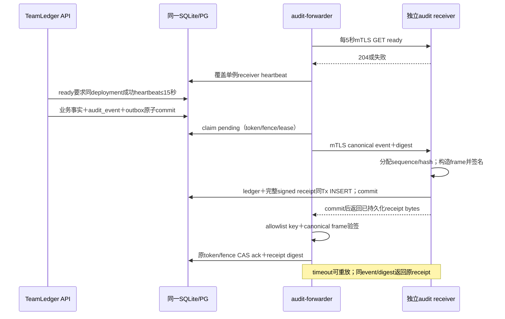

export在输出前持久prepare audit/逐对象版本清单，依次小批decrypt、每chunk release检查；每chunk视为一次批准披露，不持锁跨网络流。客户端断连或中途撤权记partial/aborted；已输出bytes不可收回。不得提前声明completed，最终delivery outcome是服务端观察到的发送结果，不证明用户确实保存/删除。

### 6.3 全窗口组织图

R2组织全窗口拟图/半开边界保持；当前scope/typed任期/subject_employee同当前日复核，图CAS与事实/投影/密文/receipt/audit/epoch同Tx，未来终止不提前失格、再任职不复活旧ref。R3-R5及R6派生消费者均已交付可达机制并复用该授权边界；来源/grant变化与AI当前结果失效同事务。生产交接/外部provider/设施政策仍未批准，不能据机制交付宣称生产启用或AC-ORG-05全产品通过。

原key/body确认先当前原receipt targets write/read/PII许可与canonical digest；异内容409。原commit后的graph推进、旧ref已结束不妨碍仍获当前原target权限者确认安全原结果；不要求旧graphCAS/旧任期重新有效，不生成“重新授权ticket”。没有receipt的新命令仍完整新写授权、图CAS和窗口校验；失去当前原owner权限不能利用receipt旁路。

### 6.3.1 R2当前授权、加密、原子持久化与读释放

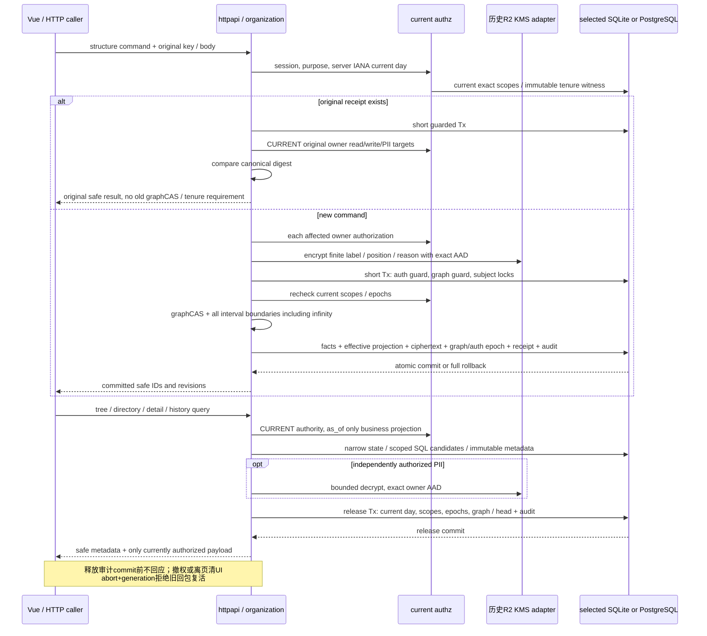


### 6.4 面谈与笔记

当前interview：scheduled→in_progress / 明确backfilled completed / cancelled，in_progress→completed/cancelled；终态不重开。actual有序且不未来、author/recorded/计划不改，状态phase最多3条；行动新增可有aggregate revision间隔而不生成伪状态事件。cancel reason独立加密且当前shared NoteR才投影。action：todo→in_progress/done/cancelled、in_progress→done/cancelled，完成面谈不关闭行动，终态面谈不新建行动；overdue只原due_date早于当前组织日且行动非终态。

note初次head expected0，已有head明确supersedes与edit_reason后append immutable draft/published；发布另当前NotePub及会话近期MFA，不把旧draft行改status、不覆盖旧发布或改类别。跨category只在独立OP-SEC-02源批准/目标grant后人工创建最小目标正文，发布重验源read/source approval/minimized，原private与ACL不变；无source read省略引用。grant与发布分别返回，不声称组合原子。source/employee epoch真实记录，未有R6消费者不能假称已失效不存在的AI结果。

### 6.4.1 R3独立批准、追加版本及有限导出时序

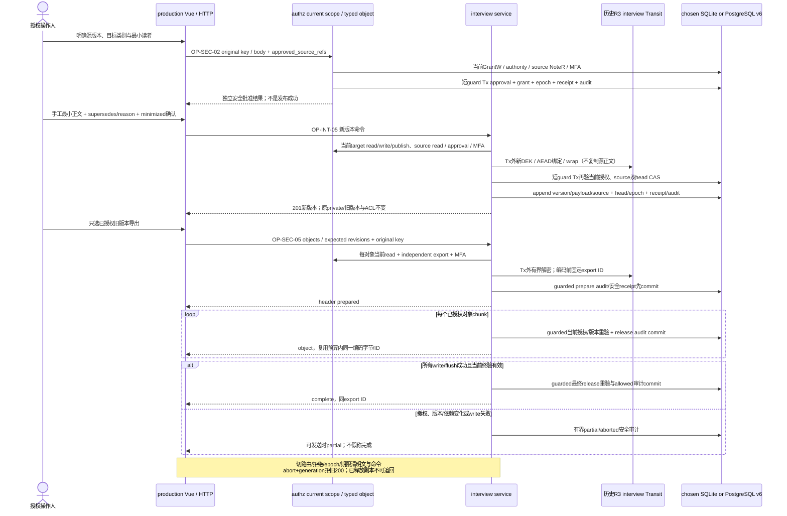

### 6.5 薪资审批与完整纠错链

proposal draft→submitted/withdrawn；submitted→approved/rejected/withdrawn，terminal immutable。submit冻结proposal revision，approve必须读取冻结版本、comp guard和B；default禁止approver=proposer，不擅设审批级数。initial要求整个拟定过去/未来有效链都无未被替代/撤销的既有初始条款且before=null，不是只看today，也不是要求历史表空；完整合法reverse已排除整链后可重新批准initial，原审批事实仍保留。adjustment的before由拟定生效日前active chain核对，Money/口径完整；未来approved event只进未来schedule，today按as_of取term，不需cron改金额。

批准顺序：当前授权＋FinR→解密冻结payload→锁/重验B/R/全部前项与后继→append approval/event/terms→重建employee schedule→bump comp_revision＋审计/receipt，单Tx。把早期新event插到已经有后继链的位置，如果改变后继before则拒绝普通approval，转显式correction group，不能自动改后继before。

纠错组锁后模拟完整replacement链。个人`correction replace`是唯一允许换币的路径：replacement after可人工提交另一允许币种的完整scale0/month/monthly/gross terms，不从旧金额或FX派生；该例外不适用于initial/adjustment或批次correction。每个后继仍按immutable before identity检查；币种变化使引用旧term的后继必须纳入组并显式给出新before/after，不能自动转换。create、PATCH、submit、approve均重验同一闭包；缺项`409/DEPENDENCY_INCOMPLETE`且零写入。

组内新term用唯一`member_key`和严格one-of `before_ref`；服务端原子分配UUID/验证拓扑，响应映射真实ID。跨币种after是新term，不改旧term或历史。

合成：CNY初始E1、后继E2引用T1。把E1显式replace为人工JPY整数时，E2若未入组则拒绝；完整组须明确E2的新JPY before及after。批准后每date唯一terms，原CNY E1/E2及审批/原因完整保留。rejected/withdrawn不改投影。

显式撤销错误批准用member `action=reverse`：保留original approval/event/terms，追加带原因与同次approval的correction_reversal marker，将原目标event排除有效链，而不是删row或写负工资。replace成员才引入新terms；reverse成员的after引用删除目标后该日剩余有效terms（若全部初始链合法撤销则为null、查询明确“未建立有效条款”）。模拟对全部reverse/replace完成后检查同一依赖闭包：任何保留后继的before不一致仍必须显式替代，不能只撤一条留下断链；删除初始但留有无合法初始的adjustment链拒绝。反向标记本身不当普通调薪排程项，不因recorded_at最新而覆盖剩余terms。

### 6.5.1 R4独立批准与完整纠错时序

下图是**DEV-009当时的R4个人薪资历史切片**。当前R5、R6b、R7、DEV-015员工主数据、DEV-034业务调薪工作台及DEV-017 canonical授权均已交付；真实生产policy/provider/设施仍未批准。

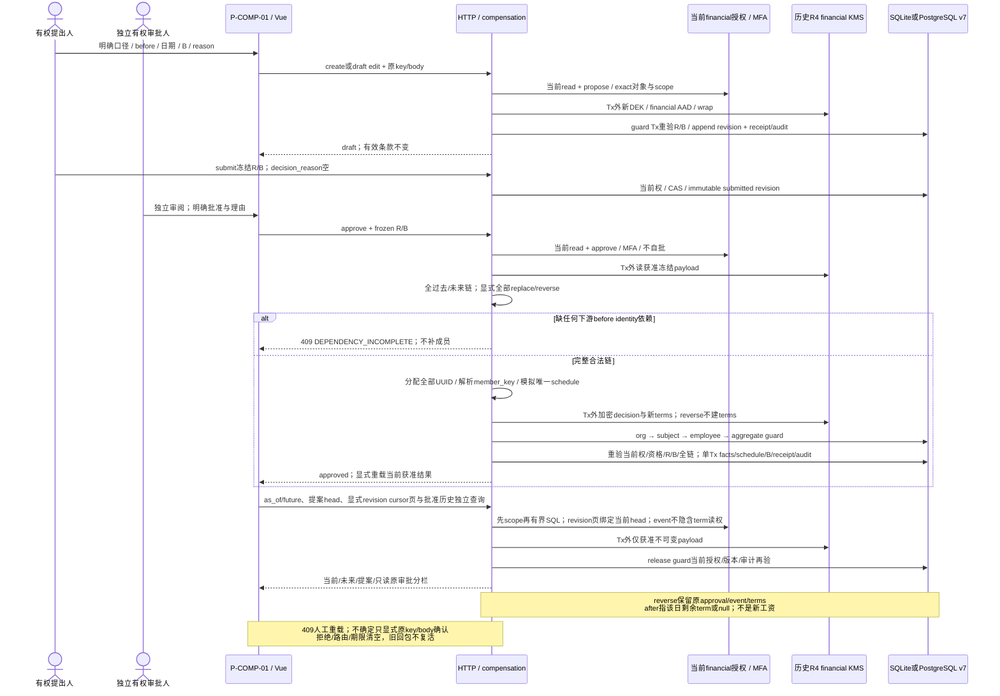

### 6.5.2 DEV-034业务调薪preview、历史纠正与单点激活

OP-COMP-07创建事务先校验名称、年度/type、法分公司、默认生效日、CNY/JPY scale0参考预算及Special原因目录，再以`compensation.batch_header.v1`封存header。事务分配`N|S-{cycle_year}-{sequence}`；counter以org＋year＋type为键，header payload、batch、专属service subject、初始state history、command receipt、audit及outbox共同提交。失败回滚counter，成功编号不回收。NC/SC编号仍只在已激活批次纠错事务内从独立counter分配。

页面初始3个空行，可增删；Staff Code失焦时的目录/个人薪资请求仅用于即时回显，不进入权威命令。OP-COMP-08的manual JSON和XLSX入口创建同一种candidate；全空行忽略，非空行最多500。XLSX另限制压缩体10MiB、展开50MiB、entry 10,000；XML拒绝任何`<f>`、numeric/date serial、外部relationship、多工作表或非Text Money。安全包/XML损坏直接422；普通字段错误加密保存为`invalid` candidate。

服务在candidate创建前按Staff Code共同HMAC lookup解析指定employee，并解析单一有效identifier/employment/job assignment、法分公司/location/family/level、同币种Salary Range及current term/revision。`ValidateBatchLines`校验before＋increase=after、Normal参考字段、Special月份/原因和非负scale0金额；Special次数以当前服务器业务日的Y/Y−1计算。输入`salary_before`与current term不同则产生`SALARY_BEFORE_MISMATCH`，不是静默改值或立即失败；无current term或纠正日与批次日冲突仍拒绝。candidate绑定batch、subject、base revision、canonical digest和24小时expiry，加密保存规范行、冻结basis、counts/warnings/errors，不保存原XLSX且不改变draft。

OP-COMP-09应用candidate时逐项重验batch revision、expiry、subject、全员工授权和冻结basis。每个工资差异必须以`confirm_salary_corrections`明确列出employee；多确认、漏确认或basis漂移均冲突。通过后将`correct_current_salary`写入加密batch line并纳入manifest，replace-all形成新draft revision。低层完整lines路径仍供受控API调用，但不能绕过employee/Staff Code/current basis解析；普通页面只使用candidate。

OP-COMP-10 submit要求当前revision及服务端manifest。服务先解密全部行、逐人重验当前授权/basis，再在compensation事务中按subject→employee UUID顺序锁定并再次解析basis。工资一致的正数行直接生成adjustment；已确认差异的行先在原current term生效日追加`correction_replacement`，after为用户输入before，再从批次生效日基于该新term生成adjustment。原event/term不更新或删除，纠正event不计normal/special次数。全部纠正、adjustment event/term/schedule、event↔batch关联、batch activation/state history、receipt、audit/outbox同事务提交；0行不生成薪资event，任一步失败不留部分事实。

业务basis冲突在回滚后CAS写`activation_conflict`；重新preview/apply生成新draft revision。503依赖失败CAS写`activation_blocked`，原revision/manifest可人工重试。当前实现没有持久prepare chunks或retire：≤500行在单个最终事务完成；若未来提高上限或需要异步恢复，必须另立PLAN并实测SQLite锁时长与PostgreSQL锁竞争。financial wrapper当前只经本地keyd。

已激活批次纠错端点接收1..500员工的DEV-009 typed correction members，按员工排序锁定并逐组执行完整closure模拟/批准。`NC|SC-{year}-{sequence}`、全部replacement/reversal事实、batch event关联、correction记录、receipt、audit/outbox共同提交；原batch/event/term不更新或删除，且correction不增加normal/special次数。

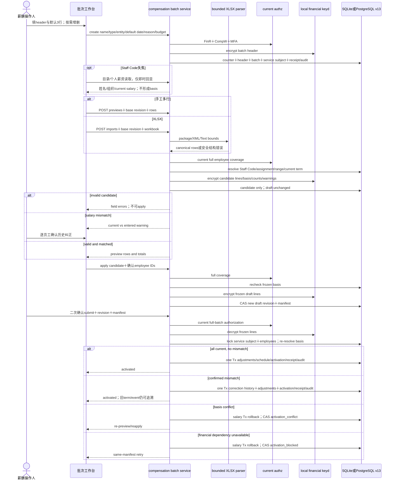


### 6.6 奖金事实、异常与冲销

target draft→confirmed/withdrawn；confirmed→withdrawn，由BonusTargetW维护并保留confirmed history。award用proposal状态机/独立批准；approved correction由新draft award `corrects_award_id`经同审批，全部原approval保留。既有完整replacement语义明确为：只有新纠错批准才在有效投影排除被替代award，原状态仍approved；draft/submitted/rejected/withdrawn纠错不改变原有效奖励。锁bonus guard、重验B/R，纠错只能引用当前有效approved链尾、同org/employee，拒绝分叉/环/重复替代；每链仅批准后的唯一尾项计入有效批准额，不能把原100和替代120加成220。替代映射、核对投影、异常及audit同Tx；target/award/支付从不自动联动。

支付和reversal的原`award_id`/原payment引用始终不改。仅沿**显式已批准替代链**派生effective_award_id，将祖先及链尾明确关联的净支付各计一次归到唯一有效奖励；A1批准100、已付40，A2完整替代120批准后是approved120/paid40/balance80，而非paid0。再替代或冲销同样沿链归集，不按金额/日期匹配、不重写历史payment。最终奖励与原支付currency/scale不符时保留原币种事实并标异常，不抵新币种余额；unmatched或另一无关奖励不归入。历史查询仍展示原批准额/原关联/时序事实，不能只返回当前投影掩盖更正。

PayW提交实际付款时，复合FK检查award/source/employee同org且caller有权关联。不存在/跨org/跨employee/无权关联拒绝，不自动改成unmatched；调用者可明确`award_id:null`＋最小外部凭证ref如实记录未匹配。关联存在但未approved（含draft/submitted/rejected/withdrawn）记录`unapproved_award`异常，不让payment批准award；币种scale不符/超额亦正常授权与payload通过后**如实记录**payment＋anomaly。批准额只含当前有效approved awards，同币种scale与关联payments按signed Money核对未支付/部分/已支付/overpay；不同口径分桶列异常，无假FX总余额。若后续才批准，保留原payment日期与原unapproved异常；paid_date早于组织时区下approval date标`payment_before_approval`，同日仅有日期不能断言先后，显示时序未确定，不伪造当时已批准。

reversal是新immutable记录，kind=reversal、positive amount、original_payment_id指同employee原payment，不能反向引用另一reversal；沿原付款的币种/scale/award归属核对，累计reversal≤原payment，防重复超冲销。错误币种/员工要先合法冲销原事实再记录正确payment，每项保留凭证/链接；没有修改原payment或auto-FX。business key+receipt、revision、付款/冲销/异常/投影/audit同Tx，旧B拒绝；重复事实先重验授权和payload，再返回原记录，不因当前aggregate新revision误生第二付款。纠正award后按关联投影重新核对，原异常detected事实仍可追到resolved record。

### 6.6.1 R5写入、读取与HMAC索引维护时序

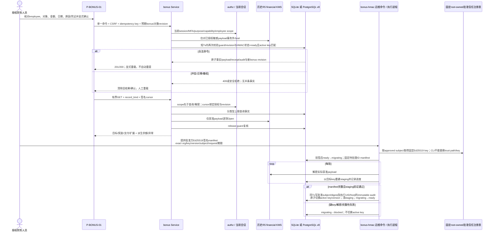

HMAC状态不是可忽略运维标记：所有新增奖金写在事务内读取并锁定当前`ready`状态及配置key id/version；`migrating/blocked`一律停写。重建只替换可派生的exact查找索引，不修改payment/award/target原事实或审批历史；恢复需明确继续原manifest或从验证过的失败状态重新开始，不能把半成品staging当active。

## 7. 可信身份、授权与加密

### 7.1 身份部署模式、session与step-up

`TEAMLEDGER_IDENTITY_MODE=local|oidc`是部署必选且互斥。fresh DB首次成功bootstrap把mode写入`identity_mode_state`；其后配置与DB不一致时API拒绝ready/登录，而非fallback。切换只能由maintenance显式执行，并在同一受控事务撤销全部session、推进所有subject/org auth epoch、更新mode epoch并写必需审计；OIDC与local identity不自动关联，任一模式失败都不得尝试另一模式。

`oidc`模式生产前必须接入实际可信IdP、精确注册issuer/client/redirect URI、JWKS信任/算法allowlist、客户端机密设施、subject绑定/停用流程及MFA声明映射。禁止测试trust身份成为生产登录。建议后端confidential Authorization Code＋PKCE S256，随机一次性state/nonce绑定浏览器短时transaction（10分钟）；token交换仅后端TLS，校验code/state/nonce/iss/aud/azp/签名/exp/iat与预期issuer，拒绝`none`/未知alg，签名轮换通过可信JWKS更新而非任意token URL。[S1][S2] email/title/IdP group不直接升敏感grant。

两种模式都签发cookie `__Host-teamledger_session`：随机256-bit opaque值、DB只hash，`Secure; HttpOnly; SameSite=Lax; Path=/`无Domain；生产同源且TLS。session绝对8小时、idle30分钟，登录/step-up/密码变更轮换或撤销session/CSRF，subject/session撤销实时检查。OIDC access/refresh token不进浏览器；如确需保留仅服务端加密，非必要就不存refresh。redirect只允许站内已知路由，不开放任意URL。

所有cookie mutation及敏感POST校验session绑定CSRF token、Origin与Fetch Metadata。[S3] token只经keyd当前`csrf_token` MAC：规范输入为domain＋原始32-byte session随机值，DB存token hash/key version，`/session`从已验证cookie以**当前同version key**重算。CSRF key rotation必须停写，并在激活前同一DB事务撤销全部旧version session、推进subject/session epoch及写audit；因此不提供历史MAC派生。旧tab/reload/POST统一401并清敏感状态，按当前部署模式重新登录才取得新session/token；多tab不静默换token。OIDC callback仍以state/nonce/PKCE而非普通CSRF。

两种模式均提供step-up。OIDC通过同login流程绑定当前主体、action/return和可信`auth_time/acr/amr`；local在当前business session中重新验证当前密码＋未重放TOTP。`/security/audit`的canonical return及action固定为`audit.read`，local JSON shape接受密码/TOTP凭据后由identity service验证，不再因通用OIDC shape丢弃；OIDC不以这些本地凭据替代IdP证明。两者成功均撤销旧session、轮换opaque cookie/CSRF，并从本次证明时间签发10分钟`mfa_until`。合格近期MFA是会话级认证条件，不是一次性动作票据；action只约束认证意图，不创造能力、scope或grant，UI不得自动重放先前业务命令。

#### 7.1.1 OIDC身份协议时序（DEV-006候选已实际运行，生产设施另验）

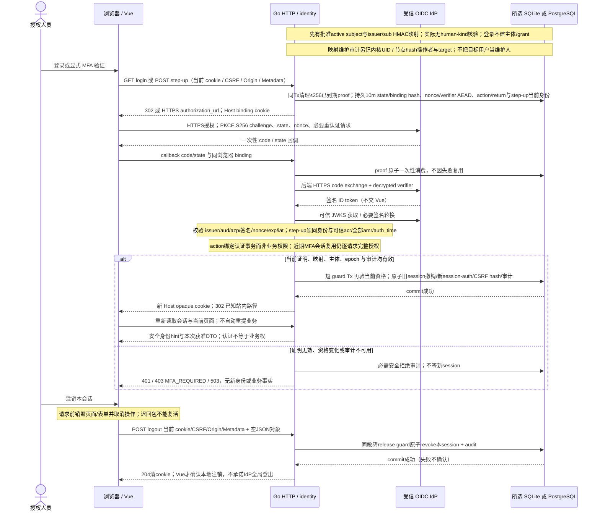

当前v3身份proof与业务release/授权变化使用同组织guard，跨组织先排序所有org、再排序subject；网络交换不在SQL事务里。callback后仍重验当前mapping/主体/原session撤销与epoch，不以开始认证时的快照授会话；unlink后重bind不得复活旧cookie。已有C3 grant原回执规则不因身份gate改变。

#### 7.1.2 内置账号、Staff关联、首次改密与TOTP协议（DES-008；DEV-019/035/038/043已实装）

P-SEC-03显式创建`standalone`或`staff` local账号。两者都建立新的active subject/account且不自动建立普通capability/grant；`identity.manage`也不等于`access_grant.manage`。standalone不绑定employee且默认零业务权限。staff必须提供规范精确Staff Code，并在同一事务解析当前有效且未绑定的employee，写`subject_employee`及immutable `staff_default.v1`；不能按用户名、姓名或邮箱推断，也不能转绑。canonical username为小写ASCII并匹配`[a-z0-9][a-z0-9._-]{2,63}`；DB保存`local_username_lookup` HMAC索引与以identity mapping domain加密的`identity.local_username.v1` source，owner永不转移。username读写不得使用`identity_mfa` wrapper。密码按原始UTF-8 bytes处理，不trim/normalize，长度12..256且拒NUL；不能进入argv/env/log/audit。
`staff_default.v1`不是普通grant或可委派authority。每次请求用当前组织日、employee生命周期及未结束/未supersede的administrative reporting line动态计算本人＋一层直属下属；不递归二层。它只允许员工metadata/PII读取、面谈metadata读取和OP-INT-02创建。客户端用派生提示`interview.create`显示创建入口，但该提示不进入grant能力目录，也不能执行面谈状态转换、笔记、行动、评估、薪资或导出。关系或本人任职结束后下一请求即失效；历史`as_of`不能恢复权限。


`local_password_pepper`不离开keyd。规范MAC frame进入Argon2id `m=65536 KiB,t=3,p=1`、随机16-byte salt、32-byte output；credential保存exact pepper reference＋PHC。不存在/disabled账号执行有效fake PHC。`local_login_throttle`把密码或TOTP失败按username digest原子累计，退避`min(2^(n-1),900)`秒；响应不能暴露账号/factor是否存在。

fresh `local-bootstrap`和OP-SEC-07新用户均设置`password_change_required=true`。初始密码正确只签10分钟`access_kind=password_change`受限session；只允许提交当前密码和不同的新密码或注销，不能访问`/session`、MFA、用户管理或业务API。成功改密原子替换credential、清flag、推进auth epoch、撤销全部session并写安全审计，用户必须用新密码重新登录。v14→v15既有账号flag为false，保持原有密码流程。

改密完成且MFA状态为`enrollment_required`时，正确密码才签10分钟`access_kind=mfa_enrollment`受限session。页面调用enrollment端点取得CSPRNG 20-byte Base32 secret和本地生成二维码；pending使用`identity_mfa` domain密封、绑定org/account/enrollment/generation AAD，10分钟内最多确认5次。TOTP固定RFC 6238 HMAC-SHA-1、6位、30秒，服务端接受current±1并选择最接近current且严格大于`last_accepted_step`的step。factor secret同样以`identity_mfa`密封；登录、step-up、factor替换和恢复码重发共用持久replay状态。确认时原子推进generation，替换factor、删除pending/旧恢复码、撤销其他session，并返回一次显示的32字符恢复码；恢复码只保存`local_recovery_code` exact MAC reference。

恢复登录必须同时提供密码、恢复码及UUID `Idempotency-Key`。事务在账号锁内消费恢复码、撤销全部session/pending、建立browser-bound `mfa_recovery`受限session及receipt；同request/input在响应丢失后返回同一pending，异input冲突，并发只有一个成功。它不能签business session或`mfa_until`。遗失TOTP和恢复码时只允许受保护文件驱动的`identity local-mfa-reset`离线命令；不存在网页等价入口。

密码修改保留active factor但撤销全部session；账号disable作废MFA事实。keyd/DB/audit、AAD/tag/key reference任一不可用时不签session、不返回secret并fail closed。初始密码、二维码、TOTP secret与恢复码不写URL、storage、clipboard自动化、telemetry或日志；HTTP均`no-store`。

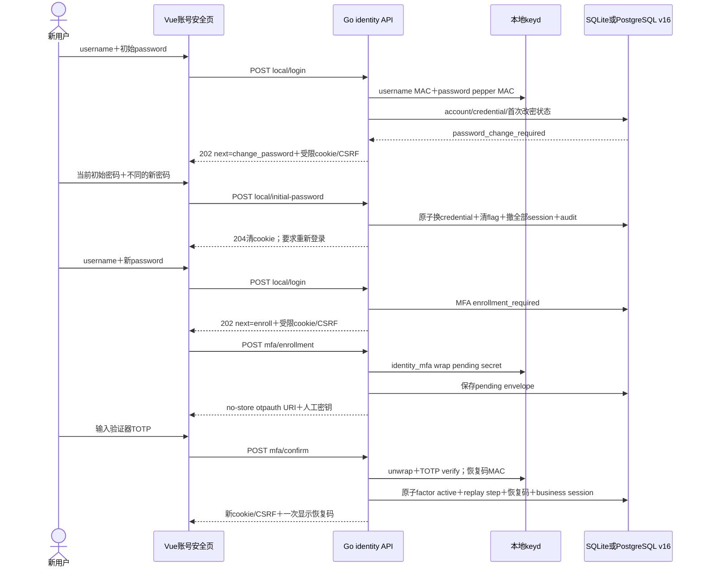

### 7.2 服务端判定顺序与当前grant

1. session/worker身份有效，subject active、org匹配；外部输入不能选择主体/owner。
2. metadata取得canonical org/employee/object并核对当前read-scope；不存在/不可读统一404，不先发对象相关MFA挑战。已可见对象缺动作capability才403；写不隐含read。
3. scope核对org/department/employee；department exact不继承，employee用当前business date的canonical job assignment，不以历史`as_of`取得旧经理资格。
4. category（metadata/PII/shared/manager_private/hr_confidential/financial/assessment/audit）与typed object/scope grant精确匹配；metadata也受其对象类型read capability限制，不是全域读权；grant未撤销、期限/许可动作有效。
5. relation-bound资格核对grant的确切typed relation_ref仍在当前有效投影中、主体/对象/scope符合批准资格，并受该关系半开区间限制；无ref、已结束/被替代均拒绝。M1第一任期结束后即使第三任期再次管理同员工，也不能复活第一任期grant，需新任期显式批准的新grant；不依赖scheduler及时撤销。独立grant也必须来自明确批准policy，没有永久author/participant例外。manager/title/ancestor/dotted不自动财务/历史授权。
6. purpose取有限policy集合且grant许可，再校验操作所需可信MFA条件；AI还必须外传policy/approved input，human/result需所有sources当前read交集；导出额外Export与scope。
7. 记录org/subject/object/source auth/policy epochs；通过才请求本地keyd。commit/release/dispatch/publication再执行该判定，不只在UI/session缓存做一次。

组织交接/到期/离职撤关系bound grant并bump epoch；new manager不继承history/financial，新交接grant需显式委派批准。自由reason用于加密/安全审计但不能成为授权purpose。普通HR/DBA/IT没有自动FinR/KEK unwrap；employee本人也不自动员工自助。private不豁免适用法律调查/访问/保留，相关流程政策确认后显式登记，不用普通note edit删除原证据。

### 7.3 密文包、AAD与用途隔离

写库前每个immutable payload生成随机256-bit DEK，以AES-256-GCM仅加密该payload一次；DB只存sealed bytes和wrapped DEK。`encrypted_payload`保存owner/purpose/schema、DEK/KEK id/version、唯一`dek_id`及包revision。长期key按§3.2.1 domain/type分离，不能跨用途复用。

DES-007 root是CSPRNG RAW32。配置路径位于预设root-owned锚点下；Linux从锚点FD用`openat2(RESOLVE_BENEATH|RESOLVE_NO_SYMLINKS|RESOLVE_NO_MAGICLINKS)`逐层打开并核对owner/mode。最终目录`0700`；`root.key`0400，`keyring.bin`/`.lock`0600，均keyd UID、regular、`nlink=1`。同FD读取前后`fstat`；root exact32 bytes。固定inode只保证本次快照，不声称防host root。

`keyctl-local init`在已验证父dirfd下建同filesystem随机临时目录，创建上述三文件，fsync文件/目录，以`renameat2(RENAME_NOREPLACE)`发布并fsync父目录；目标已存在或不支持no-replace即拒绝。normal startup不创建/修复。

Keyring认证包含magic/format/**material_generation**/previous digest/随机128-bit update salt/密文/tag。每次material更新以HKDF-SHA-256(root, update salt, `TEAMLEDGER-KEYRING`＋format＋generation)派生只用一次的AES-256-GCM key，以固定nonceSeal一次；salt在链内唯一，AAD绑定完整header。明文entry按domain/type/key UUID/version排序，包装key状态仅`staged|active|decrypt_only`，MAC key为`staged|active_write_verify|verify_only`；每domain/type恰一active或明确disabled。

所有密码上下文使用`CF1`：`"TLCF"[4] | version u16=1 | field_count u16 | fields`。field=`tag u16 | type u8 | length u32 | value`，整数network order。type仅null=0/bytes=1/UTF8-NFC=2/UUID=3/u64=4/enum-u16=5/digest32=6；null长度0，UUID为RFC4122网络序16 bytes，其余固定8/2/32。tag严格递增唯一；拒未知type/tag/version、非规范长度/顺序、重复、尾随、非NFC及总长>64KiB。optional必须既定tag＋null，不可省略或以empty代null。

Payload AAD=`"TEAMLEDGER-PAYLOAD\\0" || CF1`，tags固定：1 org UUID、2 object-kind enum、3 owner-binding嵌套CF1 bytes、4 record UUID、5 immutable version/revision u64、6 purpose enum、7 schema ID NFC、8 schema version enum、9 `dek_id` UUID。object-kind：1 profile、2 identifier/education、3 org/catalog label、4 assignment position、5 structure reason、6 interview note、7 interview action、8 compensation terms/proposal、9 salary range、10 batch、11 bonus、12 assessment、13 identity mapping、14 identity transaction、15 interview reason；purpose：1 PII、2 interview-shared、3 manager-private、4 HR-confidential、5 financial、6 assessment、7 identity。

owner-binding的nested CF1只接受下表tags；`U`=UUID、`E`=enum-u16、`D`=digest32、`N`=明确null。来源均为同record受FK/immutable约束列，不取请求/header。tag7 schema ID必须逐字等于表中ID，tag8必须等于`.vN`的N。`pii.*`固定purpose1；interview note的category 1/2/3分别固定purpose2/3/4，action/reason固定purpose2；全部compensation/bonus/memo固定purpose5；assessment固定purpose6；identity固定purpose7。object-kind精确映射：profile=1；identifier/education=2；org-unit/legal-entity label=3；job-assignment=4；structure-reason=5；interview note/action/reason=6/7/15；terms/proposal=8；salary-range=9；batch-line/correction/import-raw/import-rows=10；bonus/memo=11；assessment=12；identity mapping/transaction=13/14：

| schema ID | owner-binding exact tags（tag:type=trusted source） | enum / null规则 |
| --- | --- | --- |
| `pii.profile.v2` | `1:U=employee_id` | 仅1 |
| `pii.employee_identifier.v1` | `1:U=employee_id` | 仅1 |
| `pii.education.v1` | `1:U=employee_id` | 仅1 |
| `pii.org_unit_label.v1` | `1:U=org_unit_id,2:E=unit_type` | BG=1, Division=2, Department=3 |
| `pii.legal_entity_label.v1` | `1:U=legal_entity_id,2:E=entity_kind` | branch_company=1 |
| `pii.job_assignment_position.v1` | `1:U=employee_id,2:U=assignment_id,3:U=department_id` | 三项必填 |
| `pii.structure_reason.v1` | `1:U=structure_change_id` | 仅1 |
| `interview.note.v1` | `1:U=employee_id,2:U=interview_id,3:U=head_id,4:U=note_version_id,5:E=category` | shared=1, manager_private=2, hr_confidential=3 |
| `interview.reason.v1` | `1:U=employee_id,2:U=interview_id,3:U=transition_event_id` | 三项必填；仅cancel event |
| `interview.action.v1` | `1:U=employee_id,2:U=interview_id,3:U=action_id` | 三项必填 |
| `compensation.terms.v1` | `1:U=employee_id,2:U=aggregate_id,3:U=source_id,4:E=source_kind` | personal=1, batch=2 |
| `compensation.salary_range.v1` | `1:U=legal_entity_id,2:E=location,3:U/N=family_id,4:U/N=level_id,5:E=currency` | Shanghai/Wuxi/Tokyo=1/2/3；CNY/JPY=1/2；nullable tag不得省 |
| `compensation.proposal.v1` | `1:U=employee_id,2:U=aggregate_id,3:U=proposal_id` | 三项必填 |
| `compensation.batch_header.v1` | AAD `record_id=batch_id,version_id=header_payload_id`，无employee owner | exact batch header；用途financial |
| `compensation.batch_line.v1` | AAD含exact employee，`record_id=version_id=line_payload_id` | employee-owned；用途financial |
| `compensation.correction_member.v1` | `1:U=batch_id,2:U=member_id,3:U=employee_id,4:U=target_id,5:E=source_kind` | batch_line/event/personal_event=1/2/3 |
| `compensation.batch_import.v1` | AAD `record_id=version_id=candidate_id`，无employee owner | manual/XLSX同构candidate；用途financial |
| `bonus.target.v1` / `bonus.award.v1` / `bonus.payment.v1` / `compensation_memo.v1` | `1:U=employee_id,2:U=record_id` | schema ID区分kind |
| `assessment.input.v1` | `1:U=employee_id,2:U=window_id,3:U=input_id` | 三项必填 |
| `assessment.result.v1` | `1:U=employee_id,2:U=window_id,3:U=result_id,4:U=job_id` | 四项必填 |
| `identity.mapping.v1` | `1:U=org_id,2:U=subject_id,3:U=mapping_id` | 三项必填 |
| `identity.local_username.v1` | `1:U=org_id,2:U=subject_id,3:U=account_id` | 三项必填；只用于local canonical username |
| `identity.transaction.v1` | `1:U=transaction_id,2:D=issuer_config_digest,3:N=subject` | pre-login subject必须null |

规范向量V1：org/employee=`00×16`，record=`11×16`，`dek_id=22×16`，revision=1，profile/PII，schema=`pii.profile.v2`/2。AAD共197 bytes，hex：

`5445414d4c45444745522d5041594c4f414400544c43460001000900010300000010000000000000000000000000000000000002050000000200010003010000001f544c434600010001000103000000100000000000000000000000000000000000040300000010111111111111111111111111111111110005040000000800000000000000010006050000000200010007020000000e7069692e70726f66696c652e76320008050000000200020009030000001022222222222222222222222222222222`

其SHA-256为`b683864a1df5921ab2485ca114a406ba7b84b6ee7f59b3e6be9418ad040eb5ef`。取domain=1、`kek_uuid=33×16`、kek_version=1时，TLW1 header至wrapped_len（78 bytes）hex为：

`544c573100010001333333333333333333333333333333330000000122222222222222222222222222222222b683864a1df5921ab2485ca114a406ba7b84b6ee7f59b3e6be9418ad040eb5ef0048`

对应HKDF info（`TEAMLEDGER-WRAP\0`＋header至aad_digest，不含wrapped_len）hex为：

`5445414d4c45444745522d5752415000544c573100010001333333333333333333333333333333330000000122222222222222222222222222222222b683864a1df5921ab2485ca114a406ba7b84b6ee7f59b3e6be9418ad040eb5ef`

实现必须逐byte匹配V1；把schema-version末尾`0002`改为`0001`、改变任一owner/record/dek byte或追加尾随byte均必须拒绝。

Payload包=`"TLP1"[4] | format u16=1 | algorithm u8=1 | nonce[12] | ciphertext_len u32 | ciphertext | tag[16]`，无尾随。每payload随机RAW32 DEK只Seal一次；AAD不含KEK版本，rewrap不重加密。错owner/record/version/purpose/schema/dek及非规范frame拒绝。

Wrapper包=`"TLW1"[4] | format u16=1 | domain u16 | kek_uuid[16] | kek_version u32 | dek_uuid[16] | aad_digest[32] | wrapped_len u16 | wrapped`。domain编号不得重排：1..7为PII/interview/assessment/financial/identity-transaction/identity-mapping/backup wrapper，8..14为既有MAC，15为`local_username_lookup` MAC，16为`local_password_pepper` MAC，17为`identity_mfa` wrapper，18为`local_recovery_code` MAC。v1用RFC5649 AES-256-KWP包装64-byte `DEK || aad_digest`，wrapped_len=72且无尾随；HKDF-SHA-256 salt=`dek_uuid`，info为固定prefix＋header至aad_digest。

长期KEK只用于HKDF，派生KWP key只包装一个`dek_id`。payload DEK与keyring更新派生GCM key各只Seal一次，因此v1无usage counter。实现必须固定CF1/TLP1/TLW1 byte-level golden、RFC5649及非规范/跨owner/record/version/purpose/schema/header篡改拒绝向量。
除代表向量V1外，每个registry schema（含legal-entity label、interview reason及batch import raw/rows）必须有由固定UUID/enum/null生成的AAD golden；逐项错object-kind/purpose/schema/version/owner、raw与rows schema互换及跨wrapper-domain均为拒绝向量。

Key directory内固定`.lock`是keyd UID、regular、`0600`、`nlink=1`的持久inode，初始化后永不rename/unlink。keyd和所有CLI经安全dirfd以`O_RDWR|O_NOFOLLOW|O_CLOEXEC`打开并核对directory entry与FD dev/inode一致，再取得exclusive OFD lock；锁在加载、socket bind及全部发布之前持有到进程退出。keyring不能充当锁。

协议含普通`ready|wrap|unwrap|rewrap|mac|verify`，maintenance UID另有manifest-bound `stage|mac_staging|activate|retire`。artifact验证与A1/A2 receipt由离线`keyctl-local`＋DB maintenance manifest完成，不是keyd网络op。普通wrap/mac只用DB期望active；unwrap/verify可显式历史version。Unix socket以`SO_PEERCRED`和UID/op/domain矩阵约束≤64KiB严格frame；不接受路径/UID/任意purpose/RAW长期key，日志不含秘密。

既有16-domain keyring只能在API/keyd停止且取得同一持久lock后执行`upgrade-domains`：严格核对完整旧inventory，为17/18各生成一个v1 active key，generation＋1并以previous digest链认证、temp＋fsync＋rename原子发布。v14 migration完成后单独启动keyd，再由`acknowledge-domains`核对旧16个active pointer完全相同、只新增17/18、无staged key，并以DB CAS把generation/digest/18-domain map确认到`crypto_control`。完整18-domain重复升级无变化；普通keyd启动和API ready绝不静默补domain。失败保持API停止，禁止清库、替代root或猜active状态。

### 7.4 轮换与恢复清单
`identity.mapping.v1`之外，local username source使用同一`identity_mapping` wrapper domain但独立schema `identity.local_username.v1`，owner tags为`1:U=org_id,2:U=subject_id,3:U=account_id`；两种schema不得互换。

`material_generation`只在key material/state改变时增长。stage发布G+1后复制并隔离验证artifact A1；维护命令把A1 receipt写入DB manifest，不改keyring。activate发布G+2但保持全域停写；再验证含active metadata的A2。只有A2 receipt、keyd G+2 digest/active map和DB `crypto_control`核对后才ack并恢复写。

包装key target active/source decrypt_only。MAC/index先用A1 target `mac_staging`重建；activate后target active_write_verify/source verify_only，DB停写事务CAS index＋ack。Staff Code从加密identifier、identity从全部加密mapping source重建并验owner全集。CSRF例外：**activate前**单独DB事务撤销全部旧version session、推进epoch并audit；提交成功后才允许keyd activate，崩溃只造成用户需重登，不会接受旧token。
assessment轮换manifest只列versioned generation MAC引用；source digest无key entry、无staging/CAS，恢复时仅以持久canonical structured JSON重算SHA-256并逐byte核对。

崩溃规则：A1前target不使用；A1 receipt写入可幂等重放；G+2发布而A2/DB ack缺失时保持maintenance/not-ready，只允许同manifest完成A2和ack；DB index CAS后但ack前仍停写。rewrap逐包反向验证＋CAS/checkpoint恢复。旧generation、无A2或并发manifest绝不猜active。

DB backup不含root/keyring。恢复manifest列出完整inventory及非对称信任配置；隔离目标挂载匹配artifact，known-answer探测每个version并核对schema、wrapper/AAD、MAC索引、授权/撤权、job fence和审计。恢复时间线中的旧包装active先decrypt_only，再以A1/A2创建新active。root v1不在线轮换。

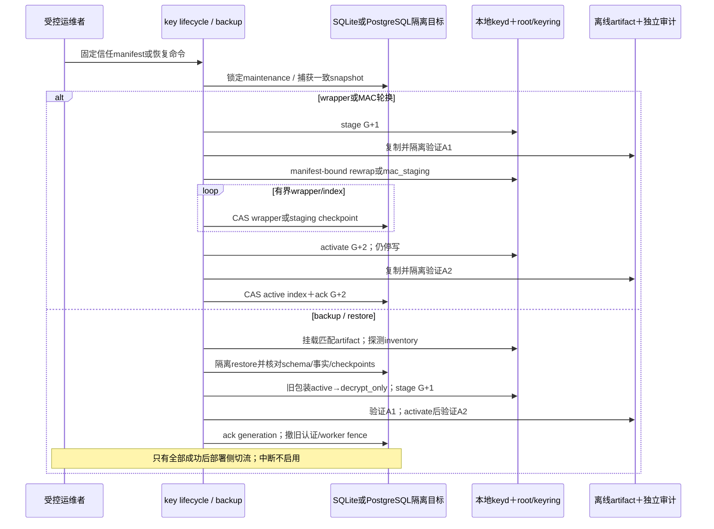

#### 7.4.1 root/keyring离线副本（DES-008固定，DEV-021已实装）

每次export产生同一`export_uuid`的两份**分别加密**可移动介质A/B；不包含DB backup，也不宣称单独介质可以恢复服务。操作先停止API/worker/forwarder等全部key写入者，再以安全dirfd取得keyd持久`.lock`的exclusive OFD lock；锁持有期间从已验证descriptor读取同一代root/keyring，不通过pathname重开。A/B输出父目录必须具有不同filesystem device ID；应用拒绝同device，但实际物理/地理分离仍由运维确认。每份介质先写同目录临时文件，逐文件及目录`fsync`，再`renameat2(RENAME_NOREPLACE)`并提交父目录`fsync`；提交失败时尝试rename回temp并持久化回滚。持续I/O故障可令回滚结果不确定，此时返回明确indeterminate错误，运维必须保持keyd停止、检查并移除本次指定路径；规范不虚称任意故障下目标必定撤回。随后卸载并在隔离主机只读重新挂载验证。

两份inventory都必须含format version、export UUID、material generation、root SHA-256、keyring SHA-256、**全部key entry**的domain/type/key UUID/version/state（active、staged、wrapper decrypt_only、MAC verify_only等有限状态）和每domain active pointer、每文件size/mode、export UTC、实际离线进程UID、source host identity digest，以及覆盖inventory canonical bytes的独立sidecar digest；不能只列active key而遗漏历史/暂存依赖。Compose中的离线进程UID是实际可验证的执行身份，不把服务UID虚称为人类操作员。A/B除介质标识和密文容器nonce外这些值完全一致。介质全盘/容器加密，解锁口令不与介质同放；A/B断电、分离且不同物理位置保管。导出成功只在两份均完成只读hash、keyring认证、完整entry/state集合/active pointers重算、全domain/version known-answer probe并匹配inventory后确认；任一失败整次export无效，不用单份“部分成功”更新登记。

恢复只在空key directory的隔离主机进行：验证介质密文、inventory/sidecar、文件metadata/hash/keyring认证、完整entry/state集合/active pointers与每个domain/version probe，再原子安装root/keyring/`.lock`；rename后的父目录`fsync`失败执行同一可报告回滚。完整回滚时CLI报告`failed_rolled_back`；回滚rename或持久化失败时报告`failed_indeterminate`及保持keyd停止/检查指定路径动作，不暴露路径或密钥。indeterminate禁止启动恢复keyd。如同时有待恢复DB，必须额外逐byte核对`crypto_control` generation、keyring digest、active pointers/A1/A2 ack及全部wrapper/MAC历史依赖；不匹配不ready、不猜新key。离线副本不含DB、OIDC client secret、audit TLS/receipt signing private key或业务备份，因此没有这些独立资产时不能恢复完整服务；RTO/RPO/灾备目标明确不在当前范围。

DEV-021实现为`teamledger-keyctl-local offline-export|offline-verify-pair|offline-restore`。Compose分离`key-offline-export`与无在线key volume、介质只读的`key-offline-verify` profile；两者仅在全栈停止后复用keyd UID，不把root读取权授给API或普通maintenance。容器格式使用两个不同受保护RAW32介质密钥分别AES-256-GCM认证加密，header绑定format/media ID/nonce/长度；密文payload绑定同一canonical inventory及其SHA-256 sidecar、原始root/keyring/空lock bytes。每个entry probe是以该entry material为key、固定域分离frame为message的HMAC-SHA-256，只存在加密payload内。verify逐份完成AEAD与全部重算后才比较A/B canonical inventory和材料bytes；restore只向不存在目标以同父目录temp directory和`RENAME_NOREPLACE`发布。

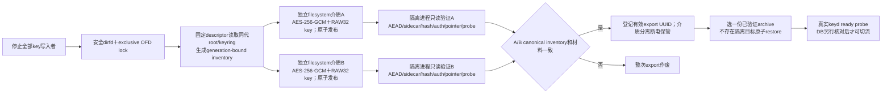

## 8. 周期、AI任务、来源与人审

### 8.1 明确日历窗口与确定事实

interview_policy显式 `cadence.unit=day/week/month`、positive count、anchor_date、IANA timezone、due_offset_days、local_due_time、pause intervals；未配置返回unconfigured，不默认monthly。窗口按当地日历从anchor累加（不是30×24h）；month anchor如29/30/31按明确policy clamp到该月末，下一窗口仍从原anchor推导，不能滚成永久28号。DST local cutoff遇不存在时间建议向前到下个合法时点，重复时间取较晚实例；这些是可测试建议，启用前确认并记录tzdb版本，绝不默认浏览器时区。窗口start,end)，持久具体start/end/due UTC与policy revision，政策变更生成新generation并使旧当前结果失效。

统计按实际面谈时间而非recorded_at；backfill标明录入滞后，不能声称当时系统已知。Go计算未安排/已安排未发生/已完成、授权可知字段完整度，以及**归属于实际面谈所在窗口**的nonterminal行动项due/overdue；缺日期/隐藏类别为unknown/partial_access而非“良好/差/员工不配合”。pause interval为当地日期半开区间；与窗口`[local_start,local_end)`有任意交集，或包含该窗口当地`due`日期时，整窗标为paused且不产overdue；恰在窗口开始前结束、且不含due不暂停。无AI/provider也可用规则状态。

### 8.2 来源snapshot与最小化

人工请求不接收任意source/body，只接当前`window_id`。API以调用者当前`assessment.request/read`构造固定`StructuredInput{window,facts,template,source_digest}`；facts沿R6a确定状态，不含姓名、联系方式、职位、原note/action正文、manager_private、hr_confidential、salary/bonus。请求保存`proposed`，不外传。

独立批准调用只接`input_id/provider_policy_id/audience`；批准者必须有`assessment.input.approve/read`且不能等于requester。批准事务将输入置approved并创建queued job/audit。provider allowlist不是grant：API与worker都必须读取owner/mode受保护的有限provider approval JSON（version、policy ID、audience、精确HTTPS endpoint、expires_at）并逐字段匹配；缺失/过期/不匹配即拒绝启用。当前仓库没有真实approval artifact，测试只用task结束即删除的合成文件。

source digest为固定模板结构JSON的SHA-256；generation为带域分离和length frame的HMAC，绑定org/employee/window/policy revision、请求/服务主体、subject/auth epoch、持久`assessment_source_epoch`及完整结构输入。source/grant INSERT/UPDATE在失效旧对象的同Tx递增employee epoch；manual/scheduler写input前按subject→employee guard重验当前session/grant和epoch，变化先提交则创建409，创建先提交则后续trigger立即invalidated/cancel，关闭“变化后插入陈旧input”竞态。HMAC不含scan time/随机input ID；同授权snapshot重启/双scanner稳定。v10对非invalidated input实施partial generation唯一：`consumed`代表当前有效draft/published结果，阻止无变化重复生成；变化后旧历史不阻塞替代generation。employee/object grant精确员工；department grant按当前canonical assignment枚举受影响employee，不能可靠缩窄时同Tx保守失效本org相关input/job/result；org grant直接按本org处理，v12没有team分支。job仅queued/leased active唯一；human读取释放前线性化复核，恢复grant不复活旧result。

### 8.2.1 周期触发与受限常设输入批准
`periodic_structured_v1`可不带standing policy保存并明确`blocked/automation_not_enabled`。真正ready须OP-AI-01同时保存独立service subject、audience、expires、provider policy和固定template v1；配置过程核对service当前request/read能力，不借配置暗授grant。

API scheduler每30秒扫描`due_at<=now`且未暂停窗口。扫描以`last_scanned_at NULL优先/最旧优先`轮转，每批最多100；无standing的periodic窗口也进入扫描并持久化`automation_not_enabled`，已有generation冲突仍推进heartbeat，故旧100窗不能饿死后续窗口。具standing时使用配置service token重做Security/当前request/read检查，构造相同固定结构输入；`CreateScheduledAssessment`在数据库唯一generation下原子插入approved input和queued job，重启/多实例冲突视为已存在。无有效service/provider/standing时持久更新window为blocked、有限block reason及`last_scanned_at`；扫描存储错误使API受控关闭，不静默吞错。真实provider审批artifact缺失时provider disabled，规则路径继续可用。

job持久input、provider/audience、generation/source digest、attempt/fence/token hash、lease/deadline。worker只有内部mTLS routes；内部API client独占worker client certificate，外部provider使用另一仅server-auth CA client且不得收到内部证书。provider调用在数据库事务外。面谈/行动/笔记/grant mutation触发cancel/invalidated后，旧heartbeat/result CAS拒绝；invalidated/discarded结果在解密前即404，恢复grant不把旧状态改回。周期与人工生成结果都只进入draft。

### 8.2.2 R6b实际控制面与数据面时序

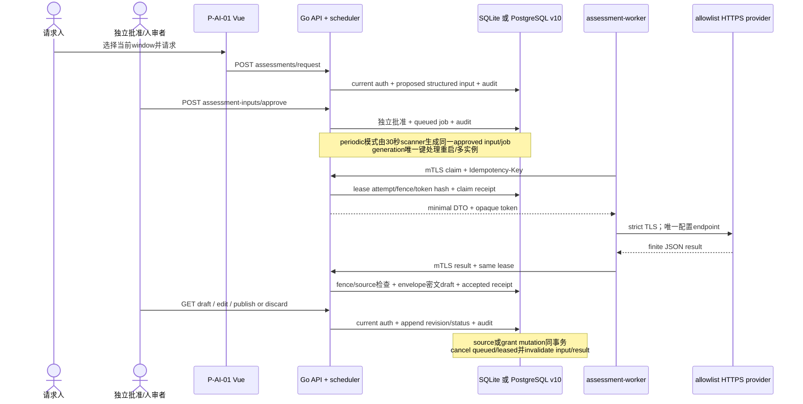

### 8.3 lease、dispatch与晚到结果

job queued→leased→completed/failed/cancelled；lease到期可重新queued领取（限attempt数需部署明确，建议3），新claim递增attempt/fence、新随机token，DB只token hash。建议lease120秒、heartbeat每30秒、总attempt wall deadline10分钟，heartbeat只当前未过期lease和identity匹配续到bounded cutoff，不让旧token复活。claim按组织→subject→employee→job锁；API解密最小DTO Tx外准备，再claim Tx核对source/policy/auth/generation、写dispatch audit并commit后返回DTO。这是批准交付worker的线性化点。

finalize成功后写accepted receipt（attempt/token hash/source digest/output digest/result ID）供相同result断连重放只返回安全ack，不再插入/改result、不更新lease。该receipt重放仍要求当前worker身份与scope/来源policy；内容不同或旧未accepted attempt即409。lease过期后首次到达的result永远不能因重放分支写入。

worker进程对领取DTO再次遵守输出/网络allowlist，不提供业务工具；provider调用无DB事务。撤权或source变化在dispatch后可能已有provider输入在途，不能回收；API可取消job并拒后续heartbeat/result，结果绝不入当前projection。先commit dispatch审计，断连不意味着provider未调用；重领/retry可能多次provider invocation，因此**不承诺exactly once provider call**。仅保证一个current generation accepted result/current publication；claim receipt避免同请求断连重复领取，但不能使外部调用变原子。

result提交检查当前worker identity、job state、attempt/fence/hash、lease_until（服务端clock）、generation/source digest/epochs/schema/version；解密/加密准备Tx外，finalize Tx再次校验且CAS。claim维护先在同一事务把`deadline_at<=now`的queued关联approved input转invalidated，再把job转failed/`deadline_exceeded`，释放两个active partial uniqueness；即使没有下一项可领取，也先提交该维护再返回`200 {"job":null}`，不因空队列回滚。过期leased按attempt上限重新queued或failed，旧token/fence永不复活。

### 8.4 结果与发布

result draft→published/discarded/invalidated；published→invalidated（由source/policy/ACL变化），不把job completed当已人审。人类edit/publish/discard先做授权与加密准备，最终保存Tx按subject→employee guard重读当前session/grant及`assessment.publish`，锁查result revision/draft后才append/transition/audit，故与撤权/源变线性化。edit另解密当前获准revision，只允许保留其精确citation集合的子集，不覆盖模型草稿；新增或改动引用必须走新输入generation/批准/审核。不得借改稿掺入工资/private/HR正文扩大给读者。只一个employee/window/purpose当前publication slot，重复publish409（同幂等命令返回原事实），新generation需要新的review。

来源更新/撤回、权限/purpose改变同Tx通过source逆向索引标记affected results invalidated、取消queued/leased job/移除当前pointer；read先做状态拒绝和解密准备，释放前再以统一subject/employee guard短Tx重读当前session/grant、result revision/status/source digest并写audit，commit后才可输出正文。该release与source/grant mutation线性化；若release先commit，随后撤权不能追回已批准输出，若mutation先commit则read 404。历史失效正文不作为当前可读摘要旁路；保留metadata/review事实按授权政策。法律删除/更正传播至derived/cache/provider stateful对象需清单/确认，不虚称stateless provider可追回已发数据。provider合同/region/retention/training/ZDR/删除逐项确认，否则不启用。

## 9. 双后端、一致迁移与运行语义

### 9.1 类型/连接/索引/锁差异

| 契约 | SQLite | PostgreSQL |
| --- | --- | --- |
| 部署/类型 | 同机持久盘单API owner，STRICT tables；UUID规范TEXT、密文BLOB | 一/多API，UUID原生或适配为同规范ID、密文BYTEA |
| 日期/时间/布尔 | 日期TEXT校验；UTC微秒INTEGER；boolean INTEGER CHECK | DATE/TIMESTAMPTZ，保存到微秒；BOOLEAN；另存IANA zone而非TIMESTAMPTZ当zone |
| JSON/金额 | 非敏感规范JSON TEXT；不可把NUMERIC当exact Money | 非敏感JSON/JSONB显式使用；共同密文schema内Money；不互搬两库binary JSON |
| 每连接设置 | **只在§9.3只读preflight确认exact v12/v13/v14升级源或exact v15后**才以正常连接启用foreign_keys、busy_timeout、synchronous与WAL；拒绝目标不得切journal/create sidecar | preflight只读role/transaction识别目标；exact v12/v13/v14/v15后业务或migration role启TLS/pool/statement/lock timeout与UTC |
| 锁/事务 | 开始Tx后第一条guard写取得单writer；短Tx、writer pool建议1，读池有界；BUSY取消映射安全503 | guard `FOR UPDATE`＋CAS，默认Read Committed也必须遵循guard；不让无锁跨行SELECT决定批准 |
| 索引 | 第4节unique/复合FK所需父key与子反查、org-leading keyset/窗口/lease索引；尽量共同能力 | 同逻辑索引；partial/exclusion/RLS可选纵深，不能替代共同应用不变量 |
| 持久化运维 | WAL/checkpoint/磁盘FULL与空间监控；不放共享网络盘 | pool、主从/故障/备份由选定部署能力明确；不默认已HA |

锁定支持的Go/driver/libc/DB实际版本；WAL-reset问题使用官方修复3.51.3+或指定回补，本历史实验引擎为3.53.4，不把旧driver全部视为已修复。RLS如启用，业务role必须非owner/superuser/BYPASSRLS，但共同权限仍在Go。金额/名字无明文排序或全文索引；授权候选只允许有界decrypt/filter。

### 9.2 迁移与备份

当前v19 binary分四路：①v1-v11/未知版本/checksum drift只读拒绝且零写；②fresh空目标顺序安装至v19；③exact v12–v18按冻结顺序前向执行至v19并保留业务/密文/审计子事实；④exact v19正常重启。

v1–v19已发布migration bytes/checksum冻结。升级前必须停写并验证绑定源/目标版本的数据库备份和keyring双介质副本。v13→v14仍须完成16→18 domain升级/ack；v14→v19不增加key domain。中断、未知source、漂移或缺恢复条件保持阻塞，不能drop/重建、fallback空库或手工重导冒充migration。

v15建立管理员安全事实；v16补齐38项authority；v17新增空Staff关联政策且不推断既有账号；v18把既有全局教育三档按org复制并保持全部education记录；v19只追加工资基线批次关系子类型与独立编号counter。SQLite及PostgreSQL迁移均须验证schema ledger、org隔离和既有记录引用。

R3只新增v6，两方言扩有限typed面谈对象/source批准、事件/密文/receipt及OIDC intent；必要SQLite旧表copy/rebuild完整保旧列，PG按真实v5约束名变更，不改v1-v5 bytes/checksum。有数据v5→v6、原KMS/receipt、真实CHECK/FK/schema漂移/回滚/多连接消费者及最新464.45s all/race/vet绿；四最终binary已build，双库compiled migrate/API原DB重启、精确版本head裁剪/导出/撤权成品及175 Vue已验。此前完整身份CLI bind/unbind与有限敏感扫描保持各自证据边界。标准PG并发all+race曾原生out-of-shared-memory，失败不记绿；最终串行`-p 2`，不减native约束、不加应用重试或调PG容量掩盖。


SQLite→PG：维护停写/停止worker dispatch→一致逻辑导出（默认保持ciphertext而非明文）→目标对应迁移→转换公开UUID/date/time/布尔类型并保持AAD/所有版本IDs→复合FK/行数/全窗口图/薪资纠错projection/奖金/anomaly/grant/audit/digest校验及授权合成解密→真实程序/API/UI smoke→批准切换→旧库保留只读并明确回退条件。默认不无停机/双写。只比行数不足以证明迁移。

SQLite备份使用一致Backup API/VACUUM INTO等机制，不能复制活main.db却漏WAL；必须验证空间及checkpoint/备份连接行为。PostgreSQL按批准RPO选择一致逻辑dump或base backup＋WAL/PITR，不把普通文件copy/单dump宣称自动持续恢复。两者备份整包加密、最小访问并保护metadata，与KEK恢复渠道分开；恢复步骤见§7.4。实际后端、方案版本和恢复演练必须绑定，未知RPO/RTO不填承诺。

### 9.3 配置、启动与关键runbook

目标配置保留backend、public origin、OIDC、audit、worker/provider；API只配置`TEAMLEDGER_KEYD_SOCKET`、预期peer UID和获准domain，keyd配置绝对key directory、socket、API/maintenance UID矩阵。API不得获得root/keyring路径；不接受生产KMS URL/token/CA或独立对称key file。

首部署按identity mode分流：`oidc`先经维护流程建立active subject并绑定可信issuer/sub；`local`不依赖IdP，运行一次`local-bootstrap`得到首个固定管理员subject/account。管理员初始密码只能先完成强制改密，重新登录后登记TOTP，保存恢复码后才进入工作区。immutable `bootstrap_admin.v1`固定赋予组织/PII维护权及`identity.manage`、`access_grant.manage`、`audit.read`的MFA-required org grant；原批准者为admin主体自身。该窄自批例外不适用于普通授权，不授金融、面谈、导出或业务正文。

启动分相：keyd安全遍历并锁定持久`.lock`，验证root/keyring后ready返回material generation/digest及包装/MAC状态。API零写DB preflight比较`crypto_control`和peer/socket；maintenance或不符时not-ready，不自动建key/猜active/切外部KMS。

`TEAMLEDGER_KEYD_DIR`必须绝对且startup前存在；从`/`directory FD开始的每个ancestor须root/keyd-owned且无group/other write，最终目录/文件mode按§7.3。API UID无文件读权，socket目录不可由API写；连接身份只取`SO_PEERCRED`。

历史R3/R7外部Transit URL/token/CA只保留为固定代码证据；DEV-018已迁移生产调用者并删除外部KMS生产路径/secret，不得回退。

组合根只接受`TEAMLEDGER_IDENTITY_MODE=local|oidc`。`local`拒绝OIDC变量，经keyd使用username、password pepper、identity username source、`identity_mfa`与`local_recovery_code`用途分离domain，首次改密和TOTP验证均不调用外部服务。`oidc`要求完整issuer/client secret/MFA ACR/AMR及可选CA；redirect固定为已校验PUBLIC_ORIGIN下callback，只允许RS256和TLS code flow。身份模式配置不是MFA绕过开关。

OIDC client secret及非对称信任继续使用受保护配置文件；identity lookup、transaction envelope、CSRF、receipt/generation及cursor长期对称key均由keyring/keyd提供。历史client secret之外的identity/transaction RAW32 key-file配置已删除且无fallback；session opaque token仍只存SHA-256 hash，无session key。

历史`-identity-key-file` CLI已删除。v12 OIDC/local identity保存加密canonical source和exact lookup key reference；受控reindex从source重建OIDC及local username索引，不接受调用方raw key path，也不从digest/email反推identity。

受控维护binary`identity bind|unbind`使用受保护DSN/CA/sub文件、approved issuer、existing org/subject/可选employee、request ID及本地keyd socket；identity lookup digest只经keyd MAC并保存exact key ID/version，canonical issuer/sub source以`identity.mapping.v1`认证密文保存。subject必须是active且同owner；可选employee绑定只能引用existing same-org一对一immutable `subject_employee`，不能推断、自动创建、转移、重绑或创建grant。unbind原子停映射、撤匹配会话、推进epoch并审计；rebind不复活旧会话。命令不回显sub、DSN或key，不是公开admin API或bootstrap替代。
R7审计入口保持历史事实；`key-rewrap`通过本地keyd staged target操作，不接受Vault endpoint/token，并以数据库A1/A2 receipt、generation/digest/active key map及全库wrapper引用计数控制ack/retire。`keyctl-local stage|activate`输出generation/digest/active/staged状态；API在未ack阶段逐请求503。数据库耦合MAC索引使用各自staging/CAS维护入口，CSRF activate先原子撤销对应session；不可安全重建的persistent MAC domain拒绝generic rotation。

Backup命令每次生成随机archive DEK，经keyd `backup_archive`包装；DB archive不含root/keyring且无长期backup-key-file。Restore先经keyd解包archive DEK，再核对archive认证、schema及数据库业务wrapper样本，失败目标不切流；恢复后的API还必须以库内`crypto_control`核对keyd generation/digest/active map。离线key副本使用双RAW32介质独立加密、完整entry/state/pointer/probe inventory、pair verify和不存在目标的原子restore。

PG身份维护窄入口直接以同descriptor已检查的完整PEM CA bytes构造RootCAs，**不再按sslrootcert路径重开**；显式URL/单一verify-full与声明CA，primary及每个TCP fallback均严格hostname/TLS≥1.2，后续pool连接仍用同可信内容。只接受有界纯PEM CA证书bundle，不含junk/私钥/非CA；拒绝Unix socket、service/servicefile、client cert/key/passfile及ambient PGSERVICE，不能借环境SSL文件或凭据改掉受检信任。通用store.Open仍服务API/migrate等原实际调用，并非身份CLI fallback。该窄运维契约不声称提供PG client-certificate设施或全量恢复流程。

身份维护无自报`-actor-subject-id`：repository直接读取kernel effective UID及hostname，记`actor_kind=local_maintenance`、UID及域隔离`SHA256("TEAMLEDGER-MAINTENANCE-HOST" + NUL + version1 + hostname)`，不存明文host。权限来自受控进程DB/identity-key及同UID文件边界，不借target业务grant。application subject=NULL，target subject＋exact identity digest及R2 target_employee_id独立记录，同对应/映射/撤销/epoch/audit Tx；active/owner冲突或audit失败全回滚。这是执行进程本地principal/节点指纹，不是sudo/共享UID背后的真人或个人批准证明；schema无human分类。真实CLI绑定、拒重绑、native UID/host/targetemployee审计已由集成负责人实跑，生产账户责任与独立审计仍另验。

**历史固定v4证据（不适用于v12 baseline）**：v4不改v1-v3 migration bytes，有数据v3→v4仅补审计分型。旧AUTH-BIND/UNBIND没有可恢复的operator证明，原10字段逐值保留、actor_kind=`legacy_unattributed`、target沿原代码记录的subject，UID/node/identity digest保持NULL不猜；当时读取/展示必须按actor_kind解释，不能把legacy subject_id显示成已核验操作者。其他既有业务事件仍是application型/current subject；v4不补造grant、身份批准或审计外部receipt。R7独立审计与恢复机制后来已固定交付，真实生产设施/政策仍待批准。

| 故障 / 操作 | 运行语义与处置，不是已运行命令 |
| --- | --- |
| revision/basis/source冲突 | 客户端重取可见当前事实/人工处理；不替用户自动批准/覆盖 |
| SQLite忙/PG锁超时死锁 | 整Tx rollback，安全503/WRITE_BUSY；查竞争/长Tx/磁盘/连接数；无无限重试或静默丢写 |
| root/keyring/keyd或generation不可用 | 无权请求仍先auth拒绝且不触发socket；有权敏感操作503/KEY_UNAVAILABLE。缺文件/历史版本不得自动生成、切外部KMS、猜active或修tag |
| DB磁盘满/连接失效/commit不确定 | 不报告成功；幂等key重查安全receipt；先恢复持久性/检查历史审计，不重复付款事实 |
| 审计故障 | sensitive release fail closed；已commit批准不伪撤销，outbox保留待投递、明确未完成独立ack；恢复后去重发送并核对 |
| IdP失效/身份撤销 | 拒新login/必要session策略；subject/grant/session撤销重验；不能本地密码旁路 |
| provider失败/timeout/最小化失败 | safe failed/blocked，无draft/current publication；规则状态仍可读；输入/输出不得进排障日志 |
| lease来源变化/旧worker回包 | cancel/invalidated或409/drop；新attempt新fence，旧identity/token不renew |
| 密钥泄漏/恢复/升级 | 受控停写；隔离恢复全部wrapper/MAC/非对称依赖，旧active转decrypt-only并先备份新key；未知撤权/generation不开流量 |

必须为真实部署版本落实责任人、权限、命令/前置/成功判据/失败回退与演练证据；本文runbook语义不伪造尚无代码的运维脚本。健康200不等于业务恢复，单文件存在不等于key可恢复。

## 10. 生产启用与TDD映射

下表是完整目标与生产启用验收，不以任一历史切片覆盖其余范围。历史设计模型不当产品验收。实际开发按[开发规则](DEVELOPMENT_RULES.md)RED→最小真实GREEN→REFACTOR；测试、DDL、契约和版本证据只在本仓库维护，不复制测试假成功。

| feature / 责任 | TDD核心可观察案例 | 集成/启用必要证据 |
| --- | --- | --- |
| F-ORG-001 / organization | 半开边界、scope/current relation、并发typed set；profile CAS；人员XLSX数字工号/1900与1904日期/错误定位、18字段dirty阻断与review、org级学历追加及rank | 两真实后端migration/API；Vue tree/directory/profile、人员导入编辑重验/显式学历追加及真实浏览器smoke |
| F-INT-001 / interview | 三分区/version heads、terminal/no重开、action逾期、换经理撤权/来源最小化、旧revision | 两库API拒绝无正文、真实页面重载/乱序response清空、交接E2E |
| F-COMP-001 / compensation | CNY/JPY scale0规范整数、HALF_UP边界/溢出、同Branch混币；个人显式换币correction完整闭包；range区间唯一；batch header/reference budget、Staff Code preview、工资差异确认及先纠正后调薪；全批increase分币种摘要、无FX/grand total | 双库/API：manual/XLSX同构candidate、Text-cell exact与numeric拒绝、旧term/event保留、纠正不计次数、固定service零部分写、range重叠拒绝；Vue默认3行/警告确认/预算对照/局部横向滚动及真实浏览器smoke |
| F-BONUS-001 / compensation | target/award/payment分列、crossorg refs、异常事实、reversal累计、永久业务key、extension拒绝 | 双库异常/冲销/幂等/atomic rollback、UI不跨币种假余额 |
| F-AI-001 / assessment | 日历/DST/unknown/partial、source digest/交集ACL、lease fencing、provider失败、人工publish重验 | 双库真实job竞争；可控provider边界；真实provider/model/合同与人审质量另验，不pin自然文案 |
| F-SEC-001 / identity/authz/sensitive/audit | 授权先于keyd；本地首次改密/TOTP/recovery受限session；`identity.manage`与grant/audit分离；38项bootstrap authority精确tuple/object边界；standalone/Staff关联原子创建及动态一层默认scope；持久replay；openat2/no-replace/lock；AAD/KWP；18-domain inventory与DB ack；MAC staging | bootstrap固定三项安全direct grant＋38项当前可委派authority、用户list/create幂等/分页/拒绝、Staff关联员工/面谈窄默认权与越界拒绝、首次改密直达API隔离；显式目标assignment仍用于普通grant；RFC向量、登记/登录/step-up/恢复/离线reset；secret不入DB明文/日志；真实OIDC/介质责任另验 |
| F-DB-001 / adapters/ops | PK/FK/owner/CAS/失败回滚、每连接FK、busy/死锁、v12–v19 checksum及前向migration | SQLite/PG空schema安装至v19；v1-v11/未知目标拒绝；exact v12–v18顺序升v19、exact v19重启；业务/教育/MFA/审计/authority/账号映射及原调薪保留；备份恢复、生产构建API/UI smoke与负载目标 |

纵向实施顺序与功能规范一致：安全/双库最小真实读写→组织历史→分区面谈/交接→薪资批准纠错→奖金事实→确定规则/AI人审→生产运行启用门禁；每片已有真实界面/API/存储/授权，不先堆空package再宣称功能。安全与恢复从相关切片落实，末项是上线验收不是此前许可忽略。Go行为table/fuzz/race、双库真实集成、Vue/Vitest和关键浏览器E2E各自证据不互替；分工不跑检查，集成负责人统一验证最终候选，整体task两轮串行实际luna review。

生产密钥来源已由DES-007批准为本地受保护root file＋同部署keyd；DES-008进一步批准两份分离加密可移动介质、本地identity mode与Compose同库audit receiver。DEV-021已固定可执行离线流程；具体保管人、实际介质和解锁职责仍是生产部署决定，不是实现阻塞。IdP仅在可选`oidc` mode需要。容量与AI/保留等业务政策仍待实际启用决定；RPO/RTO/PITR等灾备目标明确scope外。


## 11. 未决政策、来源与更新归属

已确定并实装DES-004员工主数据、DES-005调薪批次、DES-006薪资Money、DES-007本地root file＋keyd及DES-008内置身份/同库receiver/离线介质；DEV-015至DEV-022均已固定交付。“已确定/已实装”不等于生产启用。

未决或未实装：24小时candidate TTL业务接受、生产XLSX原文件的系统外保留责任、AI provider/法域/保留政策，以及root/keyring真实介质保管人和口令责任。RPO/RTO/PITR等灾备目标明确scope外。Special原因目录从薪资policy受控加载、未配置为空；500人/10MiB上限已实现；Compa Ratio保持禁用。OIDC canonical identity source、长期MAC/index维护及CSRF换键撤session已实装，但真实生产IdP与介质流程仍需部署验收。

### 11.1 新增协议来源

查阅日期均 **2026-10-10**。以下只支持协议/工具事实，不证明本项目实现、用户接受设计、模型效果或法律合规；实际部署锁定版本并重新核对。

- **S1**：[OpenID Connect Core 1.0 incorporating errata set 2](https://openid.net/specs/openid-connect-core-1_0.html)，§3.1.3.7 token验证、nonce/auth_time、§5.5.1.1 acr；acr意义需RP/IdP约定，`acr_values`请求不等于实际MFA保证。本设计更保守始终验签。
- **S2**：[RFC 9700](https://www.rfc-editor.org/rfc/rfc9700)，§2.1/2.1.1 exact redirect、code flow/PKCE S256/绑定nonce、防CSRF/open redirect；不自行设计OAuth认证协议。
- **S3**：[OWASP CSRF Prevention Cheat Sheet](https://cheatsheetseries.owasp.org/cheatsheets/Cross-Site_Request_Forgery_Prevention_Cheat_Sheet.html)，stateful synchronizer token、state-changing请求/Origin/Fetch Metadata、SameSite纵深而非独立保证。
- **S4**：[Vue Security](https://vuejs.org/guide/best-practices/security.html)，非可信模板/HTML风险，具体敏感缓存限制为本项目设计。
- **S5**：[Go GCM官方实现文档](https://go.dev/src/crypto/cipher/gcm.go)，支持payload及一次性派生key的AES-GCM边界；同一派生key只Seal一次，不把随机nonce碰撞预算留给实现猜测。[RFC 5649](https://www.rfc-editor.org/rfc/rfc5649)定义带完整性检查的AES Key Wrap with Padding，本设计用于32-byte DEK wrapper；代码task须锁定实现并用RFC向量、篡改和上下文错配验证。

未在本规范列出第一方来源或运行证据的数据库、加密、key rotation、backup、AI及法域结论，一律不得标记已验证。未来重大结论或政策变更先更新task计划，再同步本文件、功能规范、源码、契约、迁移和验证；全部当前文档只在本仓库维护。
