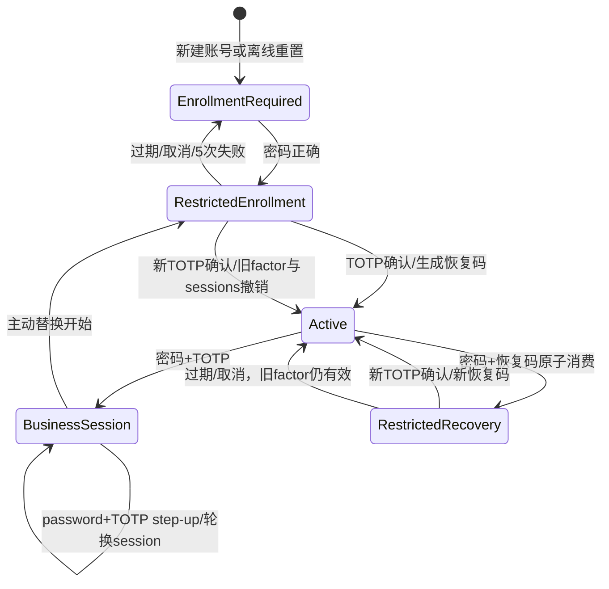

# PLAN · DEV-035 · 本地 TOTP、恢复码与独立部署 MFA

- 日期：2026-10-16
- 状态：现状研究完成；详细设计冻结中
- 类型：F-SEC-001 / F-DB-001 身份安全纵向切片
- 目标：在内置账号/密码模式中实现不依赖外部身份服务的 TOTP、一次性恢复码、敏感操作 step-up、受限登记/恢复会话和离线 MFA 重置，使本地独立部署能够完成真实 MFA。
- 已批准来源：`DEV-030 §4`。WebAuthn/passkey、OIDC 改造、灾备 RPO/RTO 不在本 task。

## 1. T1 现状与差距（已完成）

### 1.1 当前行为

1. `identity.LocalLogin`只校验密码，签发`AMR=["pwd"]`且`mfa_until=epoch`的8小时会话；本地`/auth/step-up`返回`MFA_REQUIRED`，因此要求近期 MFA 的人员资料写入、授权和财务操作无法使用。
2. 本地用户名由`identity_mapping` wrapper加密，并以`local_username_lookup` MAC检索；密码采用Argon2id＋keyd `local_password_pepper`。现有模型具备账号revision、登录节流、会话撤销、CSRF和审计基础，但没有factor/enrollment/recovery/replay状态。
3. `httpapi`在解析session后直接进入普通业务授权；若新增受限登记session而不建立服务端`access_kind`门禁，会形成密码单因子进入业务API的越权风险。
4. 当前schema为v13。v13已由DEV-034占用；`DEV-030`中“本地MFA使用v13”的旧文字已过期。本 task只能追加v14，不能修改v12/v13 baseline。
5. v13迁移文件冻结摘要：SQLite `a5ebf613354346e4da5cd165a37bfc9fc719fa98eb6e5f67a069c65a871de45e`；PostgreSQL `d479aae0a10d5bdc0cc63f64dde3be793fbbf179adcfc5ff4df75e6863a4520f`。支持矩阵为精确v13→v14及空库顺序安装至v14；不清库、不回写旧migration。
6. keyd当前有16个domain，最后是`local_password_pepper`。TOTP secret必须使用新的独立wrapper domain，恢复码必须使用新的独立MAC domain，不能复用用户名、密码pepper或OIDC transaction key。
7. 直接扩充`allKeyDomains()`会使既有16-domain keyring在keyd启动时失败。因此v14应用升级前必须提供显式、离线、持锁、原子发布的keyring domain升级命令；normal startup不得静默建key或自动修复。
8. `IdentityGate.vue`已有顶栏“账号安全”浮层，可承载登记、恢复、替换和恢复码更新；当前提示“可信登录与 MFA 设施未启用”是后端能力缺失，不是CSS或可由开关解决的问题。

### 1.2 已接受安全契约

- TOTP由TeamLedger服务端验证；用户端只需标准离线Authenticator，不是运行时外部服务。
- CSPRNG secret只以独立identity MFA KEK密封；AAD绑定org/account/factor或enrollment/generation/schema。二维码和人工key仅在当前页面内存显示，不进入URL、日志、history、localStorage。
- 既有active本地账号升级后进入`enrollment_required`；正确密码只能获得短时受限登记session。该session只可访问登记/恢复/logout接口，不可读取业务session、不可调用普通API、不可签发`mfa_until`。
- active账号正常登录必须同时提供密码＋TOTP。TOTP采用服务端时间窗口、尝试限制和持久replay step；同一步验证码不能重用于登录或step-up。
- 恢复码只显示一次，数据库只存独立keyd MAC及精确key引用。它不能直接登录或step-up；只能与正确密码原子消费并建立browser-bound受限恢复登记。并发消费只允许一个成功，同一幂等请求在响应丢失后可恢复同一pending transaction。
- 敏感step-up再次验证当前密码＋TOTP，轮换session/CSRF并从认证时刻起签发短时`mfa_until`，不自动重放业务命令。
- 主动替换TOTP和重新生成恢复码均要求当前密码＋近期TOTP；新generation确认时撤销旧factor、旧恢复码、其他session和pending transaction。
- 遗失全部因子只允许离线维护命令重置为`enrollment_required`；必须撤销session/factor/recovery/pending并写审计，不能提供管理员网页绕过。

## 2. 冻结参数与密码学边界

| 项目 | 固定值 |
| --- | --- |
| TOTP | RFC 6238，HMAC-SHA-1，6位，30秒；接受`current-1/current/current+1`，选择尚未使用且最接近current的step |
| replay | factor持久保存`last_accepted_step`；新接受step必须严格大于它。登录、step-up和恢复码重发共用，不按用途分开 |
| TOTP secret | CSPRNG 20 bytes，RFC 4648 Base32无padding；`otpauth://totp/TeamLedger:<username>?secret=...&issuer=TeamLedger&algorithm=SHA1&digits=6&period=30` |
| 恢复码 | CSPRNG 20 bytes，Base32 32字符，按4字符分组显示；每账号只保留一个未消费码，原文只显示一次 |
| enrollment/recovery | 10分钟、最多5次TOTP确认；过期或用尽即撤销受限session并删除pending secret |
| 普通session | 8小时绝对期限、30分钟idle；仅`access_kind=business`可进入业务授权 |
| MFA freshness | 从本次TOTP接受时间起10分钟；普通登录、登记确认、恢复确认、step-up签发 |
| 登录节流 | 密码或TOTP任一失败均复用账号当前指数退避，1秒起、最多15分钟；未知账号执行fake Argon2后走同一外观 |

TOTP不是加密密钥。factor/enrollment secret以新wrapper domain `identity_mfa`（wire number 17）及`identity.local_mfa_factor.v1` / `identity.local_mfa_enrollment.v1`密封；AAD包含org、account、factor/enrollment ID、generation、purpose、schema/version。恢复码以新MAC domain `local_recovery_code`（wire number 18）保存exact key ID/version和digest；幂等输入另用既有`command_receipt`。两个domain不能复用、互换或从数据库材料离线验证。

## 3. v14持久化与迁移

v14同时提供SQLite/PostgreSQL migration：

1. `session`增加`access_kind`，仅允许`business|mfa_enrollment|mfa_recovery`，既有值为`business`。普通授权session loader必须显式要求`business`；identity专用loader仍可读取受限session并返回kind。
2. `local_mfa_account(account_id PK/FK,status,generation,updated_at)`；状态仅`enrollment_required|active`。每个active本地账号必须有一行；generation从1开始且只增不减。
3. `local_mfa_factor(account_id PK,factor_id UNIQUE,generation,last_accepted_step,envelope metadata...)`；只保存当前factor。secret密文可因KEK rewrap更新包装字段，factor身份、AAD、sealed bytes不可改。
4. `local_mfa_enrollment(account_id PK,enrollment_id UNIQUE,mode,generation,attempts,expires_at,bound_session_hash,envelope metadata...)`；mode仅`initial|replace|recovery`。每账号最多一个pending；替代、过期、确认后删除，不能保留旧secret。
5. `local_mfa_recovery_code(account_id PK,generation,key_id,key_version,digest,created_at)`；消费通过受账号锁保护的精确CAS删除。旧码、重发前码和旧generation码均不可恢复。
6. `local_mfa_recovery_receipt(request_id PK,account_id,input_digest,enrollment_id,expires_at,created_at)`仅支持恢复开始的响应丢失重放；同request ID不同输入返回`IDEMPOTENCY_MISMATCH`。过期receipt不能复活transaction。
7. v13→v14 migration为全部active `local_account`建立`enrollment_required`，并撤销这些账号对应的全部既有session；OIDC session不受影响。创建/bootstrap本地账号在同一事务建立MFA状态。schema失败整笔回滚。
8. v14增加factor/enrollment密文的schema registry、inventory/rewrap/backup引用检查。任何缺密钥、错AAD、未知format或tag失败均fail closed。

锁序固定为identity mode → organization guard → subject → local account/MFA account → factor/enrollment/recovery/receipt → session；所有generation切换、replay step CAS、恢复码消费及session撤销在一个serializable业务事务内完成。SQLite持writer锁，PostgreSQL对相同行`FOR UPDATE`；并发同码登录、恢复码消费和确认均只能一个成功。

## 4. 既有keyring升级

fresh `keyctl-local init`直接生成18个domain。既有16-domain keyring必须显式升级：

1. `keyctl-local upgrade-domains -dir ...`只在keyd停止时取得既有OFD lock；仅接受完整旧16-domain或完整新18-domain inventory。它为17/18各生成一个v1 active key，generation＋1，以previous digest链认证后临时文件＋fsync＋rename原子发布；重复执行在完整18-domain时无变化。normal keyd startup只接受18-domain，不自动补key。
2. keyd以新keyring单独启动后，`keyctl-local acknowledge-domains -socket ... -backend ... -dsn-file ... -request-id ...`读取ready state，并以数据库CAS确认：旧`crypto_control`必须`stable`、generation恰为新值减1、旧16-domain active key完全相同、新状态只增加17/18且无staged key。然后把generation/digest/18-domain active map写为stable并记录审计/receipt；重复执行只接受完全相同状态。
3. 受控升级顺序：停止API/keyd → 验证数据库＋key离线备份 → 拉取新镜像 → 运行`upgrade-domains` → 单独启动keyd → 运行`acknowledge-domains` → 运行v14 migrate → 启动全栈。任一步失败保持API不可ready，不清库、不生成替代root、不猜测active pointer。
4. Compose新增`key-upgrade`/`key-domain-ack`受控profile；README给出Linux/Windows Docker Desktop可复制命令和恢复检查。升级后应重新制作并验证包含18-domain inventory的离线双介质副本。

`crypto_control` canonical active数量从16更新为18；仅上述一次性扩展入口可以接受严格旧16→新18，通用stage/activate和API ready不得把缺domain状态当健康。

## 5. 身份状态机与API

### 5.1 公开及受限入口

- `POST /api/v1/auth/local/login`：严格JSON `username,password,totp_code?,return_to`。`enrollment_required`且密码正确时签发10分钟`mfa_enrollment` session并返回HTTP 202 `{next:\"enroll\",return_to}`；active账号缺TOTP返回`MFA_REQUIRED`，错/重放验证码返回通用未认证并计入节流；成功签发business session、`AMR=[\"pwd\",\"otp\"]`和10分钟MFA。
- `POST /api/v1/auth/local/recover`：`username,password,recovery_code,return_to`，`Idempotency-Key`必填。正确密码＋码在一个事务删除恢复码、撤销该账号全部session/pending、建立recovery enrollment＋受限session＋receipt；返回HTTP 202。相同request/input可重新取得同一pending并轮换为新的受限session，不重复消费。
- `GET /api/v1/auth/local/mfa/pending`：只允许当前受限session；返回manual secret、otpauth URI、mode、expires_at。响应`Cache-Control: no-store`。
- `POST /api/v1/auth/local/mfa/confirm`：严格JSON `totp_code`；受限session确认初始/恢复，或当前business session确认主动替换。成功原子切generation，删除旧factor/recovery/pending，撤销其他session，签发新business session和一次展示`recovery_code`。
- `POST /api/v1/auth/local/mfa/cancel`：删除当前pending并撤销受限session；initial回到`enrollment_required`，recovery/replace保留原active factor但不恢复已消费恢复码。

受限入口仍要求host-only Secure cookie、trusted Origin/Sec-Fetch-Site和CSRF；受限session调用`/api/v1/session`或任一业务API一律401，不能依赖前端隐藏。logout同时适用于business/受限session。

### 5.2 business账号安全入口

- `POST /api/v1/auth/local/step-up`：`action,return_to,current_password,totp_code`；action/return仍走allowlist。成功撤销当前session并签发新business session/CSRF，`mfa_until=accepted_at+10m`；不执行或重放目标业务命令。
- `POST /api/v1/auth/local/mfa/replace`：当前business session＋current password＋未重放TOTP；建立`replace` pending并返回no-store secret/URI，原factor在新factor确认前仍有效。确认成功后撤销原factor、恢复码和其他session。
- `POST /api/v1/auth/local/mfa/recovery-code`：当前business session＋current password＋未重放TOTP；删除旧码、生成一个新码、撤销其他session并轮换当前session，只返回一次原文。

密码修改保持撤销全部session但不删除active factor；之后登录仍需新密码＋原TOTP。账号disable删除/作废MFA事实并撤销session。错误响应不返回secret、账号存在性、factor generation或服务器时间。

## 6. 离线维护

新增`teamledger-identity local-mfa-reset`，只接受受保护输入文件中的规范username及必填request ID、DB/keyd维护配置；不提供HTTP等价物。命令先用`local_username_lookup`定位唯一账号，再在事务中切到`enrollment_required`并generation＋1，删除factor/recovery/pending/receipt、撤销全部session、推进subject/org auth epoch并写`AUTH-MFA-RESET`审计。重复request只允许同输入幂等；错账号、非local mode或审计失败零变更。

## 7. 页面契约

1. 登录页在密码验证后按服务端状态显示TOTP；不把factor状态放入可缓存公开查询。提供“使用恢复码”独立表单，避免把恢复码误当TOTP。
2. initial/recovery受限会话只渲染最小“设置验证器”页面：二维码、人工key、验证码、取消/注销；不挂载应用导航或业务页面。二维码在浏览器本地从otpauth URI生成，不调用外部二维码服务。
3. 顶栏“账号安全”显示MFA已启用、有效至何时；支持主动替换和重新生成恢复码。两者均在原位要求当前密码＋TOTP，错误不关闭浮层。
4. 恢复码只在成功确认/重发后的阻塞确认面板展示；用户明确勾选“已保存”后才离开。刷新/路由离开即清除原文，服务端不能再次读取。
5. 本地step-up使用模态对话框输入密码/TOTP，成功后关闭并提示“请重新执行刚才操作”；不得自动重放可能已变化的命令。OIDC模式继续既有跳转流程。
6. secret/code不用URL、query、telemetry、日志、clipboard自动写入、local/session storage。响应及页面使用`no-store`；取消请求与session失效清空内存。

## 8. TDD、验证与审查

T3按RED→GREEN覆盖：

- RFC 6238公开向量、Base32/parser、±1漂移、错误长度、未来/旧step、持久replay；
- v13→v14 SQLite/PostgreSQL带账号/会话/审计样本升级，旧local session撤销、OIDC session保留、fresh install、失败回滚/重启；
- 初次登记、过期/取消/5次失败、正常登录、step-up session/CSRF轮换、主动替换前后factor边界；
- 恢复码一次展示、错误密码/码、同请求响应丢失、不同输入冲突、两个连接并发消费只一成功、恢复确认前旧factor有效但旧session无效；
- 恢复码重发、密码修改、账号disable、离线reset、keyd不可用/错AAD/tag、16→18 keyring升级中断/幂等及crypto_control扩展CAS；
- 所有受限session直达`/session`和业务API拒绝，CSRF/origin/content-type/unknown field边界。

T4使用组件测试验证状态/敏感内存清理，再用真实production build＋API＋SQLite在Chromium完成首次登记→注销→密码/TOTP登录→本地step-up→敏感写入→恢复码恢复→新TOTP登录；桌面和390px均检查无溢出、键盘焦点和错误保留。PostgreSQL同契约在可用DSN运行；缺DSN必须准确登记，不虚报。

T5运行受影响Go定向测试、`go test ./...`、`go vet ./...`、Web全量测试/build、真实程序smoke；审查认证绕过、session fixation、CSRF、replay、竞争、secret泄漏、keyring升级和migration。同步FUNCTIONAL_SPEC、TECHNICAL_SPEC的Mermaid身份数据流、README安装/既有环境升级/离线重置说明及`docs/validation/DEV-035.md`。

## 9. 验收

1. 纯本地Docker部署无需OIDC/KMS/外部MFA服务即可登记标准Authenticator并完成所有MFA-required业务操作。
2. v13既有账号不丢失且必须登记；密码单独只能进入受限页，所有普通API服务端拒绝。
3. 密码＋TOTP登录和step-up正确签发/轮换session、CSRF、AMR和10分钟MFA；验证码不能replay。
4. factor secret和pending secret仅以独立KEK密文持久化；恢复码只存MAC、只显示一次；错AAD/key/tag/keyd不可用不降级。
5. 恢复码消费具备响应丢失幂等和真实双连接并发单赢家；恢复不能直接进入业务session。
6. 主动替换、恢复确认、重发恢复码、密码修改、账号disable、离线reset对factor/code/pending/session的保留与撤销完全符合本PLAN。
7. 16-domain既有keyring可按README显式升级到18-domain并严格ack数据库；fresh install直接可用；失败不清库或静默生成key。
8. SQLite/PostgreSQL v13→v14和fresh install永久测试；页面在桌面/390px真实浏览器可完成主路径；规格、Mermaid和验证记录同步。

## 10. Task进度

| Task | 状态 | 退出条件 |
| --- | --- | --- |
| T1 现状与差距 | 已完成 | 当前local identity/session/http/store/UI、v13迁移和16-domain keyring差距已映射；批准契约无未决业务问题；commit＋双push |
| T2 设计冻结 | 已完成 | v14、18-domain keyring升级/ack、状态机、API/UI、安全不变量、TDD和验收已冻结；commit＋双push |
| T3 后端与迁移 | 进行中 | RED→GREEN完成keyd domain升级、v14双库迁移、TOTP/recovery/step-up/offline reset和API契约；定向测试与真实后端smoke；commit＋双push |
| T4 页面实装 | 待开始 | 登记/登录/step-up/替换/恢复/一次性恢复码完整交互；Web测试/build及Chromium桌面/390px smoke；commit＋双push |
| T5 规格与回归 | 待开始 | FUNCTIONAL/TECHNICAL/README/Mermaid/升级guide同步；全量回归、安全审查和真实部署smoke；commit＋双push |
