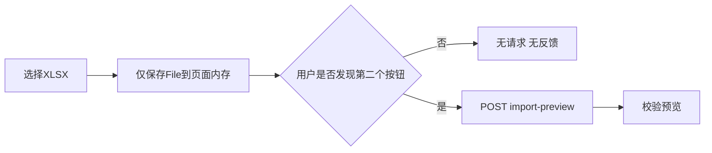
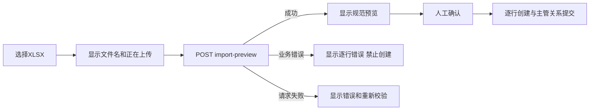

# PLAN · DEV-036 · 人员批量上传选件无反馈修复

- 日期：2026-10-16
- 状态：T1–T3完成
- 范围：`PersonnelImportPanel`选件交互、既有人员导入preview调用及真实浏览器验证
- 非范围：人员导入数据模型、schema、现有OP-ORG-05权限与逐行创建事务边界

## 1. 根因

批量上传API已经存在，并非后端未实装：

- `GET /api/v1/orgs/:org_id/employees/import-template`下载固定18列XLSX模板；
- `POST /api/v1/orgs/:org_id/employees/import-preview`上传并解析不超过5 MiB、100行的XLSX，返回规范行、业务错误及冻结的catalog/graph revision，不写数据库；
- 用户确认后，页面复用`POST /employees`逐行创建完整员工主数据，最后用`POST /workforce-changes`建立同批主管关系。

当前`chooseWorkbook()`只把浏览器`File`写入内存并清除旧结果，不调用preview。只有用户再次点击“校验并预览”才发起上传；页面也不明确显示已选文件或“等待第二步”的状态。因此“选择填写好的模板”在视觉和网络层面都没有动作，形成无反馈操作。

## 2. 决策

选中有效文件后立即上传并校验，不再要求第二次点击才能获得反馈；保留“重新校验”按钮，供解析失败或服务暂时不可用后明确重试。

不新增API或数据库migration；沿用既有5 MiB、100行、CSRF、same-origin、权限、XLSX安全解析和零持久化preview边界。

## 3. 实装与测试

| Task | 状态 | 退出条件 |
| --- | --- | --- |
| T1 根因与契约确认 | 已完成 | 确认API、页面事件和无请求原因；PLAN commit并双push |
| T2 UI修复与回归 | 已完成 | 选件立即自动preview；上传中和成功消息包含文件名；失败后保留明确重新校验；组件测试无需点击第二按钮即观察到POST及预览 |
| T3 实机验证与交付 | 已完成 | 真实production页面上传填写模板并看到预览；Web/Go受影响回归、build、规格/验证记录、commit并双push |

## 4. 验收

1. 用户选择非空且不超过5 MiB的`.xlsx`后，页面立即发起一次`import-preview`。
2. 上传期间显示文件名及进行中状态；成功显示行数/预览，失败显示可操作错误。
3. 重新选择文件立即销毁旧预览和执行状态，并只预览新文件。
4. 自动preview不创建人员；仍须点击“确认并批量创建”。
5. 请求失败后可用同一选件明确“重新校验”，不会静默执行创建。
6. 既有权限、CSRF、XLSX安全解析、逐行幂等和主管关系提交行为不变。
