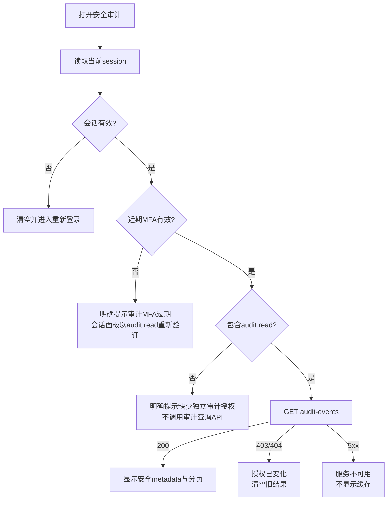

# PLAN · DEV-037 · 安全审计可用性诊断与拒绝态改造

- 日期：2026-10-16
- 状态：T1完成；T2–T3进行中
- 范围：现有审计查询端到端实现核对、审计页权限/MFA拒绝态、审计路由本地TOTP step-up意图、真实浏览器验证
- 非范围：改变独立审计授权模型、把审计权自动授予bootstrap账号、独立receiver存储模型

## 1. 诊断结论

安全审计不是空壳，现有实现包括：

- `GET /api/v1/audit-events`、`internal/audit.Service.List`、SQLite/PostgreSQL查询、脱敏事件投影、签名cursor及授权变化重验；
- `audit_event`主库事实、transactional outbox、Docker Compose独立`audit-forwarder`及append-only `audit-receiver`；
- P-SEC-02筛选、分页、离页/拒绝清空和无缓存结果；
- 永久API/服务/receiver测试。

截图是访问前置条件失败，不是“API没有实现”。审计读取故意同时要求：

1. 当前主体有org范围的职责assignment与`audit.read / audit / security_administration` grant；
2. grant要求的近期MFA仍有效。

fresh local bootstrap按既有`bootstrap_policy.v1`只固定授予OrgR/OrgW/PIIR/PIIW，不授审计或grant管理权。因此初始账号即使完成TOTP，也会看到拒绝；这属于尚未完成安全职责配置，不是receiver或查询API缺失。

另发现两个可修复的产品问题：

- 页面把“缺少audit.read”和“MFA已过期”合并为同一提示，用户无法判断下一步；
- `/security/audit`在共同会话面板中错误沿用默认`pii.write` step-up意图，不能发起`audit.read`重新验证。

## 2. 决策

不弱化独立审计权限，不把bootstrap组织管理员静默升级为审计员。先修复可诊断性和正确step-up：

谁可取得首个`access_grant.manage`和`audit.read`、批准者及期限是安全治理决定；未经批准不通过代码自动授予。

## 3. 实装与测试

| Task | 状态 | 退出条件 |
| --- | --- | --- |
| T1 端到端实现与根因核对 | 已完成 | 以源码、永久测试及fresh bootstrap事实确认API/receiver已实现，拒绝来自授权/MFA |
| T2 拒绝态与审计step-up修复 | 进行中 | audit页区分MFA过期、缺权限、授权变化和服务错误；审计路由发出`audit.read` step-up；拒绝时不显示筛选工作台 |
| T3 实机与回归交付 | 待开始 | 组件/Go回归、production build、真实浏览器拒绝态与step-up意图、规格/验证记录、commit并双push |

## 4. 验收

1. 当前MFA失效时明确提示先做审计MFA重新验证，不宣称审计服务缺失。
2. 当前MFA有效但无`audit.read`时明确提示缺少独立审计授权，不请求`/audit-events`且不残留筛选/事件。
3. `/security/audit`的本地或OIDC step-up action为`audit.read`，完成认证不自动执行查询外的敏感业务命令。
4. 有效`audit.read`＋近期MFA仍正常查询、筛选和分页；服务端403/404立即清空旧结果。
5. 不自动给bootstrap账号增加审计或授权管理权；不修改schema/migration。
