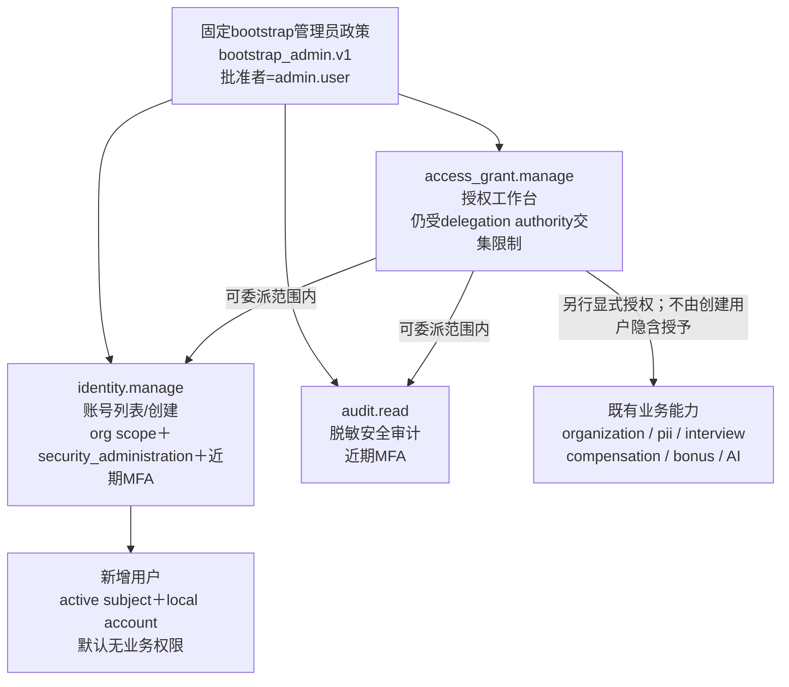
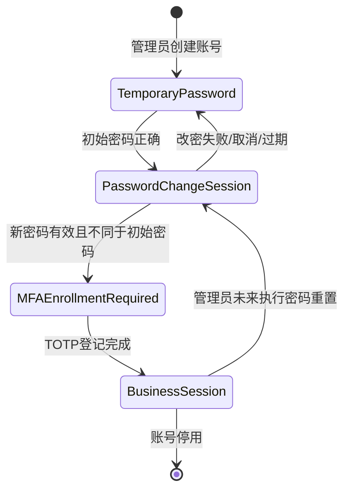

# PLAN · DEV-038 · 管理员基线、用户追加与首次改密

- 日期：2026-10-16
- 状态：T1–T4全部完成
- 范围：local身份模式的管理员固定权限、用户列表/追加、临时初始密码、首次登录强制改密、用户管理模块权限和v14→v15迁移
- 非范围：用户删除、批量导入用户、密码邮件发送、自助注册、员工与登录用户自动绑定、灾备、外部IdP用户生命周期

## 1. 已批准业务决定

- fresh local安装的`admin.user`默认同时拥有`access_grant.manage`、`audit.read`和使用用户管理模块所必需的`identity.manage`。
- 允许同一主体同时拥有上述权限；固定管理员基线的原始批准者记录为`admin.user`自身。
- 新增用户由管理员设置一次性初始密码；该用户第一次成功密码登录后必须先改密码，不能进入MFA登记或任何业务页面。
- 既有环境必须迁移；不得清库、覆盖冻结migration或把既有账号重新标为待改密。

## 2. 权限体系

### 2.1 能力边界

| 能力 | 类别 / purpose / scope | 允许 | 明确不允许 |
| --- | --- | --- | --- |
| `identity.manage` | `audit` / `security_administration` / org | 查看本集团本地账号安全metadata；创建新subject/account；设定一次性初始密码 | 读取员工PII、分配业务权限、关闭首次改密、查看密码/TOTP secret、自动绑定employee |
| `access_grant.manage` | `audit` / `security_administration` / org | 在当前immutable delegation authority交集内查看、授予、撤销grant | 自行扩大authority、因账号管理而读取业务正文、绕过目标职责assignment |
| `audit.read` | `audit` / `security_administration` / org | 查询脱敏审计事件 | 读取正文、工资、笔记、密码、TOTP或底层日志 |
| 既有业务能力 | 既有category/purpose/typed scope | 按当前grant和职责交集执行 | 因新建账号或管理员名称自动取得 |

`identity.manage`与`access_grant.manage`保持分离：用户管理员可创建账号但不能因此授予业务数据；授权管理员也不能凭grant权限创建登录账号。两项都要求近期MFA，API逐请求重验，导航隐藏仅是提示而非授权边界。

### 2.2 bootstrap管理员

v15以immutable `bootstrap_admin.v1`记录唯一local bootstrap主体、原始批准者、批准时间和政策版本；同一主体自批准只允许该固定policy事实，普通delegation authority仍禁止自批。固定政策原子创建：

- `identity.manage`、`access_grant.manage`、`audit.read`的org级职责assignment和MFA-required direct grant；
- 对`audit.read`和`identity.manage`建立org级bootstrap delegation authority，使管理员可在显式职责assignment存在时委派这两项安全能力；不自动建立业务能力authority，也不因bootstrap读取业务正文；
- 审计和receipt；不把管理员自动绑定employee。

v14→v15只对存在`local_bootstrap_receipt`的local部署补齐该固定政策。OIDC部署和非bootstrap账号不猜管理员。

## 3. 首次登录状态机

- v15为`local_account`增加`password_change_required`；既有账号迁移值为false，新建账号及fresh bootstrap管理员为true。
- 受限session新增`access_kind=password_change`，TTL 10分钟，只允许读取自身受限状态、提交当前密码＋新密码或注销。
- 改密成功原子更新PHC/revision、清除flag、撤销该主体全部session并写`AUTH-PASSWORD-CHANGE`审计；用户必须用新密码重新登录，之后才进入既有TOTP登记。
- 临时密码、当前密码、新密码不写日志、审计、receipt、页面缓存或响应；管理员提交成功后系统不再显示初始密码。

## 4. API与页面

| 操作 | 契约 | 权限/结果 |
| --- | --- | --- |
| GET `/api/v1/security/users?limit=&cursor=` | 返回account/subject ID、解密username、active、首次改密状态、MFA状态、created_at；keyset分页 | local mode＋`identity.manage`＋近期MFA；无密码、digest、envelope、factor |
| POST `/api/v1/security/users` | `{username, initial_password}`＋Idempotency-Key | 同权限；一个事务创建subject/account/credential/MFA状态/receipt/audit；默认零业务权限 |
| POST `/api/v1/auth/local/initial-password` | 受限session、CSRF、当前初始密码和新密码 | 成功204并撤销session；不得直接签business session |
| `/security/users` | 用户列表、状态、单用户创建 | 仅session提示含`identity.manage`时显示导航；直接URL/API仍独立拒绝 |

用户创建任一步失败不留下subject、account或半成品credential；相同Idempotency-Key/body返回原subject/account，异body冲突。username继续使用现有3..64位canonical规则，全库唯一；密码继续12..256 UTF-8 bytes且新密码不得等于初始密码。

## 5. Migration

v15必须同时提供SQLite/PostgreSQL exact v14→v15 migration：

1. 扩展`session.access_kind`为`password_change`；
2. `local_account.password_change_required NOT NULL`，旧行false；
3. 在能力/授权/authority约束加入`identity.manage`，保持旧行和FK；
4. 增加bootstrap policy及用户创建receipt；
5. 增加用户创建审计operation；
6. 对local bootstrap主体幂等补齐固定权限/authority，OIDC不补造；
7. 更新schema checksum/preflight、Docker升级说明及双数据库迁移测试。

migration失败必须整事务回滚并保留v14；不修改v1–v14冻结bytes/checksum。

## 6. 实装任务

| Task | 状态 | 退出条件 |
| --- | --- | --- |
| T1 权限/状态机/API/migration设计 | 已完成 | 业务决定映射为独立能力、固定bootstrap政策、受限首次改密和v15前向迁移；PLAN commit并双push |
| T2 后端与迁移 | 已完成 | v15双库migration；bootstrap三项固定权限及两项安全authority；用户list/create及认证cursor；强制首次改密；幂等/冲突/分页/权限拒绝测试；SQLite行为测试与PostgreSQL 17 v1→v15实库migration通过 |
| T3 Web | 已完成 | 权限提示控制导航和用户页；创建反馈不回显初始密码；首次改密受限gate；用户列表分页；Web全量283项回归和production build通过 |
| T4 实机交付 | 已完成 | production Docker fresh与真实v14→v15持久卷升级均ready；真实浏览器完成admin首次改密/TOTP/审计、用户创建、新用户无权拒绝和既有账号升级登录；规格、README、validation已更新 |

## 7. 验收

1. fresh `admin.user`完成首次改密和TOTP后，`/session`同时显示`identity.manage`、`access_grant.manage`、`audit.read`，审计页可实际查询。
2. v14既有local部署升级后，不强迫既有用户改密，但bootstrap管理员获得已批准固定权限；全部既有业务数据保留。
3. 无`identity.manage`或近期MFA不足时，用户列表和创建均拒绝且不泄漏用户名/数量。
4. 新用户提交成功后默认无业务grant；首次密码登录只能进入改密页，不能调用`/session`、MFA或业务API。
5. 新密码更新成功后旧初始密码失效；重新登录进入TOTP登记，登记后才可形成business session。
6. 重复创建请求严格幂等；username冲突、密码非法、keyd/audit/DB失败均零部分事实。
7. 页面刷新、路由切换、401/403、晚回包不会恢复初始密码、用户列表或旧权限状态。

## 8. 交付证据

- fresh production Docker：初始密码受限改密、重新登录、TOTP/恢复码、三项管理员能力、审计查询、用户创建及新用户403拒绝均实际观察。
- v14→v15：同一SQLite data/key/audit volumes原位migration成功；既有账号不强制改密，审计/outbox保留，bootstrap管理员补齐三项安全grant并可打开用户管理。
- SQLite迁移真实发现并修复有audit outbox时的deferred FK commit失败；永久测试覆盖该持久数据路径。
- username source与MFA secret使用独立cipher/domain；production keyd实跑及不可用MFA wrapper回归证明用户列表不再误用MFA domain。
- 自动结果、命令及边界见[DEV-038验证摘要](../validation/DEV-038.md)。