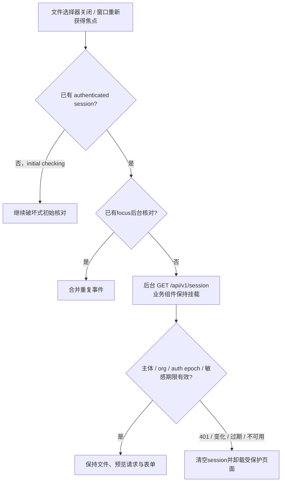

# PLAN · DEV-039 · 会话后台核对与文件上传连续性

- 日期：2026-10-16
- 状态：T1–T3全部完成
- 范围：已认证页面在窗口重新获得焦点时的会话核对、批量人员工作簿选择与预览状态保留、重复focus合并
- 非范围：延长session/MFA期限、减少服务端授权重验、在401/身份变化/服务失败后保留受保护内容、保存原始上传文件

## 1. 问题与决定

1. 截图中的“正在核对服务端会话”不是临时验证token，也不是XLSX上传API；它是`GET /api/v1/session`的全屏安全gate。
2. 原实现对每次`window.focus`执行破坏式会话核对。文件选择器、切换浏览器标签或切回窗口都会产生focus；Cloudflare Tunnel或服务端延迟使全屏gate停留数秒。gate先卸载业务组件，因此文件对象、预览请求和未保存表单随之销毁。
3. 已认证状态的focus/pageshow改为后台核对：相同subject、org及auth epoch时保持当前组件实例；重叠focus只保留一个后台请求，不重复取消并重启。
4. 安全失败不降级：401、身份上下文变化、敏感期限失效、非成功响应或网络失败仍清空session、卸载受保护页面并要求重新认证。显式“重新核对会话”和真实pagehide恢复继续使用破坏式边界。
5. 不用延长token或缓存授权结果换取流畅度；只移除成功重验前不必要的全屏卸载。

## 2. 会话流

## 3. 实装任务

| Task | 状态 | 退出条件 |
| --- | --- | --- |
| T1 复现与根因 | 已完成 | 永久测试在旧实现稳定复现focus后`phase=checking`、上传组件卸载；确认preview API已实现且已发出请求 |
| T2 会话连续性修复 | 已完成 | authenticated focus使用保留式核对；重复focus合并；相同会话不中止人员preview；失败路径保持fail closed |
| T3 验证与交付 | 已完成 | IdentityGate 65项、PersonnelImport 3项、Vue类型检查＋production build通过；真实Chromium观察上传期间focus无全屏gate且预览完成 |

## 4. 验收

- 选择XLSX后即使窗口产生focus，文件名、上传状态、组件实例及在途preview请求保持。
- 后台核对期间不显示全屏“正在核对服务端会话”，不刷新或重新挂载当前业务页。
- 连续focus不并发或反复重启相同后台核对。
- 后台核对返回401、身份变化、敏感期限失效或服务不可用时，受保护内容仍立即销毁。
- 初次打开、显式重新核对及pagehide安全边界不被放宽。
