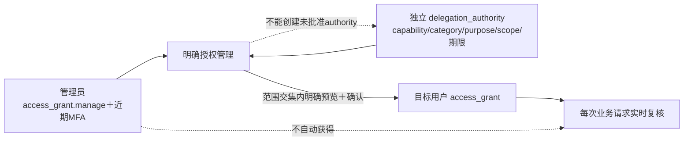

# PLAN · DEV-040 · 明确授权管理可用性修复

- 日期：2026-10-16
- 状态：T1–T3全部完成
- 范围：P-SEC-01 bootstrap管理员授权列表、`identity.manage`委派、管理类授权筛选、页面用途说明
- 非范围：自动赋予业务委派批准权、降低MFA、让授权管理员读取被授权业务内容、创建/撤销delegation authority的审批流程

## 1. 功能定义

“明确授权管理”用于把**已经由独立政策批准可委派的权限**授予具体系统用户，以及查询、查看和撤销已有grant。三个事实保持分离：

1. `access_grant.manage`：允许进入和操作授权工作台；不是读取员工PII、业务正文或审计内容的权限。
2. `delegation_authority`：规定管理员可以委派哪一种capability/category/purpose、在哪个scope和期限内委派；工作台不能创造批准范围。
3. `access_grant`：发给目标用户的实际权限，服务端每次仍复核目标资格、当前authority、scope、MFA和auth epoch。

fresh local安装的`admin.user`按DEV-038固定拥有本页管理权；当前bootstrap政策只给它`audit.read`和`identity.manage`两类org级委派批准范围。组织、PII、面谈、薪酬等业务权限不会因管理员身份自动可委派；扩大这些authority需要另行批准，不在本修复中暗增。

## 2. 故障根因与决定

v15后端已经返回bootstrap管理员的`access_grant.manage`和`identity.manage`持久授权，并返回`identity.manage`委派authority；但Web的旧allowlist仍只认识`audit.read`：

- `access_grant.manage`持久事实被当成非法grant；
- `identity.manage`既被当成非法grant，也被当成非法authority；
- 任一项导致整个安全DTO fail closed，页面把客户端契约拒绝统一显示为“服务或网络不可用”。

修复保持两类集合分离：

- **可签发能力**加入`identity.manage`；普通页面仍不能签发`access_grant.manage`，与服务端禁止普通delegation一致。
- **可读取持久事实**另允许固定bootstrap `access_grant.manage / audit / security_administration`，且只允许无对象限制的安全grant。
- 筛选器补齐`audit`、`security_administration`、`access_grant.manage`和`identity.manage`。
- 页面首段改为业务说明，不再只展示技术限制。

## 3. 实装任务

| Task | 状态 | 退出条件 |
| --- | --- | --- |
| T1 复现与契约梳理 | 已完成 | 用v15 bootstrap形状稳定复现页面将合法管理grant/identity authority拒绝为不可用；确认GET/POST授权API已实现 |
| T2 Web契约修复 | 已完成 | 持久管理grant可读、identity authority可预览签发、access manager仍不可普通签发；安全筛选项完整；永久回归覆盖 |
| T3 实机交付 | 已完成 | Web 285项、类型检查和production build通过；真实Chromium以完整bootstrap DTO显示7项grant、2项authority并完成identity grant预览 |

## 4. 验收

- fresh或升级后的bootstrap管理员打开`/security/grants`不再看到伪“服务或网络不可用”。
- 列表可显示`access_grant.manage`、`identity.manage`及其他当前可管理grant。
- 当前批准范围显示`audit.read`和`identity.manage`，新建授权可选择并预览`identity.manage`。
- `access_grant.manage`只可作为固定持久事实读取/筛选，不能通过普通授权表单签发。
- 任意未知capability、错误category/purpose、对象限制或畸形DTO仍使页面fail closed。
