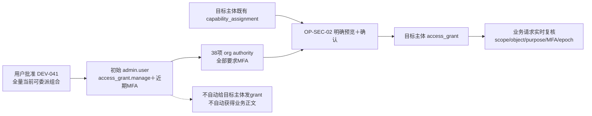

# PLAN · DEV-041 · 初始管理员全量可委派权限

- 日期：2026-10-16
- 状态：T1–T4已完成；T5进行中
- 批准决定：初始`admin.user`默认拥有全部**当前可委派**capability/category/purpose组合的org级authority
- 非范围：把`access_grant.manage`改成可委派能力、自动给新用户建立职业资格assignment、自动给任何用户发业务grant、绕过MFA或目标资格检查

## 1. “全部权限”的精确定义

“全部”固定为`authz.SupportedPair`中服务端允许由OP-SEC-02签发的全部组合。`access_grant.manage`虽然是受支持的bootstrap安全grant，但OP-SEC-02与数据库明确禁止普通签发，因此不伪装为可委派authority；初始管理员仍由固定bootstrap政策直接持有该能力。

| 目的 | capability | category | authority数 |
| --- | --- | --- | ---: |
| `organization_management` | `organization.read`、`organization.write` | `metadata` | 2 |
| `organization_management` | `pii.read`、`pii.write` | `pii` | 2 |
| `security_administration` | `audit.read`、`identity.manage` | `audit` | 2 |
| `interview_followup` | `interview.read`、`interview.write`、`interview_policy.manage`、`assessment.request`、`assessment.read`、`assessment.input.approve`、`assessment.publish` | `metadata` | 7 |
| `interview_followup` | `note.read`、`note.write`、`note.publish` | `shared`、`manager_private`、`hr_confidential`各一项 | 9 |
| `interview_followup` | `action.read`、`action.write` | `shared` | 2 |
| `compensation_management` | `compensation.read`、`compensation.propose`、`compensation.approve`、`bonus.target.manage`、`bonus.propose`、`bonus.approve`、`bonus.payment.record`、`compensation.extension.manage` | `financial` | 8 |
| 三类业务目的 | `sensitive.export` | `pii`；`metadata/shared/manager_private/hr_confidential`；`financial` | 6 |
| **合计** |  |  | **38** |

所有authority：

- scope为当前org；可覆盖该org内合法org/department/employee grant，仍由服务端`ScopeCovered`和对象owner复核；
- `mfa_required=true`；不会把高敏能力降级成无MFA；
- 生效时间与bootstrap事实一致，到期为100年后；
- 批准者保留初始管理员自身，policy来源保留既有immutable `bootstrap_admin.v1`；本次批准的矩阵扩展由v16 migration checksum与DEV-041单独版本化，不改写v15历史migration。

## 2. 权限链

## 3. 既有环境迁移

分配schema v16：

1. v1–v15 migration bytes/checksum冻结；新增SQLite/PostgreSQL `*_v16.sql`。
2. 仅对存在`local_bootstrap_receipt`的local bootstrap主体补齐缺少的org级authority；OIDC部署和普通用户不猜测。
3. `NOT EXISTS`按org、manager、capability、category、scope、purpose和bootstrap policy判断，保留已有authority并避免重复。
4. v15已有`audit.read`和`identity.manage`两项保持不变；v16补齐其余36项，最终精确38项。
5. migration不新增管理员自身业务grant或assignment，不撤销session；authority扩展会在下一次session读取时出现。
6. fresh v16安装先完成空库migration，后执行local bootstrap；`BootstrapLocal`直接创建38项。

## 4. 实装任务

| Task | 状态 | 退出条件 |
| --- | --- | --- |
| T1 全量authority矩阵与安全边界 | 已完成 | 38项矩阵与非委派`access_grant.manage`边界固定；PLAN commit并双push |
| T2 v16 migration设计 | 已完成 | 双方言只新增authority事实和schema ledger v16；existing/fresh、确定ID、`NOT EXISTS`、checksum/preflight、事务回滚边界固定；PLAN commit并双push |
| T3 后端与migration | 已完成 | fresh及v15→v16均精确38项；非bootstrap authority保留；SQLite及真实TLS PostgreSQL 17回归通过 |
| T4 Web与文档 | 已完成 | 页面精确接受/展示/筛选38项authority；assessment/bonus/object组合fail closed；规格及v15→v16安装升级文档已更新 |
| T5 实机验收 | 未开始 | production Docker fresh与既有v15卷升级；真实浏览器显示38项并至少预览组织、面谈、薪酬、导出四类授权 |

## 5. 验收

- fresh local bootstrap和v15升级后的同一管理员均精确拥有38项当前可委派authority。
- 没有`local_bootstrap_receipt`的组织不增加任何authority。
- 页面可选择全部38项；同capability的不同category/purpose保持独立，不折叠成万能字符串。
- `access_grant.manage`仍不可由OP-SEC-02签发；目标主体缺少资格assignment、scope不覆盖、MFA不足、期限越界或对象非法仍拒绝。
- migration失败整事务回滚；v15数据库和全部业务/审计/密文事实保留。
