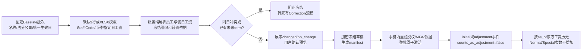

# PLAN · DEV-047 · 指定日期工资批量录入

- 日期：2026-10-17
- 状态：实施中
- 目标：在现有薪资批次工作台追加“工资基线”批次，以同一指定日期批量登记员工税前固定月基本工资；保留既有薪资历史，不把基线录入计入Normal/Special调薪次数。
- 外部依赖：无；XLSX模板、解析、预览、加密候选、原子激活和审计均由TeamLedger本体完成。

## 1. 业务契约

1. 批次类型固定为`baseline`，业务编号为`B-YYYY-NNNN`；批次包含名称、法分公司、统一生效日。年度由生效日年份约束。基线没有参考预算、绩效、调薪幅度或Special理由。
2. 每行必填`staff_code`、`currency`和`salary_at_date`。币种仅`CNY`/`JPY`；金额沿用薪资Money口径：scale 0、非负十进制整数字符串、税前固定月薪、无FX。
3. Staff Code按生效日解析唯一员工，并冻结identifier、employment、assignment和当前薪资aggregate依据。员工必须在该日期属于批次法分公司。
4. 若该日没有任何有效薪资，登记`initial`事件；若此前存在有效薪资且金额/币种不同，登记新的`adjustment`事件，但`counts_as_adjustment=false`；若金额和币种完全相同，结果为`no_change`且不创建事件。
5. 若该日已经存在同日生效的薪资且金额不同，或该日之后已有未来薪资term，批次预览失败。此类历史改写必须走现有append-only correction，不由基线导入猜测或覆盖。
6. 一批最多500名唯一员工。默认3行，可追加/删除；全空行忽略。提交前必须预览，再冻结草稿，再明确确认整批激活。
7. 激活是单数据库事务：任一员工依据、当前授权、MFA、组织任职或薪资版本变化，整批不生效。既有事件和term不更新、不删除。

## 2. XLSX与页面

- 下载端点提供`Salary Baseline`单工作表空白模板，表头固定为`Staff Code`、`Currency`、`Salary at Date`。
- XLSX复用有界单工作表解析器；拒绝公式、宏、外部关系、多工作表和越界压缩包。工资金额必须是文本，避免浮点和科学记数法造成金额变化。
- 手工三行和XLSX进入同一服务端preview candidate，不在浏览器自行决定employee、现有工资或写入结果。
- 预览显示员工、指定日期、系统该日工资、拟登记工资及`changed/no_change`；只有`valid`候选可冻结。
- 页面沿用当前财务MFA、`compensation.read`＋`compensation.propose`权限和现有会话连续性，不增加外部服务。

## 3. API与持久化

| 操作 | 方法与路径 | 结果 |
| --- | --- | --- |
| 下载基线模板 | `GET /api/v1/compensation-adjustment-batches/import-template?adjustment_type=baseline` | XLSX attachment，`no-store` |
| 创建基线批次 | `POST /api/v1/compensation-adjustment-batches` | 复用现有header，`adjustment_type=baseline` |
| 手工预览 | `POST /api/v1/compensation-adjustment-batches/:id/previews` | 加密、24小时candidate |
| XLSX预览 | `POST /api/v1/compensation-adjustment-batches/:id/imports?revision=R` | 同一candidate契约 |
| 冻结/激活 | 复用`PATCH .../:id/draft`及`POST .../:id/transitions` | 原子写入不可变薪资事件和批次链接 |

schema v19采用只追加的关系子类型：保留既有`compensation_adjustment_batch.adjustment_type=normal|special`约束和全部v18行，新增`compensation_salary_baseline_batch`标记表及独立`compensation_salary_baseline_counter`。领域/API将有标记的父批次投影为`baseline`，业务编号为`B-YYYY-NNNN`；不重建父表、不改旧批次/密文/事件/term/回执/审计事实。批次line继续使用加密`compensation.batch_line.v1`；baseline字段映射为`salary_after=salary_at_date`，`salary_before`由服务端权威依据填入，`increase_amount`为空，不伪造调薪增量。

## 4. 数据流

## 5. Task进度

| Task | 状态 | 退出条件 |
| --- | --- | --- |
| T1 现状追踪与业务边界 | 已完成 | 确认复用薪资事件、批次candidate、Staff Code和加密/审计边界；冻结冲突策略 |
| T2 PLAN与迁移设计 | 已完成 | v19约束、API、页面、XLSX及原子激活契约明确 |
| T3 服务端及迁移 | 已完成 | SQLite/PostgreSQL v18→v19、baseline preview/freeze/activate/template完成；commit＋双push |
| T4 页面实装 | 已完成 | 新建、默认3行、模板/XLSX、预览、冻结和激活闭环完成；Web行为测试/build通过；commit＋双push |
| T5 回归与文档 | 实施中 | 双库/API/Web永久测试，功能/技术规格、README和验证记录更新 |
| T6 验证与交付 | 待开始 | focused/full测试、真实API及production browser smoke通过并双仓推送 |

## 6. 非目标

- 不导入奖金、年度调薪预算、绩效或Salary Range。
- 不覆盖同日既有工资，不自动重排已有未来薪资链。
- 不把基线事件计入Normal/Special次数，不自动生成工资支付、个税或银行指令。
- 不绕过`compensation.propose`、近期MFA、financial keyd或当前组织权限。
